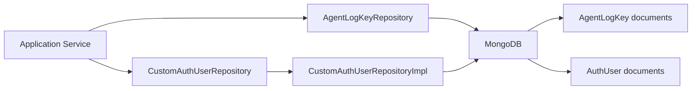
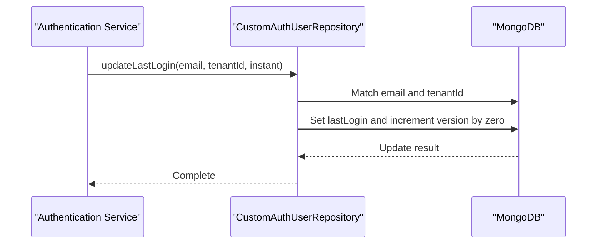
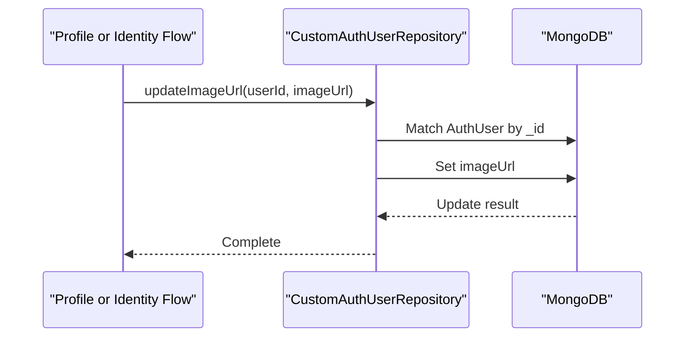

# Agent And Auth Repositories

Agent And Auth Repositories is the MongoDB persistence boundary for two security-adjacent concerns in OpenFrame: retrieving the current agent log key and applying narrowly scoped updates to authentication users. The module is supplied at runtime by the OpenFrame OSS Library artifact `com.openframe.oss:openframe-data-mongo-sync` version `7.0.11`, which this repository consumes.

The module deliberately favors targeted database operations over loading and resaving whole documents. This keeps high-frequency login and profile-image updates small and avoids unnecessary optimistic-lock conflicts with concurrent user edits.

## Responsibilities

| Component | Responsibility |
|---|---|
| [AgentLogKeyRepository](https://github.com/flamingo-stack/openframe-oss-lib/blob/16e7c1cbd9664e7d10ec5ebca7d53c9bd314decf/openframe-data-mongo-sync/src/main/java/com/openframe/data/repository/agent/AgentLogKeyRepository.java) | Spring Data MongoDB repository for `AgentLogKey` documents, including latest-key lookup and collection-existence checks. |
| [CustomAuthUserRepository](https://github.com/flamingo-stack/openframe-oss-lib/blob/16e7c1cbd9664e7d10ec5ebca7d53c9bd314decf/openframe-data-mongo-sync/src/main/java/com/openframe/data/repository/auth/CustomAuthUserRepository.java) | Contract for isolated updates to an authentication user's login timestamp and image URL. |
| [CustomAuthUserRepositoryImpl](https://github.com/flamingo-stack/openframe-oss-lib/blob/16e7c1cbd9664e7d10ec5ebca7d53c9bd314decf/openframe-data-mongo-sync/src/main/java/com/openframe/data/repository/auth/CustomAuthUserRepositoryImpl.java) | `MongoTemplate` implementation of the custom authentication-user updates. |

## Architecture

The repository interfaces separate calling code from persistence mechanics:

- `AgentLogKeyRepository` extends `MongoRepository<AgentLogKey, String>`, inheriting standard CRUD access while adding query methods required by agent-log-key lifecycle code.
- `CustomAuthUserRepository` is a focused custom interface. Its implementation receives a `MongoTemplate`, builds explicit queries, and performs a single-document update against `AuthUser`.

## Agent Log Key Access

`AgentLogKeyRepository` adds two operations beyond the inherited repository API:

- `findFirstByOrderByCreatedAtDesc()` returns an `Optional`, allowing callers to handle an empty log-key collection explicitly while choosing the most recently created record when one exists.
- `existsAny()` uses an empty MongoDB query with `exists = true`. It answers whether at least one document exists without fetching a full `AgentLogKey` document.

These operations support bootstrap and lookup paths where code needs either the current log key or a lightweight answer about whether key material has been initialized.

## Authentication User Updates

The custom repository exposes operations that intentionally update only the fields involved:

| Operation | Match criteria | Updated field | Concurrency behavior |
|---|---|---|---|
| `updateLastLogin` | `email` and `tenantId` | `lastLogin` | Adds an increment of zero to `version`, preventing Spring Data from adding its normal version increment for this login-only write. |
| `updateImageUrl` | `_id` | `imageUrl` | Uses a direct field update rather than read-modify-save, so it avoids a stale-document version conflict while MongoDB and Spring Data handle the update. |

### Login Timestamp Flow

The composite lookup prevents a login event for one tenant from targeting a user document with the same email in another tenant. The zero increment is intentional: it marks the update as handling the version field itself, so an authentication event does not conflict with a simultaneous user-profile edit merely by advancing the version.

### Image URL Update Flow

The implementation does not load the document before updating it. That choice reduces database traffic and avoids making the image update depend on a document version observed before the write.

## Data and Integration Boundaries

- The module works with `AgentLogKey` and `AuthUser` document types defined by the shared data model; their fields are not redefined here.
- It relies on Spring Data MongoDB: `MongoRepository` supplies conventional repository behavior, `@Query` defines the existence probe, and `MongoTemplate` executes custom updates.
- It belongs to the synchronous MongoDB data layer. Tenant-aware Mongo configuration and service-level authorization remain outside this module's scope.
- Consumers should treat repository calls as persistence operations only. Authentication decisions, key generation, response mapping, and access control belong in their calling services.

## Maintenance Considerations

1. Preserve the tenant-qualified predicate in `updateLastLogin`; changing it to email-only would weaken tenant isolation for users sharing an email address.
2. Preserve the targeted-update approach for login and image changes unless the surrounding versioning behavior is redesigned and tested under concurrent updates.
3. Keep `findFirstByOrderByCreatedAtDesc()` ordered by `createdAt`; the method represents the newest key, not an arbitrary key.
4. Treat an empty result from the latest-key lookup as a valid initialization state, because the API expresses this with `Optional`.
