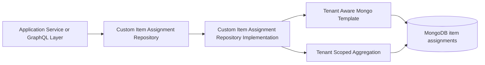
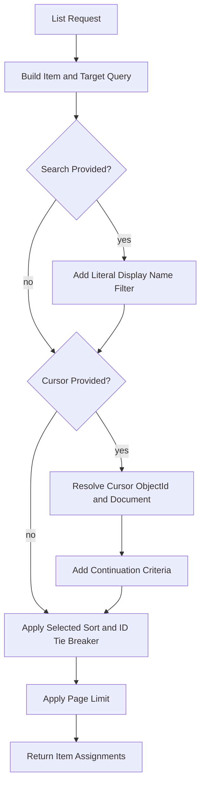
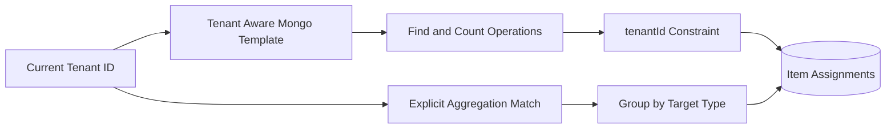

# Assignment Repositories

Assignment Repositories provide the MongoDB query layer for resolving which targets are assigned to an OpenFrame item. The module is supplied at runtime by the OpenFrame OSS Library artifact `com.openframe.oss:openframe-data-mongo-sync` version `7.0.11`; this tenant repository assembles that library into its services.

The module operates on tenant-scoped `ItemAssignment` documents. An assignment relates one item, such as a ticket or knowledge article, to a typed target, such as an organization, device, ticket, or knowledge article. It supports three complementary access patterns:

- cursor-based browsing of an item's assignments for one target type;
- counts for pagination and target-type summaries; and
- reverse lookup of items assigned to a particular target.

## Position in the System

The repository belongs to the OpenFrame Data Mongo Sync layer. Application services and GraphQL-facing features can use the repository contract to read assignment relationships without embedding MongoDB query construction in higher layers. The repository receives a tenant-aware Mongo template, so normal find and count operations are constrained to the current tenant. Its aggregation explicitly adds tenant criteria because aggregation pipelines are not automatically scoped.

The `ItemAssignment` document stores `tenantId`, `itemId`, `itemType`, `targetType`, `targetId`, `displayName`, and `createdAt`. The underlying collection has a uniqueness constraint on the item, target type, and target ID combination, plus an index for target lookups. The currently defined item types are ticket, knowledge article, and insight. Target types are organization, device, ticket, and knowledge article.

## Components

### Repository Contract

[`CustomItemAssignmentRepository`](https://github.com/flamingo-stack/openframe-oss-lib/blob/16e7c1cbd9664e7d10ec5ebca7d53c9bd314decf/openframe-data-mongo-sync/src/main/java/com/openframe/data/repository/assignment/CustomItemAssignmentRepository.java) defines the persistence operations expected by assignment consumers:

| Operation | Responsibility |
|---|---|
| `findAssignmentsWithCursor` | Returns one page of assignments for an item and target type, with optional display-name search, ordering, and a cursor. |
| `countAssignments` | Counts assignments matching the same item, target type, and optional search criteria used by list pagination. |
| `countByItemIdGroupedByTargetType` | Produces a per-target-type summary for an item. |
| `findItemIdsByTarget` | Performs the reverse lookup from a typed target to assigned item IDs of a requested item type. |
| `isSortableField` and `getDefaultSortField` | Expose the sorting policy to callers so requests can be validated before querying. |

### MongoDB Implementation

[`CustomItemAssignmentRepositoryImpl`](https://github.com/flamingo-stack/openframe-oss-lib/blob/16e7c1cbd9664e7d10ec5ebca7d53c9bd314decf/openframe-data-mongo-sync/src/main/java/com/openframe/data/repository/assignment/CustomItemAssignmentRepositoryImpl.java) implements the contract using `TenantAwareMongoTemplate` and is created only when `openframe.tenant-isolation.enabled` is `true`.

Its query builder requires both `itemId` and `targetType`, then optionally adds a case-insensitive literal match against `displayName`. The search term is trimmed and quoted before being used as a regular expression, so user input is treated as text rather than as a regular-expression pattern.

The implementation accepts only `createdAt` and `displayName` as client-sortable fields. `createdAt` is the default. For non-ID sorting, MongoDB orders by the selected field and then by `_id` in the same direction. The `_id` tie-breaker makes page boundaries deterministic when several assignments share the same sort value.

## Cursor Pagination

A cursor is a MongoDB ObjectId identifying the final document from the preceding page. The implementation resolves the cursor document to obtain the corresponding selected sort value and creates a two-part continuation condition:

1. rows past the cursor sort value; or
2. rows with the same sort value and an ObjectId past the cursor ID.

The direction is reversed for descending order. When sorting by `_id`, or when the cursor is malformed, absent, or has no usable sort value, the implementation falls back to an ObjectId-only continuation condition. Invalid and missing cursor documents are logged as warnings rather than causing the query to fail.

## Tenant Isolation

`ItemAssignment` is tenant-scoped. `TenantAwareMongoTemplate` injects the current `tenantId` into standard `find` and `count` operations for tenant-scoped entity types. Therefore, list, count, reverse-lookup, and cursor-document retrieval operations are isolated through the template.

MongoDB aggregations are intentionally not auto-scoped by the template. `countByItemIdGroupedByTargetType` consequently starts its pipeline with the tenant criterion before matching the item ID, grouping by `targetType`, and projecting the count. Results are collected in an enum-keyed map; unknown persisted target type values are ignored after a warning is logged.

## Reverse Lookup and Summary Queries

The reverse lookup method filters by all three relationship dimensions: `itemType`, `targetType`, and `targetId`. It projects only `itemId` and returns those IDs, making it suited to callers that must find work items associated with a particular entity.

The summary method answers a different question: how many assignments does a single item have for each target type? It returns only types present in the data, rather than pre-populating zero values. Callers that need a complete presentation set should add zeroes for absent enum values at their boundary.

## Operational Considerations

- The implementation is conditional on tenant isolation. Deployments without `openframe.tenant-isolation.enabled=true` do not create this custom repository implementation.
- Validate requested sort fields with `isSortableField`; the implementation itself applies the supplied field name to the Mongo sort definition.
- Use the returned last document ID as the next cursor while retaining the same filter and sort inputs across pages.
- Search applies only to `displayName`; it is not a general full-text search.
- The grouping query explicitly protects tenant boundaries. New aggregation methods in this layer must likewise prepend tenant criteria.
- The target-lookup collection index aligns with the reverse-lookup filter's `targetType` and `targetId` prefix. The item-target uniqueness index prevents duplicate assignment tuples within the collection's modeled key.

## Source and Ownership

The two documented components are maintained in the OpenFrame OSS Library repository and consumed by this tenant deployment through `com.openframe.oss:openframe-data-mongo-sync` version `7.0.11`. The tenant repository publishes and deploys the services that use this library; it does not contain the repository implementation source.
