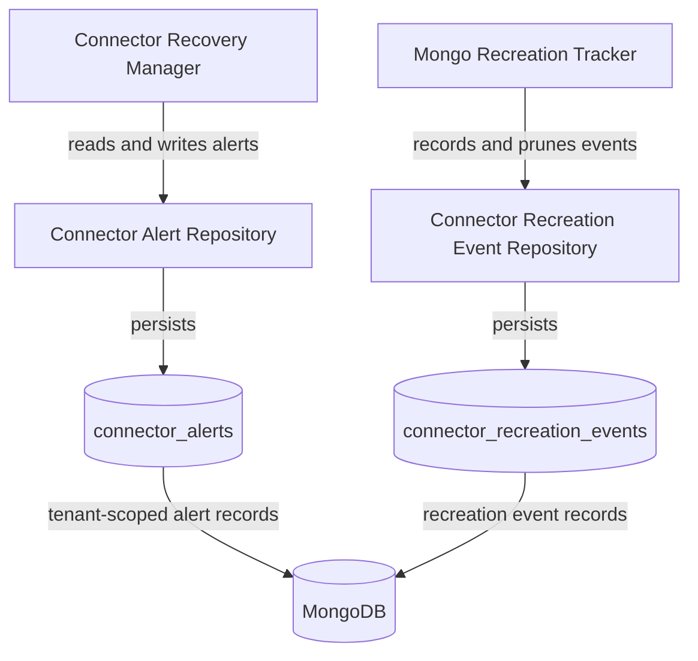
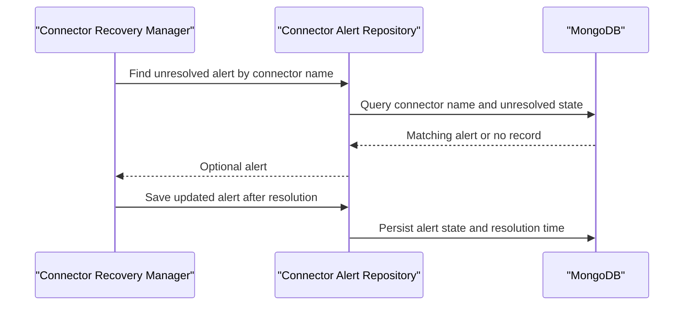
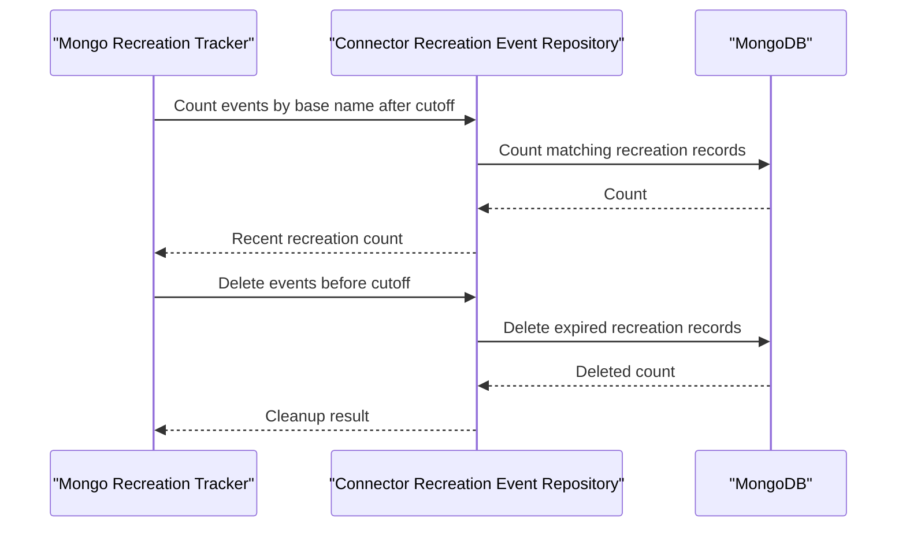

# Connector Repositories

Connector Repositories is the MongoDB persistence boundary for connector recovery state in OpenFrame. It is supplied by the `com.openframe.oss:openframe-data-mongo-sync` library at version `7.0.11`, which this repository consumes. The two Spring Data repositories preserve distinct operational records:

- unresolved connector failures, represented by `ConnectorAlert`; and
- timestamped connector-recreation activity, represented by `ConnectorRecreationEvent`.

The implementation source is maintained in OpenFrame OSS Library:

- [ConnectorAlertRepository source](https://github.com/flamingo-stack/openframe-oss-lib/blob/16e7c1cbd9664e7d10ec5ebca7d53c9bd314decf/openframe-data-mongo-sync/src/main/java/com/openframe/data/repository/connector/ConnectorAlertRepository.java)
- [ConnectorRecreationEventRepository source](https://github.com/flamingo-stack/openframe-oss-lib/blob/16e7c1cbd9664e7d10ec5ebca7d53c9bd314decf/openframe-data-mongo-sync/src/main/java/com/openframe/data/repository/connector/ConnectorRecreationEventRepository.java)

## Purpose and Scope

The module exposes declarative Spring Data MongoDB interfaces rather than hand-written storage code. Both repositories inherit standard identifier-based persistence from `MongoRepository`, including save, lookup, deletion, and pagination operations. Their derived query methods encode the domain-specific access patterns used by connector recovery logic.

`ConnectorAlertRepository` works with tenant-scoped alerts in the `connector_alerts` collection. An alert carries its connector name, error category and message, retry attempt count, creation time, resolution flag, and optional resolution time. `ConnectorRecreationEventRepository` stores recreation-rate observations in the `connector_recreation_events` collection, where an event records a connector base name and creation time.

## Architecture Overview

The repositories are part of the synchronous Mongo data layer. Spring derives query implementations from the interface method names and maps records to the two document types supplied by the `com.openframe.oss:openframe-data-mongo-common` library.

## Components

### Connector Alert Repository

`ConnectorAlertRepository` extends `MongoRepository<ConnectorAlert, String>`. Its `String` identifier aligns with the document identifier field.

| Operation | Result | Responsibility |
| --- | --- | --- |
| `findByConnectorNameAndResolvedFalse(String connectorName)` | `Optional<ConnectorAlert>` | Finds one currently unresolved alert for a named connector. The optional result makes absence explicit. |
| `findByResolvedFalse()` | `List<ConnectorAlert>` | Returns every alert whose resolution flag is false, supporting a recovery or monitoring sweep. |

The derived query names mean that only unresolved records participate in the custom alert lookups. Resolution itself remains a state transition on the persisted document, typically followed by a standard repository save operation.

### Connector Recreation Event Repository

`ConnectorRecreationEventRepository` extends `MongoRepository<ConnectorRecreationEvent, String>` and supports time-window accounting and cleanup.

| Operation | Result | Responsibility |
| --- | --- | --- |
| `countByBaseNameAndCreatedAtAfter(String baseName, Instant cutoff)` | `long` | Counts events for one connector base name strictly after a supplied time cutoff. This supports recent recreation-rate decisions. |
| `deleteByCreatedAtBefore(Instant cutoff)` | `long` | Deletes events older than a supplied cutoff and returns the number removed. This supports retention cleanup. |

The event document has no tenant identifier in the supplied model. Its repository methods therefore scope events by connector base name and time, not tenant context.

## Recovery Data Flows

### Alert Lookup and Resolution

The repository does not decide whether a connector should be retried, when an alert is resolved, or how an alert is presented. Those policies belong to the service that consumes the repository. Its responsibility is a narrow and consistent lookup boundary for unresolved alert records.

### Recreation Window and Retention

Counting and cleanup use caller-supplied `Instant` cutoffs. This keeps retention duration and rate-limit windows in recovery policy rather than embedding them in the persistence layer.

## Integration in OpenFrame

The repository interfaces are implemented at runtime by Spring Data MongoDB and are consumed by connector-recovery code from the OpenFrame OSS Library:

- `ConnectorRecoveryManager` uses the alert repository to retain connector failure state.
- `MongoRecreationTracker` uses the recreation-event repository to observe recent recreations and delete expired records.

The OpenFrame OSS Tenant service consumes the `openframe-data-mongo-sync` artifact. The repository module operates only when a service context includes the synchronous Mongo configuration and has access to MongoDB. It does not expose an HTTP endpoint and does not independently schedule recovery operations.

## Operational Considerations

- Treat `resolved` as the alert lifecycle boundary: custom alert reads deliberately exclude resolved records.
- Preserve the intended time semantics when supplying `Instant` cutoffs. The repository applies the `After` and `Before` predicates named in its methods.
- Use the returned deletion count to observe retention cleanup effects where callers need telemetry or diagnostics.
- Keep alert handling tenant-aware. Although the `ConnectorAlert` document is tenant-scoped, the alert repository methods shown here do not include a tenant parameter; tenant isolation is provided by the surrounding Mongo data configuration and application context.
- Avoid placing recovery policy in these interfaces. Retry thresholds, alert creation, resolution decisions, and cleanup scheduling remain responsibilities of their consuming services.

## Source and Dependency Boundary

This module's source code is owned by the OpenFrame OSS Library, not by this repository. OpenFrame OSS Tenant assembles it through `com.openframe.oss:openframe-data-mongo-sync` version `7.0.11`; the associated document models are supplied by `com.openframe.oss:openframe-data-mongo-common` at the same version.
