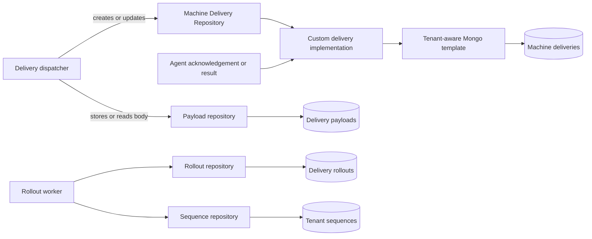
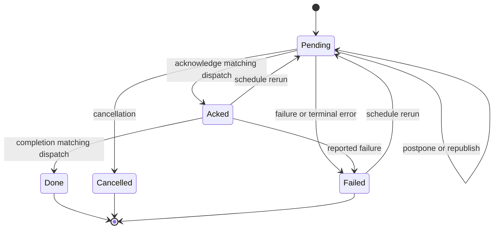
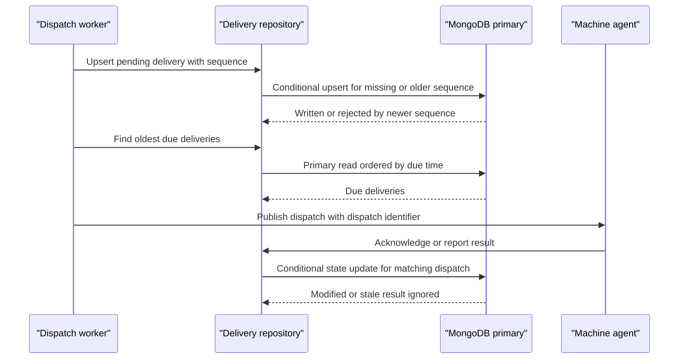

# Delivery Repositories

Delivery Repositories is the tenant-scoped MongoDB persistence layer for machine-directed work. It is supplied by the OpenFrame OSS Library artifact `com.openframe.oss:openframe-data-mongo-sync` at version `7.0.11` and is assembled by this repository's services. The module persists delivery metadata, detachable payload bodies, rollout cursors, and a per-tenant monotonic sequence used to order dispatch decisions.

The implementation is intentionally concurrency-aware. Its mutations match the delivery state, dispatch identity or timestamp, sequence, and—where applicable—rerun number that the caller observed. A mutation returning `false` therefore means the record was no longer in the expected version or state, rather than silently overwriting newer work.

## Responsibilities

- Store `MachineDelivery` rows and expose basic Spring Data MongoDB operations.
- Find work whose due time has elapsed, ordered from the oldest due item, while reading the MongoDB primary to avoid replica-lag duplicate dispatches.
- Create or refresh pending work without replacing a delivery already superseded by a higher sequence.
- Advance, acknowledge, complete, cancel, fail, retry, and replace delivery payloads using guarded atomic updates.
- Store payloads independently and read them from the primary immediately after publication.
- Maintain resumable rollout cursors and dispatched counts only for the rollout sequence being processed.
- Allocate monotonically increasing delivery sequence numbers per tenant.

## Architecture

All repositories are annotated for tenant-aware access, and the two custom implementations are enabled only when `openframe.tenant-isolation.enabled` is `true`. The `TenantAwareMongoTemplate` inherited by both implementations supplies tenant scoping for their queries and writes.

## Repository Components

| Component | Responsibility | Concurrency and consistency behavior |
| --- | --- | --- |
| [Machine Delivery Repository](https://github.com/flamingo-stack/openframe-oss-lib/blob/16e7c1cbd9664e7d10ec5ebca7d53c9bd314decf/openframe-data-mongo-sync/src/main/java/com/openframe/data/repository/delivery/MachineDeliveryRepository.java) | Spring Data repository for delivery rows, extended with custom lifecycle operations. | `existsByIdAndDispatchId` checks that a result corresponds to a particular publication. |
| [Custom Machine Delivery Repository Implementation](https://github.com/flamingo-stack/openframe-oss-lib/blob/16e7c1cbd9664e7d10ec5ebca7d53c9bd314decf/openframe-data-mongo-sync/src/main/java/com/openframe/data/repository/delivery/impl/CustomMachineDeliveryRepositoryImpl.java) | Implements due-work selection, conditional state transitions, upserts, payload replacement, and rerun publication. | Each mutation has a restrictive query predicate, preventing stale dispatchers or late agent reports from changing a newer run. |
| [Machine Delivery Payload Repository](https://github.com/flamingo-stack/openframe-oss-lib/blob/16e7c1cbd9664e7d10ec5ebca7d53c9bd314decf/openframe-data-mongo-sync/src/main/java/com/openframe/data/repository/delivery/MachineDeliveryPayloadRepository.java) | Stores payload bodies separately from delivery metadata. | `findHeldById` explicitly reads from the primary so a sweep can observe a just-written body. |
| [Machine Delivery Rollout Repository](https://github.com/flamingo-stack/openframe-oss-lib/blob/16e7c1cbd9664e7d10ec5ebca7d53c9bd314decf/openframe-data-mongo-sync/src/main/java/com/openframe/data/repository/delivery/MachineDeliveryRolloutRepository.java) | Persists rollout status, cursor, and dispatched count. | Cursor advancement and completion match both rollout identifier and sequence, isolating a new rollout version from the old cursor. |
| [Machine Delivery Sequence Repository Implementation](https://github.com/flamingo-stack/openframe-oss-lib/blob/16e7c1cbd9664e7d10ec5ebca7d53c9bd314decf/openframe-data-mongo-sync/src/main/java/com/openframe/data/repository/delivery/impl/MachineDeliverySequenceRepositoryImpl.java) | Allocates the next delivery sequence per tenant. | Uses an upserting `findAndModify` with atomic increment and returns the post-increment value. |

## Delivery Lifecycle

The custom implementation treats a delivery as a guarded state machine. A caller must identify the particular dispatch it acted on through a dispatch identifier or dispatch timestamp. State transitions only occur if the row remains in an allowed source status.

`markAcked`, `markDone`, and the dispatch-identifier form of `markFailed` bind an agent report to the dispatch identifier. Time-based operations such as postponement, cancellation, and some failure paths bind to the recorded dispatch timestamp. Terminal transitions set completion and expiry times, and remove inline payload JSON. Scheduling a rerun resets attempt and error counters, clears prior acknowledgement, completion, failure, and error fields, increments the rerun counter, and leaves the existing dispatch identifier in place until the rerun has actually been published. This allows a late completion for the earlier publication to close the correct row.

## Dispatch Ordering and Replacement

A delivery row includes a sequence representing its ordering relative to competing decisions. `upsertPending` only writes when the existing record has no sequence or a lower one. If a competing insert races, it retries as a conditional update; if that update cannot match, the newer delivery remains authoritative.

Payload replacement is similarly guarded by the currently observed dispatch identifier. It updates the payload reference, installs the next dispatch identifier and due time, clears any inline payload JSON, and optionally changes offline behavior or the reconnect window. A competing replacement does not overwrite the later caller's update.

## Due Work, Retries, and Read Consistency

The repository selects due rows by status and due time, with variants that include or exclude delivery types. It sorts ascending by due time and always reads from the primary. This is required because a secondary can lag a recent republish and incorrectly show the item as due again.

Republishing increments `attempts` only if the caller still sees the same dispatch timestamp and expected attempt count. Postponing after an error also increments `errors`; ordinary postponement only changes the due time. Both operations use a single conditional update, making them safe when multiple workers observe the same candidate.

## Rollout Progress

A rollout worker reads active rollouts with `findByStatus`. After dispatching a batch, it calls `advance` with the rollout identifier, its sequence, the next cursor, and the dispatched count. The repository performs a MongoDB update only when both identifier and sequence match. `finish` uses the same guard, changes the status to `DONE`, and increments the final dispatched count.

This sequence guard is important when a rollout identifier is reused: a newly created rollout with a new sequence has its own cursor and cannot be advanced or completed by a worker handling an older snapshot.

## Tenant-Scoped Sequence Allocation

`MachineDeliverySequenceRepositoryImpl` keeps a sequence document keyed by the current tenant identifier. Its `next` operation atomically increments `value`, creates the document if absent, and returns the incremented value. Consequently, concurrent dispatchers in one tenant receive distinct, increasing numbers; tenants maintain independent ordering domains.

## Operational Invariants

- Query and update predicates are part of the correctness contract. Callers should treat a `false` return from a custom mutation as a stale or superseded operation and re-read before deciding how to proceed.
- Delivery and payload reads that immediately follow writes use the MongoDB primary to preserve read-after-write behavior in sweep and result paths.
- Delivery rows are updated field-by-field instead of replaced. This preserves the tenant attribute used by tenant-scoped filtering and permits selected historical fields to be explicitly unset.
- Completion paths remove inline payload JSON, while payload references can remain available through the separate payload repository.
- Sequence and rerun counters distinguish a new delivery decision from a later execution attempt of the same delivery row.
