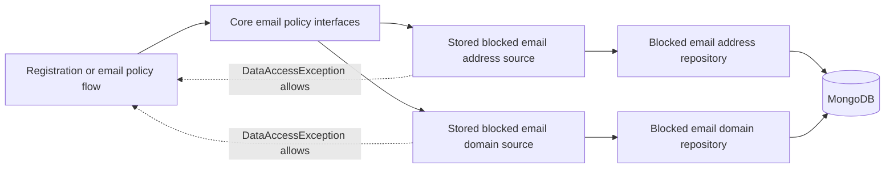
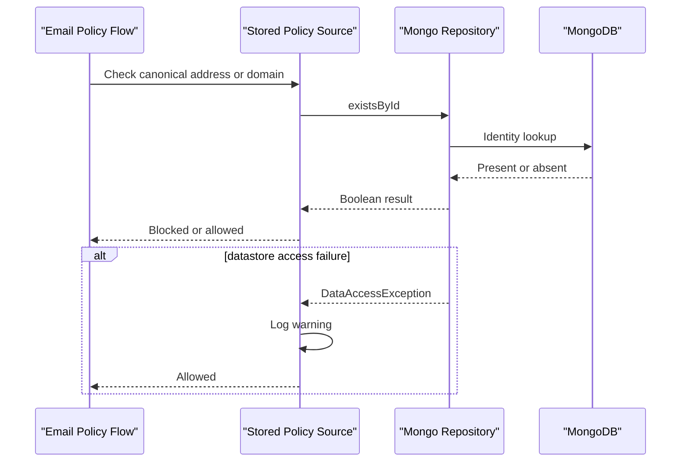

# Email Repositories

Email Repositories is the MongoDB-backed persistence adapter for the OpenFrame email-blocking policy. It is supplied by the `com.openframe.oss:openframe-data-mongo-sync` library at version `7.0.11`, which OpenFrame OSS Tenant assembles at runtime. The module stores blocked individual addresses and blocked domains, exposes management-oriented search operations, and adapts both stores to the core policy interfaces used during email-related flows such as registration.

The adapter deliberately **fails open** for policy lookups: if MongoDB raises a `DataAccessException`, the affected address or domain is allowed and a warning is logged. This keeps a datastore outage from independently preventing a registration, while making the operational condition observable. Consequently, the block lists are enforcement inputs when the datastore is available, not an availability dependency that can deny all registrations.

## Responsibilities

| Area | Responsibility |
| --- | --- |
| Address block list | Persist `BlockedEmailAddress` records, use the canonical address as the lookup identifier, and support case-insensitive search by address or reason. |
| Domain block list | Persist `BlockedEmailDomain` records, support sorted listing, and support case-insensitive search by domain or reason. |
| Core-policy integration | Provide Spring components implementing the core address and domain source interfaces. |
| Failure behavior | Catch datastore access failures at lookup boundaries, log a warning without exposing the full blocked address, and allow the evaluation to continue. |

## Architecture

The two source components are the runtime boundary: they translate a core policy question into an efficient MongoDB identity lookup through `existsById`. The repository interfaces also retain CRUD operations inherited from Spring Data `MongoRepository`, enabling administration of the underlying block-list records.

## Components

### Blocked Email Address Repository

[BlockedEmailAddressRepository](https://github.com/flamingo-stack/openframe-oss-lib/blob/16e7c1cbd9664e7d10ec5ebca7d53c9bd314decf/openframe-data-mongo-sync/src/main/java/com/openframe/data/repository/email/BlockedEmailAddressRepository.java) extends `MongoRepository<BlockedEmailAddress, String>`. In addition to standard persistence operations, it derives a paginated query that matches either `email` or `reason` using case-insensitive containment.

The identifier-based lookup is significant because the corresponding source performs `existsById(canonicalAddress)`. Callers that create address records must therefore use the same canonical representation expected by the core email policy; otherwise an entry may be searchable yet not match enforcement lookup.

### Blocked Email Domain Repository

[BlockedEmailDomainRepository](https://github.com/flamingo-stack/openframe-oss-lib/blob/16e7c1cbd9664e7d10ec5ebca7d53c9bd314decf/openframe-data-mongo-sync/src/main/java/com/openframe/data/repository/email/BlockedEmailDomainRepository.java) extends `MongoRepository<BlockedEmailDomain, String>`. It adds:

- a `findAll(Sort)` overload for ordered domain-list retrieval;
- a paginated, case-insensitive containment search over `domain` or `reason`.

As with addresses, the domain source tests existence by identifier. The stored identifier must match the normalized domain supplied to the policy interface.

### Stored Blocked Email Address Source

[StoredBlockedEmailAddressSource](https://github.com/flamingo-stack/openframe-oss-lib/blob/16e7c1cbd9664e7d10ec5ebca7d53c9bd314decf/openframe-data-mongo-sync/src/main/java/com/openframe/data/repository/email/StoredBlockedEmailAddressSource.java) is a Spring component implementing the core `BlockedEmailAddressSource` contract. Its `isBlocked` method receives a canonical address and calls the address repository once with `existsById`.

On a datastore failure, it logs only the result of extracting the address domain, rather than the complete address, then returns `false`. This protects against putting the full email address into this warning while preserving useful diagnostics.

### Stored Blocked Email Domain Source

[StoredBlockedEmailDomainSource](https://github.com/flamingo-stack/openframe-oss-lib/blob/16e7c1cbd9664e7d10ec5ebca7d53c9bd314decf/openframe-data-mongo-sync/src/main/java/com/openframe/data/repository/email/StoredBlockedEmailDomainSource.java) is the equivalent `BlockedEmailDomainSource` implementation. It makes one `existsById(domain)` call per policy check, so newly persisted domain entries are considered on the next lookup without requiring an in-memory refresh.

It follows the same fail-open policy: a `DataAccessException` produces a warning and `false`, allowing the email flow to proceed.

## Lookup and Failure Flow

## Operational Considerations

- **Canonicalization is an invariant.** Address checks are identity checks, not search queries. Persist entries in the canonical form accepted by the core policy implementation.
- **Reasons are management metadata.** Both repositories make `reason` searchable, enabling operators to locate entries by rationale without changing the enforcement path.
- **Search semantics differ from enforcement semantics.** Management searches use case-insensitive substring matching and pagination, whereas enforcement uses exact identifier existence checks.
- **Monitor warning logs.** A warning from either stored source indicates that block-list enforcement was bypassed for that lookup because the datastore was unavailable or inaccessible.
- **Domain entries take effect immediately for subsequent checks.** The domain source has no local cache and reads the repository on each request.

## System Placement

Email Repositories is part of the `openframe-data-mongo-sync` persistence layer and complements the core email-policy abstractions from the `openframe-core` library. It does not send email or implement disposable-domain detection; it supplies stored block-list decisions to whichever higher-level service composes the policy. MongoDB connectivity and tenant-aware persistence behavior are configured by the broader data layer.
