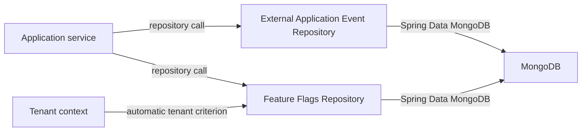
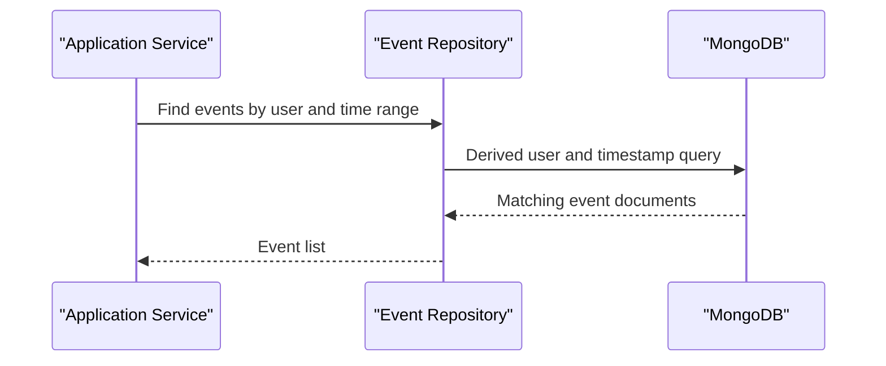
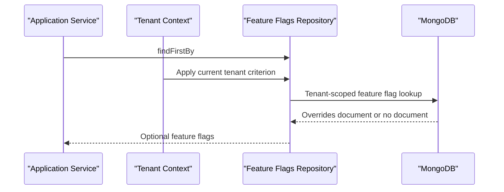

# External Event Featureflags Repositories

External Event Featureflags Repositories is a small persistence boundary in the OpenFrame data layer. It is supplied at runtime by the `com.openframe.oss:openframe-data-mongo-sync` library, consumed by this repository at version `7.0.11`. The module exposes Spring Data MongoDB repositories for two independent document types:

- external application events, queried by user and time window or by event type and tag metadata;
- frontend feature-flag overrides, resolved for the tenant of the running pod.

The repositories deliberately contain no application workflow or transport logic. They extend `MongoRepository`, which supplies standard identifier-based CRUD operations, while their declared methods express the small set of domain-specific reads required by higher layers.

## Architecture

`ExternalApplicationEventRepository` has explicit query parameters for its domain lookups. `FeFeatureFlagsRepository` instead relies on the tenant-scoping behavior documented on its `FeFeatureFlags` entity: the tenant aspect adds the tenant criterion to `findFirstBy()`. This makes the repository method a lookup for the current tenant's single overrides document rather than a cross-tenant selection.

## Core Components

### External Application Event Repository

[`ExternalApplicationEventRepository`](https://github.com/flamingo-stack/openframe-oss-lib/blob/16e7c1cbd9664e7d10ec5ebca7d53c9bd314decf/openframe-data-mongo-sync/src/main/java/com/openframe/data/repository/event/ExternalApplicationEventRepository.java) manages `ExternalApplicationEvent` documents with `String` identifiers.

| Operation | Responsibility |
| --- | --- |
| Inherited `MongoRepository` operations | Create, read, update, delete, and other standard persistence operations for event documents. |
| `findByUserIdAndTimestampBetween(userId, start, end)` | Retrieves events for one user whose timestamp falls within the supplied `Instant` range. |
| `findByTypeAndTags(type, tags)` | Uses an explicit MongoDB query to match an event `type` and its complete `metadata.tags` map. |

The tag query is declared as `{'type': ?0, 'metadata.tags': ?1}`. Consequently, callers provide a `Map<String, String>` that is compared against the `metadata.tags` field; the method does not declare a separate per-key tag predicate.

### Feature Flags Repository

[`FeFeatureFlagsRepository`](https://github.com/flamingo-stack/openframe-oss-lib/blob/16e7c1cbd9664e7d10ec5ebca7d53c9bd314decf/openframe-data-mongo-sync/src/main/java/com/openframe/data/repository/featureflags/FeFeatureFlagsRepository.java) manages `FeFeatureFlags` documents with `String` identifiers.

| Operation | Responsibility |
| --- | --- |
| Inherited `MongoRepository` operations | Provides standard persistence operations for feature-flag documents. |
| `findFirstBy()` | Returns an `Optional` containing the current tenant's feature-flag overrides document when one exists. |

The empty derived-query predicate is intentional. The entity is tenant-scoped, and the library's tenant aspect injects the current tenant criterion automatically. The `Optional` return type represents the supported absence of an overrides document, allowing consumers to apply their own default flag behavior without treating a missing record as a persistence error.

## Query Flows

### Event Lookup

A type-and-tags lookup follows the same flow, except that Spring Data executes the repository's declared MongoDB query against `type` and `metadata.tags`.

### Tenant Feature-Flag Lookup

## Integration Boundaries

The module is part of the synchronous MongoDB data library rather than a standalone service. Application services choose the query and interpret returned documents; this layer translates those requests into Spring Data repository operations. MongoDB connectivity, conversions, indexes, retry behavior, and tenant-aware repository configuration are provided by the surrounding OpenFrame data library.

When changing this module, preserve the following contracts:

1. Keep `ExternalApplicationEventRepository` query parameter types aligned with the event document schema, especially the `Instant` timestamp range and `Map<String, String>` tag metadata.
2. Do not add a caller-controlled tenant selector to `FeFeatureFlagsRepository` unless the tenant isolation model is deliberately redesigned. Its current behavior depends on automatic tenant filtering.
3. Handle `findFirstBy()` as an optional result. A missing feature-flag override document is a valid state.
4. Treat changes to method names and the explicit MongoDB query as persistence API changes, because Spring Data derives query behavior from those declarations.
