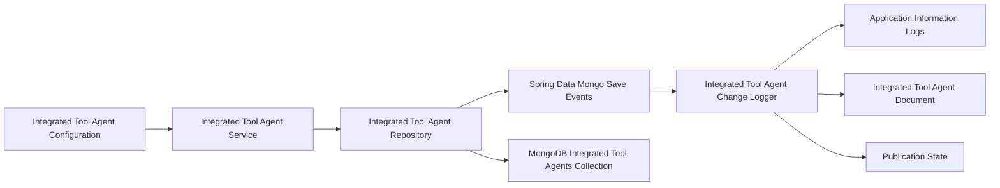
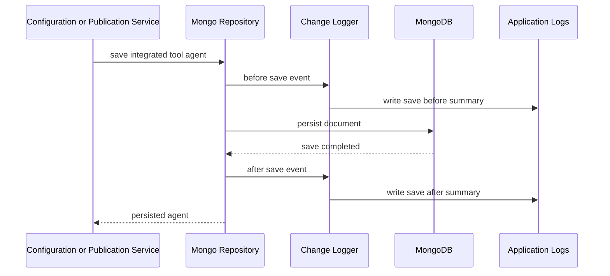
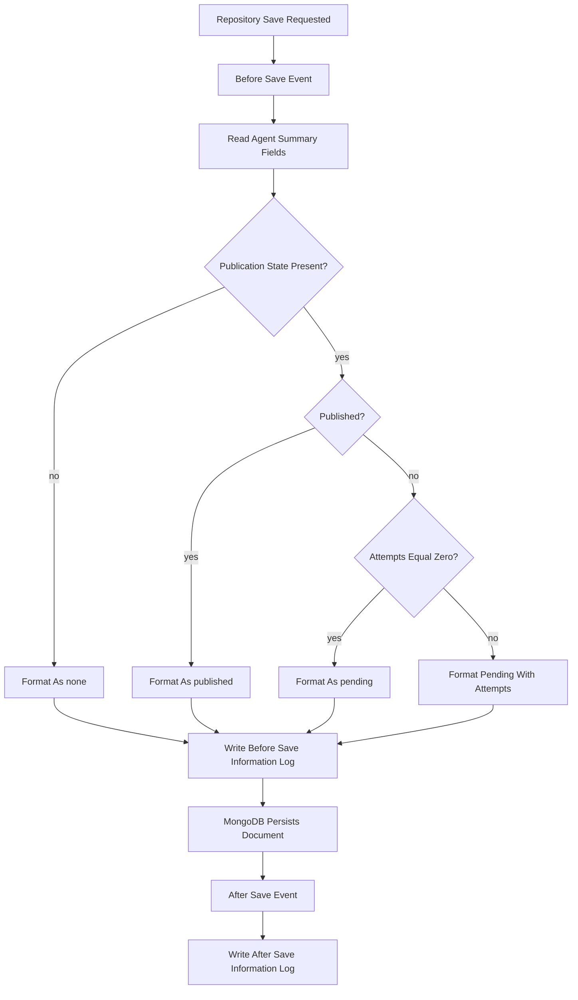

# Integrated Tool Agent Change Logger

The Integrated Tool Agent Change Logger is a Spring Data MongoDB listener that records a compact audit trail around every persistence operation for an integrated tool agent. It is supplied by the **OpenFrame OSS Library** through the `com.openframe.oss:openframe-data-mongo-sync` artifact, which this repository consumes at version `7.0.11`.

Its responsibility is observability rather than enforcement: it does not alter documents, decide whether a change is valid, or publish an agent. Instead, it writes one informational log entry before a save and one after a save, capturing the agent identity, optimistic-lock version, configured agent version, release flag, and publication state.

**Source:** [IntegratedToolAgentChangeLogger.java](https://github.com/flamingo-stack/openframe-oss-lib/blob/16e7c1cbd9664e7d10ec5ebca7d53c9bd314decf/openframe-data-mongo-sync/src/main/java/com/openframe/data/audit/IntegratedToolAgentChangeLogger.java)

## Purpose and Scope

Integrated tool agents are tenant-scoped MongoDB documents that describe a managed tool agent. Their persisted fields include a document identifier, tenant identifier, human-readable key, Mongo optimistic-lock version, tool identifier, agent version, release designation, session type, download and asset definitions, command arguments, status, and publication state.

The logger observes saves of this document type only. It extends Spring Data's `AbstractMongoEventListener` with `IntegratedToolAgent` as the event type, and Spring discovers it as a component. Spring Data invokes the listener around matching MongoDB save operations.

> The logger is named for changes, but it does not calculate a field-level diff and it does not suppress unchanged saves. Every observed save produces a `before` record and an `after` record.

## Architecture



### Runtime Dependencies

| Dependency | Role in the flow |
| --- | --- |
| `IntegratedToolAgent` | The MongoDB document observed by the listener. Its `documentVersion` uses Spring Data optimistic locking, while its `publishState` carries publication progress. |
| Spring Data MongoDB events | Deliver `BeforeSaveEvent` and `AfterSaveEvent` instances whose source is the document being persisted. |
| Lombok `Slf4j` | Provides the logger used for informational audit entries. |
| Spring component scanning | Registers the listener automatically through `@Component`; no explicit caller invokes it. |

The document is defined by the OpenFrame OSS Library's `openframe-data-mongo-common` artifact. The publication-state type is also from that artifact. The listener itself lives in the synchronous Mongo support artifact.

## Component Interaction

The surrounding integrated tool agent service is a typical producer of saves. It creates or merges configuration into the document, marks a non-release agent pending when its version or assets change, marks publication success or failure, and stores the resulting document through the repository. Any such repository save enters the Mongo event lifecycle and is logged by this module.



The before-save and after-save handlers both read the event source and use the same internal formatting path. There is deliberately no persistence call, mutation, retry, or error handling in the listener, so it remains an observational part of the save pipeline.

## Logged Fields

Each event emits an information-level message with this logical shape:

```text
save-phase id=document-id v=document-version agentVersion=agent-version release=release-flag publish=publication-summary
```

| Field | Source | Diagnostic value |
| --- | --- | --- |
| `phase` | Callback phase | Distinguishes the before-save and after-save records. |
| `id` | Document identifier | Correlates the two records and later operations on the same agent. It can be absent before a newly created document has been assigned an identifier. |
| `v` | `documentVersion` | Exposes the value used for optimistic-lock tracking. |
| `agentVersion` | Agent `version` | Identifies the configured version being persisted. |
| `release` | `releaseVersion` | Indicates whether the document represents a release-version agent. |
| `publish` | `publishState` | Presents publication status in a concise, stable form. |

### Publication State Formatting

The logger intentionally reduces the `PublishState` object to one of three output values:

| Condition | Output |
| --- | --- |
| No publication state is present | `none` |
| State is marked published | `published` |
| State is not published and attempts are zero | `pending` |
| State is not published and attempts are positive | `pending(attempts=count)` |

This mirrors the state model: a pending state starts with zero attempts, a non-published state increments attempts from its previous value, and a published state resets attempts to zero. The logger reports the state supplied by the event without attempting to repair or transition it.

## Save and Publication Process



The implementation repeats the summary operation after persistence rather than reusing the pre-save string. Consequently, the two records describe the document as it is supplied in each callback. Maintainers should treat the pair as lifecycle evidence, not as a guaranteed before-and-after field diff.

## Operational Guidance

- Search application logs for `save-before` or `save-after` together with the agent identifier to investigate configuration and publication activity.
- Use the reported document version when diagnosing optimistic-lock conflicts or unexpected repeated saves.
- Use `publish=pending` and `publish=pending(attempts=...)` to identify agents awaiting publication and to distinguish an initial pending state from one that has accumulated failed publication attempts.
- A `publish=none` value means the persisted document did not contain publication state. It does not mean publication succeeded or failed.
- The module logs at information level. Ensure the deployment's logging policy retains information-level records if these diagnostics are required.

## Maintenance Considerations

### Preserve Passive Behavior

This listener must remain free of repository writes and state transitions. Performing writes from Mongo lifecycle callbacks risks recursion, duplicate persistence, and confusing transaction behavior. Keep policy decisions in the integrated tool agent service layer.

### Keep Logs Useful and Safe

The existing log contract intentionally includes only operational metadata. Do not add download URLs, credentials, tokens, command arguments, or asset payloads to the message because the underlying document can hold deployment-sensitive configuration.

### Account for Lifecycle Timing

Identifiers and optimistic-lock values may differ in availability or value between a newly created document's before-save and after-save callbacks. Consumers should correlate records primarily by agent identifier when present, and should not assume the two log lines contain a complete change set.

### Validate Event Behavior When Upgrading Dependencies

The module relies on Spring Data MongoDB's `BeforeSaveEvent` and `AfterSaveEvent` dispatch and on automatic component discovery. When changing Spring Data versions, persistence configuration, or repository behavior, verify that both callbacks still execute for integrated tool agent saves and that logs remain at the expected level.

## System Placement

The repository packages the synchronous Mongo support library into backend services that require Mongo persistence. Integrated tool agent configuration is initialized and managed by OpenFrame service modules, while this listener contributes persistence observability wherever the corresponding Spring context scans the library package.

It complements, but does not replace, higher-level audit, delivery, or publication mechanisms. Its scope ends at recording save-time metadata for the `integrated_tool_agents` MongoDB collection.