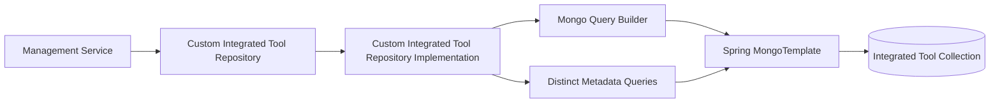
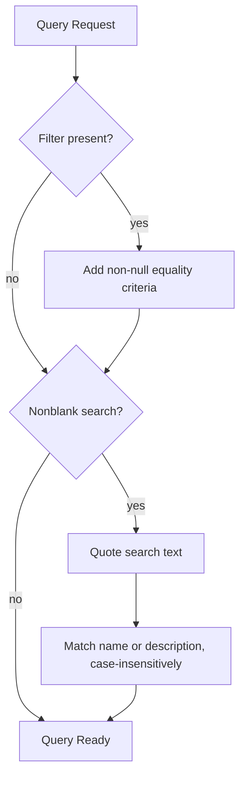
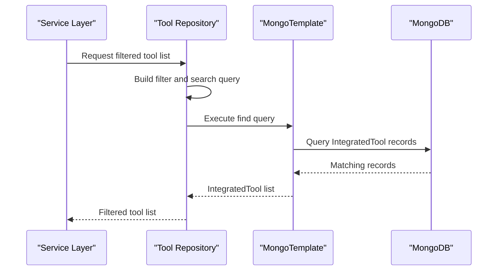

# Integrated Tool Repositories

## Purpose

Integrated Tool Repositories provide the custom MongoDB query layer for `IntegratedTool` records. The module combines structured filters, free-text search, deterministic ordering, and metadata discovery for the management of integrated tools.

The implementation is supplied by the OpenFrame OSS Library artifact `com.openframe.oss:openframe-data-mongo-sync` at version `7.0.11`, which this service consumes. It is executed in the OpenFrame OSS Tenant runtime through the Mongo-backed data layer.

## Responsibilities

- Build a MongoDB `Query` from an optional `ToolQueryFilter` and an optional search term.
- Filter tool records by `enabled`, `type`, `category`, and `platformCategory` when each filter value is provided.
- Search tool names and descriptions case-insensitively while quoting the supplied text before it is used in a regular expression.
- Return filtered tools, optionally with caller-selected ordering.
- Expose sorted, non-null distinct values for tool type, category, and platform category, supporting filter-selection interfaces.
- Restrict the supported ordering fields to `_id`, `name`, `type`, `category`, and `enabled`, and provide `_id` as the default ordering field.

## Architecture

The module is a repository extension rather than a standalone endpoint. It owns query construction and execution; callers own request validation and decide how returned `IntegratedTool` entities are exposed. Within the broader platform, the management service contains the integrated-tool controller and initialization facilities, while this module provides the persistence operations those service-layer components can use.

## Components

| Component | Responsibility |
| --- | --- |
| [`CustomIntegratedToolRepository`](https://github.com/flamingo-stack/openframe-oss-lib/blob/16e7c1cbd9664e7d10ec5ebca7d53c9bd314decf/openframe-data-mongo-sync/src/main/java/com/openframe/data/repository/tool/CustomIntegratedToolRepository.java) | Defines the repository extension contract for query building, filtered reads, sorted reads, distinct metadata lookup, and sort-field policy. |
| [`CustomIntegratedToolRepositoryImpl`](https://github.com/flamingo-stack/openframe-oss-lib/blob/16e7c1cbd9664e7d10ec5ebca7d53c9bd314decf/openframe-data-mongo-sync/src/main/java/com/openframe/data/repository/tool/CustomIntegratedToolRepositoryImpl.java) | Spring `@Repository` implementation backed by `MongoTemplate`; materializes filter criteria, sort policy, record lookup, and distinct-value queries. |

## Query Semantics

### Filter construction

`buildToolQuery` starts with an empty `Query`. If a `ToolQueryFilter` is present, it adds equality criteria only for values that are not `null`:

| Filter property | MongoDB field | Match behavior |
| --- | --- | --- |
| `enabled` | `enabled` | Exact boolean match. |
| `type` | `type` | Exact value match. |
| `category` | `category` | Exact value match. |
| `platformCategory` | `platformCategory` | Exact value match. |

A nonblank search value adds an OR criterion over `name` and `description`. The implementation applies `Pattern.quote` before creating a case-insensitive MongoDB regular expression. Consequently, characters supplied by a user are treated as literal search text rather than regex syntax.

### Retrieval and ordering

`findToolsWithFilters` executes the constructed query without an explicit sort. `findToolsWithFiltersAndSort` applies the same filter and search behavior, then determines ordering as follows:

1. A case-insensitive `DESC` direction selects descending order; every other direction value selects ascending order.
2. When the requested field is `_id`, the query sorts on `_id` alone.
3. For every other requested field, the query appends `_id` in the same direction as a secondary sort key. This makes ordering stable for tools sharing the primary sort value.

The repository exposes `isSortableField` so higher layers can validate incoming sort fields. It trims the candidate field before checking it against the allowlist. `getDefaultSortField` returns `_id`.

> Callers should validate a requested sort field with `isSortableField` before passing it to the sorted-query method. The implementation applies the provided field to the Mongo sort operation and does not substitute the default field itself.

### Distinct metadata

The `findDistinctTypes`, `findDistinctCategories`, and `findDistinctPlatformCategories` methods query the corresponding field over all integrated-tool records. Each method removes null values, sorts the remaining strings in ascending natural order, and returns the resulting list. These methods do not apply the tool filter or search term.

## Data Flow

## Operational Considerations

- **Case-insensitive discovery:** search applies to `name` and `description`, not to type or category fields.
- **Literal search safety:** quoted text avoids interpreting user input as an arbitrary regular expression.
- **Stable sorted results:** non-identifier sorts include `_id` as a tie-breaker.
- **Facet values are global:** distinct type and category queries represent all records, not merely a filtered result set.
- **Persistence dependency:** the implementation requires Spring Data MongoDB's `MongoTemplate` and a reachable MongoDB datastore configured by the surrounding application.

## Extension Guidance

When adding a new tool filter or sort option, keep the contract and implementation aligned:

1. Add the filter behavior to `buildToolQuery` using the persisted field name.
2. If the field should be externally sortable, add it to the sortable-field allowlist.
3. Preserve the identifier tie-breaker for non-identifier sort keys.
4. Consider whether the field needs a distinct-value method for user-interface filter options.
5. Add coverage for absent filters, combined filters, literal special characters in search text, ascending and descending ordering, and null distinct values.

Changes to field names or query semantics must remain compatible with the `IntegratedTool` document model and the services that manage integrated tools.