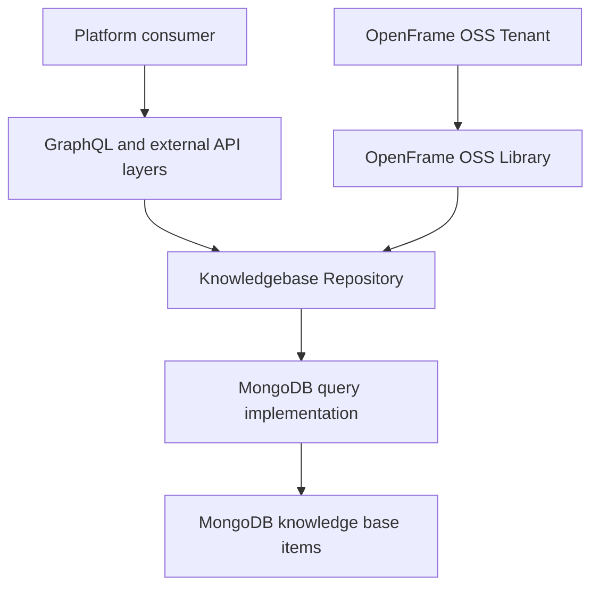
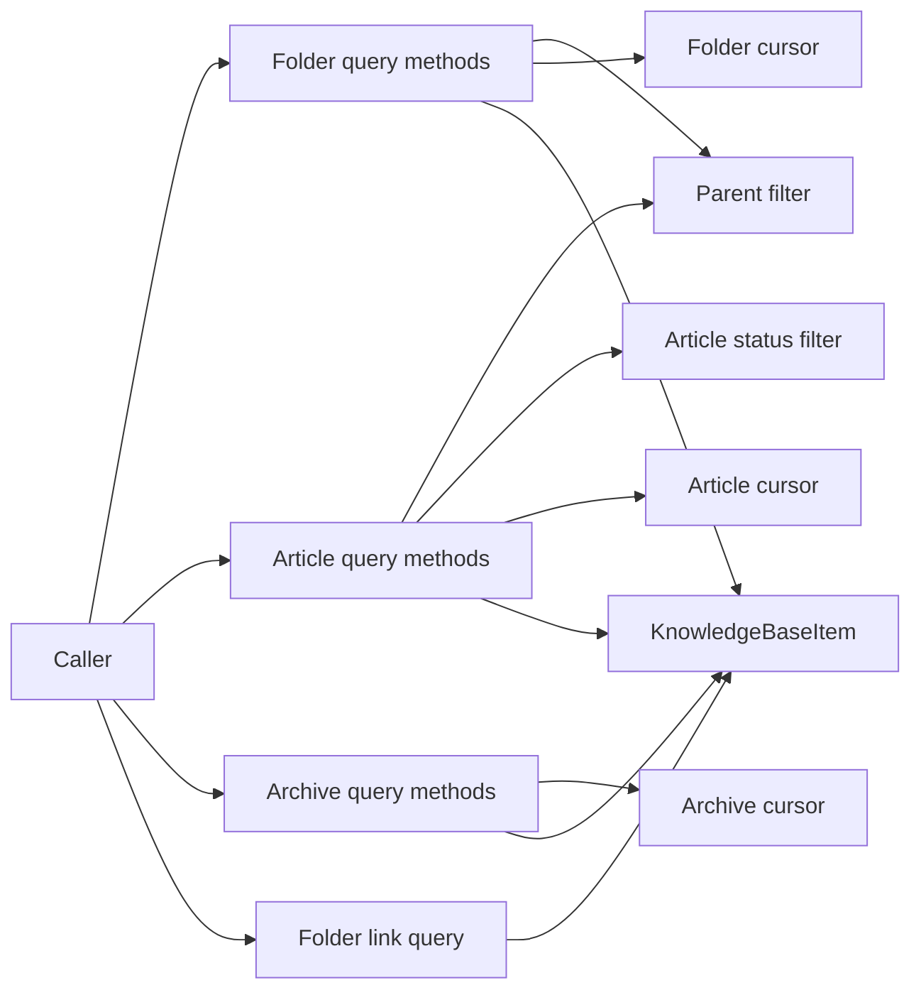
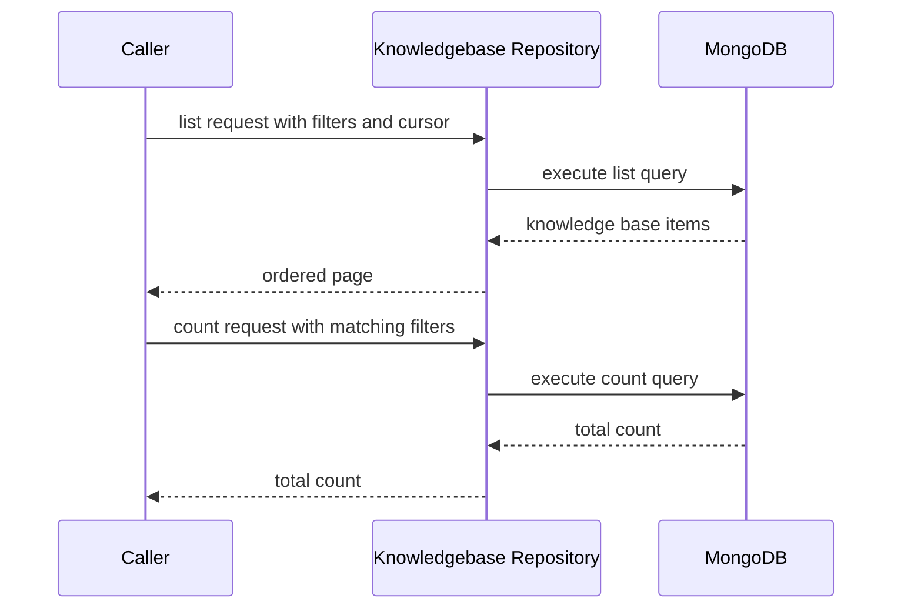
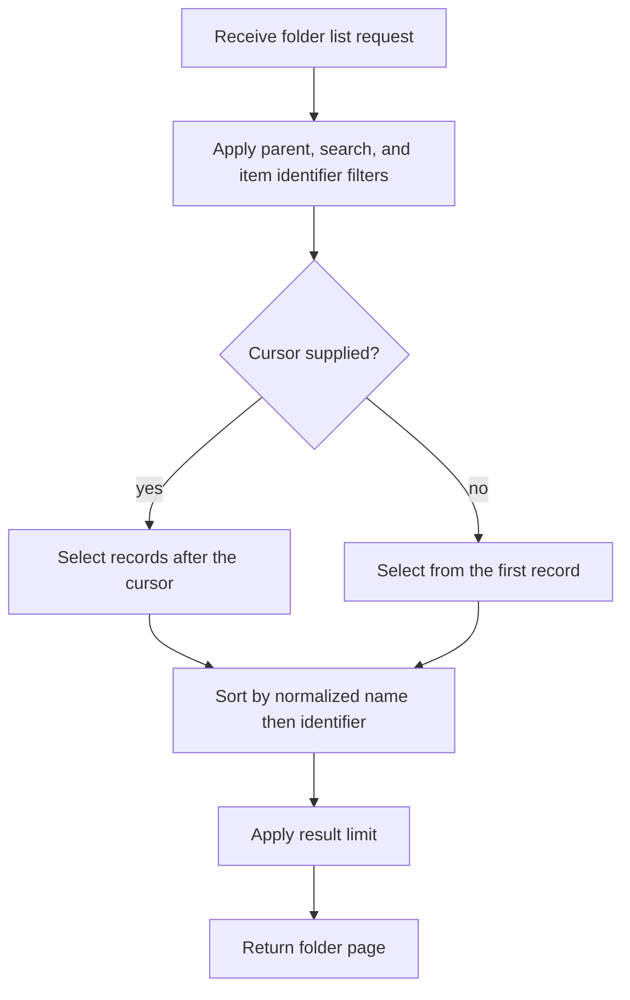
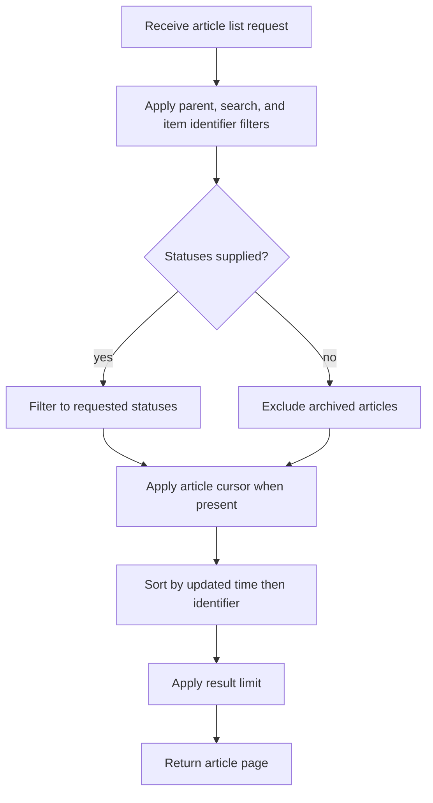
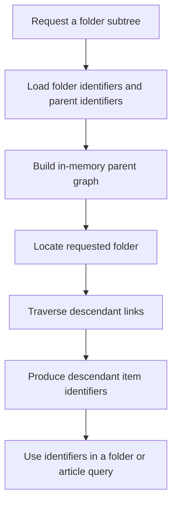

# Knowledgebase Repository

Knowledgebase Repository is the MongoDB query boundary for browsing and retrieving knowledge base items. It is supplied at runtime by the **OpenFrame OSS Library** through the `com.openframe.oss:openframe-data-mongo-sync` artifact, version `7.0.11`, which this repository consumes. The module declares custom, cursor-based reads for folders, active articles, archived articles, subtree traversal, and full article retrieval.

The repository is a contract rather than an HTTP endpoint or a persistence model. Its public API returns `KnowledgeBaseItem` records and delegates the choice of MongoDB query mechanics to its implementation. The source is maintained in the OpenFrame OSS Library: [CustomKnowledgeBaseItemRepository.java](https://github.com/flamingo-stack/openframe-oss-lib/blob/16e7c1cbd9664e7d10ec5ebca7d53c9bd314decf/openframe-data-mongo-sync/src/main/java/com/openframe/data/repository/knowledgebase/CustomKnowledgeBaseItemRepository.java).

## Responsibilities

- List folders under a selected parent scope, with optional text search, explicit item selection, cursor continuation, and a page limit.
- Count the same folder query without retrieving a page.
- List non-archived articles by default, or articles constrained to explicitly supplied statuses.
- List and count archived articles through a separate query path.
- Provide a lightweight folder graph containing only item identifiers and parent identifiers so callers can resolve a folder subtree.
- Retrieve every article when a caller needs a complete article set.

The contract intentionally keeps folders and articles distinct because they use different sort orders and archive semantics.

## Position in the System

The tenant repository packages and runs service applications, while the knowledge base persistence behavior documented here originates in the consumed OpenFrame OSS Library artifact. The surrounding platform exposes knowledge base capabilities through GraphQL and external API layers, which are also supplied by OpenFrame OSS Library artifacts. The module tree identifies `KnowledgeBaseDataFetcher`, `KnowledgeBaseImageController`, and `KnowledgeBaseController` as integration points; this repository remains the data-access layer beneath those interfaces.

## Public Query Contract

`CustomKnowledgeBaseItemRepository` defines eight read operations. All list methods return `List<KnowledgeBaseItem>`; count methods return `long` for the matching result set. The interface does not define writes, attachment storage, authorization checks, or response mapping.

| Operation | Purpose | Filtering and paging behavior | Ordering and status behavior |
|---|---|---|---|
| `findFolders` | Retrieves one page of folders. | Accepts parent filter, search text, selected item identifiers, cursor, and limit. | Name ascending with identifier descending as a tie breaker. Name comparison is case-insensitive and treats digits by numeric value. |
| `countFolders` | Counts folders for the same selection criteria. | Accepts parent filter, search text, and selected item identifiers. | No page or cursor argument, because it represents the total match count. |
| `findArticles` | Retrieves one page of articles. | Accepts parent filter, search text, selected item identifiers, optional statuses, cursor, and limit. | Updated time descending with identifier descending as a tie breaker. When statuses are absent, archived articles are excluded. |
| `countArticles` | Counts articles for the active or status-filtered listing. | Mirrors article filters except for cursor and limit. | Without statuses, archived articles are excluded. |
| `findFolderLinks` | Retrieves a folder-only parent graph. | No caller-supplied filters. | Loads only folder identifiers and parent identifiers for subtree resolution. |
| `findArchivedArticles` | Retrieves archived articles. | Accepts search text, selected item identifiers, cursor, and limit. | Archive-specific listing path. |
| `countArchivedArticles` | Counts archived articles. | Accepts search text and selected item identifiers. | Returns the archive search total. |
| `findAllArticles` | Retrieves the complete article collection. | No caller-supplied filters or pagination. | No ordering or status constraint is specified by the interface. |

### Query Inputs

The method signatures establish a consistent filtering vocabulary:

- `KnowledgeBaseParentFilter` controls the parent scope used by folder and article listings.
- `search` is the text-search input accepted by paginated folder, article, and archived-article queries.
- `itemIds` narrows applicable listing queries to an explicit set of knowledge base item identifiers.
- `KnowledgeBaseItemCursor` resumes paginated folder, article, or archive traversal. A `null` cursor begins at the first page.
- `limit` bounds the number of records returned by a paginated query.
- `KnowledgeBaseArticleStatus` filters regular article listings when the caller supplies a status collection.

A count must be requested with the same non-pagination filters as its companion listing method. This lets a caller construct a page response with its result collection and total count while avoiding a full collection scan in the application layer.

## Component Relationships

The `KnowledgeBaseItem` document is the repository's common return type. The interface makes two deliberately different traversal models available:

1. **Paged, user-facing lists** use a cursor and a deterministic order so a caller can request subsequent results.
2. **Structural traversal** uses `findFolderLinks` to obtain the minimal folder hierarchy needed to resolve descendants without loading complete folder records.

## Listing and Counting Flow

The following flow shows the intended use of paired list and count methods. The repository contract does not prescribe transaction boundaries or parallelism, so a caller decides whether to issue these reads together or independently.

### Folder Listing Process

The documented folder comparator is case-insensitive and numeric-aware. For example, names that include digits are compared by numeric value rather than only lexicographic character order. The identifier tie breaker provides a stable continuation point when names compare equally.

### Article Listing Process

The default non-archive behavior is important: callers that omit `statuses` receive every article except archived articles. Archived content has a dedicated pair of query methods, making archive views explicit rather than an accidental extension of the default article browse path.

## Archive and Subtree Operations

### Archive Browsing

`findArchivedArticles` and `countArchivedArticles` form a separate browsing path. They accept search text and explicit item identifiers, but not a parent filter or article-status list. Consumers should use these methods when presenting archive content and use their matching filters for the total count.

### Subtree Resolution

`findFolderLinks` is optimized at the contract level for relationship traversal: it returns every folder while loading only its identifier and parent identifier. It should be preferred over loading complete folders when the task is solely determining which descendants belong to a subtree.

## Integration Boundaries

| Boundary | Role in the knowledge base path |
|---|---|
| OpenFrame OSS Tenant | Consumes and assembles the OpenFrame OSS Library artifacts into deployable services. |
| OpenFrame OSS Library data module | Provides this MongoDB repository contract and its implementation through `com.openframe.oss:openframe-data-mongo-sync`. |
| API service core | Contains the knowledge base GraphQL data fetcher and image controller named in the module tree. |
| External API service core | Contains the knowledge base controller and create, update, move, archive, attachment, and response DTO types named in the module tree. |
| MongoDB | Stores the knowledge base item documents queried by this repository. |

The interface does not itself enforce tenant selection, authorization, validation, or mutation lifecycle handling. Those concerns belong to the surrounding data configuration and service layers. Maintainers changing query semantics should therefore assess consumers that expect the documented sort order, archive default, and cursor behavior.

## Maintenance Guidance

- Keep each list and count pair semantically aligned. Adding a filter to `findFolders`, `findArticles`, or `findArchivedArticles` generally requires the corresponding count method to accept and apply that filter.
- Preserve deterministic ordering whenever modifying cursor queries. A cursor is only reliable when the sort key and identifier tie breaker remain compatible with its encoding and comparison.
- Treat the default article status behavior as a compatibility contract: no `statuses` argument means archived articles are omitted.
- Use `findFolderLinks` for hierarchy resolution rather than expanding it into a full folder fetch, unless the structural query requirements change.
- Evaluate large result sets before relying on `findAllArticles`, because its signature intentionally has no pagination or filter input.
- Add repository-level tests for search handling, archive visibility, sorting, cursor boundaries, and count parity when changing the implementation. The OpenFrame OSS Library includes a search-input quoting test that references the implementation.

## Source and Ownership

- **Runtime artifact:** `com.openframe.oss:openframe-data-mongo-sync` version `7.0.11`.
- **Owning source repository:** [OpenFrame OSS Library](https://github.com/flamingo-stack/openframe-oss-lib).
- **Repository contract:** [CustomKnowledgeBaseItemRepository.java](https://github.com/flamingo-stack/openframe-oss-lib/blob/16e7c1cbd9664e7d10ec5ebca7d53c9bd314decf/openframe-data-mongo-sync/src/main/java/com/openframe/data/repository/knowledgebase/CustomKnowledgeBaseItemRepository.java).
- **Tenant assembly repository:** [OpenFrame OSS Tenant](https://github.com/flamingo-stack/openframe-oss-tenant).
