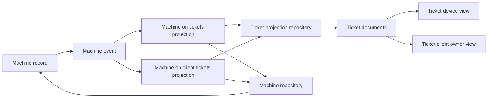
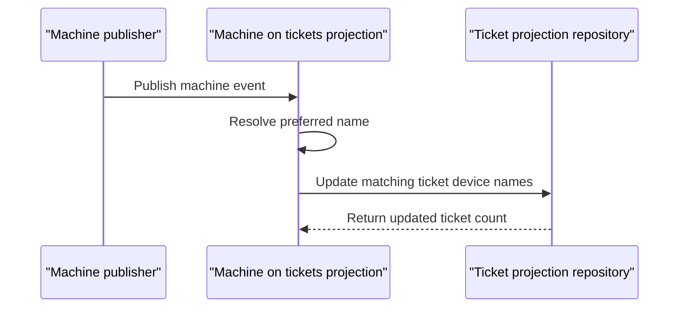
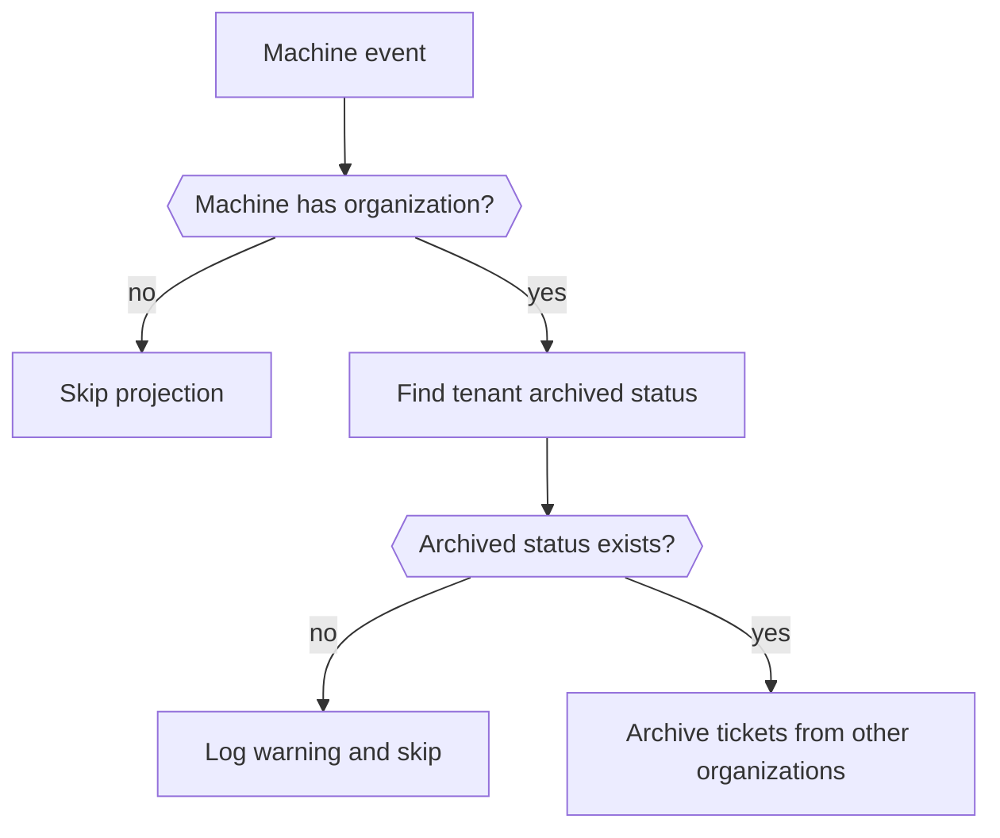
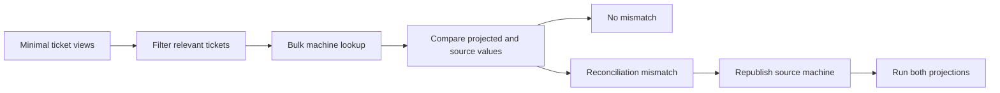

# Machine Event And Projection Repositories

Machine Event And Projection Repositories is the device-to-ticket publishing slice of the `openframe-data-mongo-sync` library. It keeps denormalized ticket fields consistent when a machine changes, without requiring ticket consumers to resolve the current machine record during every read.

The implementation is supplied by the OpenFrame OSS Library artifact `com.openframe.oss:openframe-data-mongo-sync` at version `7.0.11`, which this repository consumes at run time. It operates on tenant-scoped MongoDB records through the publishing framework's `Projection` contract.

## Responsibilities

- Define the machine event payload consumed from the machine publication stream.
- Synchronize a ticket's cached device name from the machine nickname or hostname.
- Archive open client-owned tickets when their machine has moved to a different organization.
- Supply minimal ticket read views used by reconciliation, avoiding full-ticket reads.
- Detect projection drift and identify the source machine that must be republished to repair it.

## Architecture

A machine publication contains its business machine identifier, hostname, nickname, and organization identifier. Both projections receive the same tenant-scoped published record, but maintain independent ticket invariants:

1. **Name projection:** ticket `deviceHostname` must equal the machine's preferred name.
2. **Client ownership projection:** an open client-owned ticket must be archived if it was opened under an organization different from the machine's current organization.

The projections deliberately use the business `machineId` for ticket relationships, rather than MongoDB's internal machine document identifier. Reconciliation queries machines by tenant and machine identifier, then uses the internal identifier only as the mismatch source reference used for repair.

## Components

| Component | Responsibility |
| --- | --- |
| [`MachineEvent`](https://github.com/flamingo-stack/openframe-oss-lib/blob/16e7c1cbd9664e7d10ec5ebca7d53c9bd314decf/openframe-data-mongo-sync/src/main/java/com/openframe/data/repository/device/publishing/MachineEvent.java) | Published device payload and canonical preferred-name calculation. |
| [`MachineOnTicketsProjection`](https://github.com/flamingo-stack/openframe-oss-lib/blob/16e7c1cbd9664e7d10ec5ebca7d53c9bd314decf/openframe-data-mongo-sync/src/main/java/com/openframe/data/repository/device/publishing/MachineOnTicketsProjection.java) | Propagates the machine display name to related tickets and reconciles stale copies. |
| [`MachineOnClientTicketsProjection`](https://github.com/flamingo-stack/openframe-oss-lib/blob/16e7c1cbd9664e7d10ec5ebca7d53c9bd314decf/openframe-data-mongo-sync/src/main/java/com/openframe/data/repository/device/publishing/MachineOnClientTicketsProjection.java) | Archives eligible tickets associated with a previous client organization and reconciles missed archival. |
| [`TicketDeviceView`](https://github.com/flamingo-stack/openframe-oss-lib/blob/16e7c1cbd9664e7d10ec5ebca7d53c9bd314decf/openframe-data-mongo-sync/src/main/java/com/openframe/data/repository/device/publishing/TicketDeviceView.java) | Minimal ticket projection for device-name reconciliation. |
| [`TicketClientOwnerView`](https://github.com/flamingo-stack/openframe-oss-lib/blob/16e7c1cbd9664e7d10ec5ebca7d53c9bd314decf/openframe-data-mongo-sync/src/main/java/com/openframe/data/repository/device/publishing/TicketClientOwnerView.java) | Minimal ticket projection for client-ownership reconciliation. |

## Machine Event Contract

`MachineEvent` implements the publishing framework's `PublishedEvent` marker contract. Its fields form the public data required by both projections:

| Field | Meaning | Projection usage |
| --- | --- | --- |
| `machineId` | Stable business identifier referenced by tickets and insights. | Locates affected tickets and source machines. |
| `hostname` | Machine hostname. | Fallback display name. |
| `nickname` | Optional user-managed device name. | Preferred display name when present. |
| `organizationId` | Current customer organization of the machine. | Determines whether client-owned tickets must be archived. |

The `preferredName()` method delegates to `MachineName.preferred(nickname, hostname)`. The name projection uses the same preferred-name rule as the machine domain model, ensuring ticket denormalization does not invent a competing display-name rule.

## Projection Processing

### Device Name Propagation

`MachineOnTicketsProjection` is named `machine-on-tickets`. On each event, it derives the preferred device name and asks `TicketProjectionRepository` to update ticket `deviceHostname` values for the event tenant and machine identifier.

For large repair operations, the projection supports the publishing framework's incremental protocol:

- `countChanges` counts only tickets whose cached name differs, subject to the supplied limit.
- `applyBatch` updates a page after `lastId` and returns the next cursor value.
- `projectedClass` identifies `Ticket` as the mutated document type.
- `projectedViewClass` identifies `TicketDeviceView` as the minimal reconciliation read model.

During reconciliation, the projection loads all relevant machines in one repository query keyed by tenant and machine identifier. A mismatch is emitted only when a source machine still exists and its preferred name differs from the ticket copy. A ticket whose source machine was deleted is retained and is not considered drift.

### Client Ticket Archival

`MachineOnClientTicketsProjection` is named `machine-on-client-tickets`. It prevents open client-owned tickets from remaining active after a machine moves to a different customer organization.

The archival operation is deliberately constrained:

- It requires a non-null current machine organization.
- It requires the tenant to define a ticket status of kind `ARCHIVED`.
- The repository updates only client tickets for the machine whose owner organization differs from the event organization.
- Tickets without a suitable owner snapshot, administrator-owned tickets, and already archived tickets are not candidates for change.

The same prerequisites apply to `countChanges` and `applyBatch`. If either prerequisite is missing, the projection reports no work. This makes normal execution and repair behavior consistent.

During reconciliation, `TicketClientOwnerView` candidates must be non-archived tickets with a `ClientTicketOwner` snapshot containing both machine and organization identifiers. The projection fetches all referenced machines in bulk and reports a mismatch when the machine exists, has an organization, and that organization differs from the ticket owner snapshot. Tenants without an archived status are excluded from mismatches because the projection cannot repair them.

## Reconciliation and Repair Model

Each projection returns a `ReconciliationResult` containing mismatches rather than directly modifying data during comparison. A mismatch includes the tenant, affected ticket identifier, source machine document identifier, and a diagnostic message. This preserves a separation between detecting stale denormalized state and applying a repair through republishing.

## Operational Notes

- **Tenant isolation:** every mutation and lookup is scoped by the published record tenant identifier. Bulk reconciliation keys machines using a tenant-plus-machine identifier pair, avoiding cross-tenant collisions.
- **Idempotence:** the repository update methods target values that differ from the desired source state. Replaying an unchanged machine event therefore does not introduce a new semantic change.
- **Batch safety:** the `lastId` cursor used by `applyBatch` allows large ticket sets to be processed incrementally.
- **Observability:** successful apply paths log affected ticket counts at debug level. Missing archived-status configuration logs a warning with tenant and machine context.
- **Data retention behavior:** a deleted source machine does not cause its copied ticket device name to be erased and does not produce a name-reconciliation mismatch.

## Boundaries

This module is focused on machine-originated ticket denormalization. It relies on `MachineRepository` for source records and `TicketProjectionRepository` for targeted ticket updates, status lookup, and batch traversal. Ticket document structure, machine persistence, publication delivery, and projection scheduling are provided elsewhere by the OpenFrame data and publishing infrastructure.
