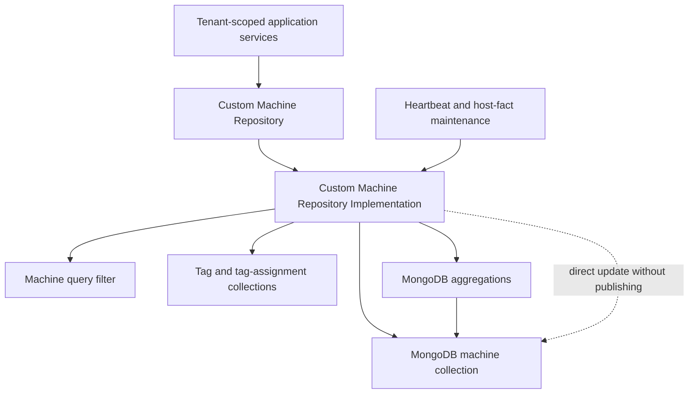
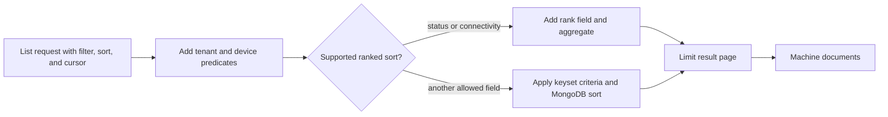
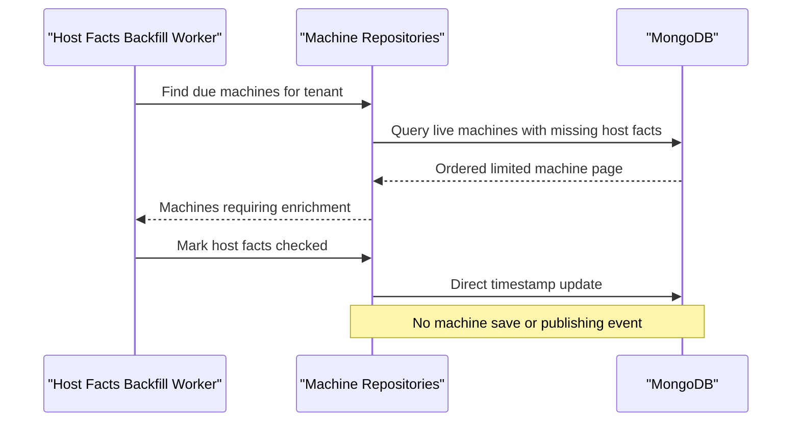

# Machine Repositories

Machine Repositories provides the tenant-scoped MongoDB query layer for managed machines. It is supplied at runtime by the `com.openframe.oss:openframe-data-mongo-sync` library, version `7.0.11`, from OpenFrame OSS Library. The module pairs a repository contract with a `MongoTemplate` implementation that supports device listing, search, filtering, facets, keyset pagination, schedule candidate ordering, and narrowly scoped maintenance updates.

The repository deliberately distinguishes regular machine queries from lightweight telemetry maintenance. Heartbeat and host-fact check timestamps are updated directly rather than through the normal save path so that changes which do not belong in the Pinot payload do not emit unnecessary Kafka publishing events.

## Source Components

| Component | Responsibility |
| --- | --- |
| [Custom Machine Repository](https://github.com/flamingo-stack/openframe-oss-lib/blob/16e7c1cbd9664e7d10ec5ebca7d53c9bd314decf/openframe-data-mongo-sync/src/main/java/com/openframe/data/repository/device/CustomMachineRepository.java) | Declares machine retrieval, facet, pagination, criteria selection, maintenance, and sort-validation operations. |
| [Custom Machine Repository Implementation](https://github.com/flamingo-stack/openframe-oss-lib/blob/16e7c1cbd9664e7d10ec5ebca7d53c9bd314decf/openframe-data-mongo-sync/src/main/java/com/openframe/data/repository/device/CustomMachineRepositoryImpl.java) | Builds MongoDB queries and aggregations, resolves tag assignments, and performs direct update operations through `MongoTemplate`. |

## Architecture

### Scope and Isolation

Every public retrieval method constructs a tenant predicate before querying `Machine` documents. Tag filtering is also tenant-scoped: the implementation first finds device tags and tag assignments for the tenant, extracts their machine identifiers, and adds that identifier restriction to the machine query. Aggregation-based paths explicitly include the resulting predicate because `aggregate()` bypasses template-level automatic scoping.

The repository excludes machines with `DELETED` status by default. A caller-provided status inclusion or exclusion filter supersedes that default behavior. Host-fact backfill separately excludes retired states: pending deletion, deleted, and archived.

## Query Capabilities

### Filter Construction and Search

`MachineQueryFilter` can constrain status, connectivity, device type, operating-system type, organization, explicit machine identifiers, package-manager manageability, exact names, wildcard name patterns, directory source, and directory-user link state.

Search is case-insensitive and literal. It checks hostname, display name, nickname, IP address, serial number, manufacturer, model, and directory user name. Exact hostname matching targets `hostname`; requested nickname matching considers both `nickname` and `displayName`. Wildcard patterns support `*` and `?` after converting them to a regular expression.

Package-manager filtering treats a device without a `packageManagers` field as eligible and otherwise requires at least one requested manager to be in the `MANAGEABLE` state.

### Listing, Counts, Identifiers, and Facets

The contract supplies complementary operations for common device views:

- `findMachines` returns all documents matching a tenant and filter.
- `findMachinesAfter` pages by ascending `machineId` after an optional machine identifier.
- `countMachines` and `findMachineIds` apply the same filter and free-text search criteria to return a count or distinct identifiers.
- `facet` groups matching records by a requested `DeviceFacetDimension`, excluding the dimension from the base filter so a facet can represent all available choices. Null group keys are not returned as options.
- `findMatchingNames` uses an aggregation to report which requested hostnames and visible names already exist, with case-insensitive exact matching.
- `findMachineIdsByCriteria` and `countMachinesByCriteria` additionally apply an operating-system scope for selection workflows.

### Cursor Pagination and Sorting

`findMachinesWithCursor` uses keyset pagination rather than offsets. Standard fields sort by the requested field and `_id` as a deterministic tie-breaker; the cursor is a MongoDB object identifier. Invalid or unresolved cursors are logged and fall back to a safe page predicate.

The allowed sort fields are `_id`, hostname, display name, nickname, status, connectivity, and last seen. `_id` is the default. `isSortableField` guards caller-selected sort fields before they reach query construction.

Status and connectivity have domain-specific ranking implemented with aggregation stages:

- Descending status places online, offline, pending, and pending deletion in that order. Ascending reverses the order.
- Descending connectivity places telemetry-online machines first.
- Both paths use a compound rank and `_id` cursor so pagination remains stable inside a rank.

For ordinary fields, cursor logic handles null sort values explicitly so later pages do not lose machines whose selected sort field is absent.

### Schedule Candidate Ordering

`findAvailableForScheduleWithCursor` prioritizes candidate machines through an aggregation bucket and pages over the compound key `(bucket, _id)`. The bucket gives priority to assigned machines and then online machines:

1. Assigned and online.
2. Assigned and not online.
3. Unassigned and online.
4. Unassigned and not online.

The cursor format is `bucket|objectIdHex`. Invalid cursor forms are logged and treated as a first-page request rather than causing a query failure.

## Maintenance Operations and Event Discipline

`updateLastSeen` sets only `lastSeen`; `markHostFactsChecked` sets only `hostFactsCheckedAt`. Both issue `updateFirst` calls and increment the optimistic-lock version by zero. This avoids an automatic version increment, preventing low-risk background state from conflicting with a concurrent user edit.

Neither operation uses a normal save path or a machine writer. Consequently, timestamp-only changes do not invoke the Pinot publishing aspect and do not create Kafka messages for data that is not part of the Pinot payload.

`findDueForFleetHostFacts` selects live machines that have any required Fleet host fact blank, missing, or null and that were never checked or were last checked before a supplied threshold. Results are ordered by the oldest host-fact check marker and machine identifier, then limited for bounded background backfill work.

## Operational Considerations

- Require a nonblank tenant identifier and positive limits where enforced by the contract implementation.
- Validate a requested field with `isSortableField` before calling cursor-based listing; otherwise use `getDefaultSortField`.
- Treat cursors as opaque client state. A cursor encodes ordering state and should be reused only with the same query and sort semantics.
- Use direct maintenance methods only for fields intentionally excluded from publication. Business changes to a machine must continue through the regular persistence path so downstream projections remain correct.
- Facet and tag resolution can involve multiple MongoDB collections. Preserve the tenant parameter across all calls to retain isolation.

## System Context

This module is one repository component within the synchronous Mongo data layer assembled by OpenFrame services. It stores and retrieves machine records used by device-facing API and client workflows, while the adjacent machine event and projection repository components handle publishing-oriented representations. The OpenFrame OSS Tenant repository consumes this library as `com.openframe.oss:openframe-data-mongo-sync` version `7.0.11` and provides the service configuration and deployment environment in which it runs.
