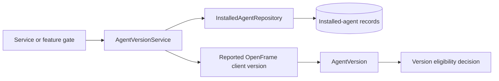
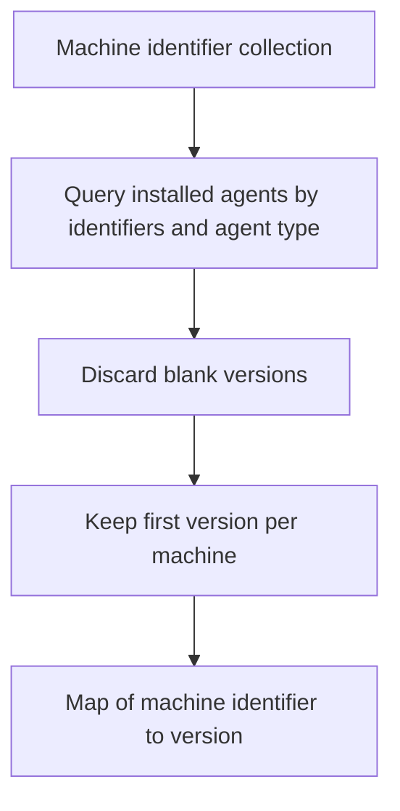
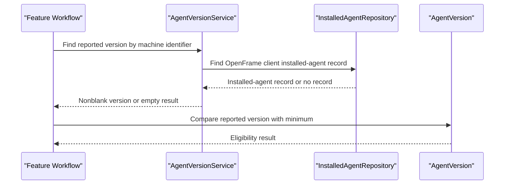

# Machine Service Core

Machine Service Core is a small service-layer module from the `com.openframe.oss:openframe-data-mongo-sync` library. It provides the authoritative lookup and comparison of the OpenFrame client version currently reported by a machine. The tenant repository consumes this library at version `7.0.11`.

The module deliberately reads the OpenFrame client version from installed-agent records rather than from a machine's installation-time version. An installed-agent record is updated when the client registers and after it applies an update, whereas the machine installation version does not change. This makes Machine Service Core suitable for feature gating, rollout checks, and determining which client behavior a managed machine can support.

## Source and Scope

The implementation is supplied by the OpenFrame OSS Library:

- [AgentVersion source](https://github.com/flamingo-stack/openframe-oss-lib/blob/16e7c1cbd9664e7d10ec5ebca7d53c9bd314decf/openframe-data-mongo-sync/src/main/java/com/openframe/data/service/machine/AgentVersion.java)
- [AgentVersionService source](https://github.com/flamingo-stack/openframe-oss-lib/blob/16e7c1cbd9664e7d10ec5ebca7d53c9bd314decf/openframe-data-mongo-sync/src/main/java/com/openframe/data/service/machine/AgentVersionService.java)

## Architecture

### Components

| Component | Responsibility |
| --- | --- |
| `AgentVersionService` | Spring service that retrieves the version of the `openframe-client` installed-agent record for one or more machines. |
| `AgentVersion` | Stateless utility that evaluates whether a reported dotted version meets a minimum version. |
| `InstalledAgentRepository` | Persistence dependency used by the service to query installed-agent records. It is outside this module. |
| `InstalledAgent` | Persisted record supplying a machine identifier, agent type, and version. It is outside this module. |

## Version Lookup

`AgentVersionService` fixes the relevant agent type as `openframe-client`, preventing callers from accidentally retrieving another managed tool's version.

### Single-machine lookup

`find(machineId)` queries the installed-agent repository by machine identifier and the fixed agent type. It returns an optional version only when both of the following conditions hold:

1. A matching installed-agent record exists.
2. The record's version contains text.

Missing records and blank versions are intentionally represented as an empty result. Callers must therefore treat absent version data as unknown, rather than as a valid client version.

### Bulk lookup

`findAll(machineIds)` uses one repository query for the supplied collection and returns a map from machine identifier to nonblank version. If duplicate records resolve to the same machine identifier, the stream collector retains the first version encountered. Machines with no matching client record or blank versions do not appear in the result map.

## Version Eligibility Rules

`AgentVersion.isAtLeast(actual, min)` applies these rules:

| Input condition | Result |
| --- | --- |
| `actual` is blank | `false` |
| `min` is blank and `actual` has text | `true` |
| Both values contain text | Compare numeric dot-separated components from left to right. |

Absent components are treated as zero, so `1.2` and `1.2.0` compare as equal. Each component is parsed only through its leading numeric portion; suffix text after a numeric prefix is ignored. A component that cannot provide a parseable numeric prefix is treated as zero.

Examples of the resulting behavior include:

| Actual version | Minimum version | Eligibility |
| --- | --- | --- |
| `1.4.2` | `1.4` | Eligible |
| `1.4` | `1.4.0` | Eligible |
| `1.4.1` | `1.4.2` | Not eligible |
| `2.0-beta` | `2.0` | Eligible |
| blank | `1.0` | Not eligible |

## Typical Flow

A feature or update workflow obtains the current client version from `AgentVersionService` and delegates the compatibility decision to `AgentVersion`.

## Operational Considerations

- The reported version is only as current as the installed-agent record. The module relies on agent registration and post-update reporting to keep that record current.
- A missing or blank version fails a minimum-version check. Consumers that require backward-compatible behavior should explicitly decide how to handle this unknown state.
- The comparison is numeric and component-oriented, not a complete semantic-version implementation. In particular, it ignores suffixes after an initial number and normalizes missing components to zero.
- Bulk callers should prefer `findAll` when resolving multiple machines to avoid a repository lookup per machine.

## Relationship to the Tenant Platform

This module is part of the Mongo synchronous data library assembled by the tenant services. It has no HTTP endpoint or scheduled task of its own. Instead, higher-level services use its lookup and comparison behavior when they need the live OpenFrame client version associated with managed machines. The installed-agent data model and repository are provided by the same library's persistence layer.
