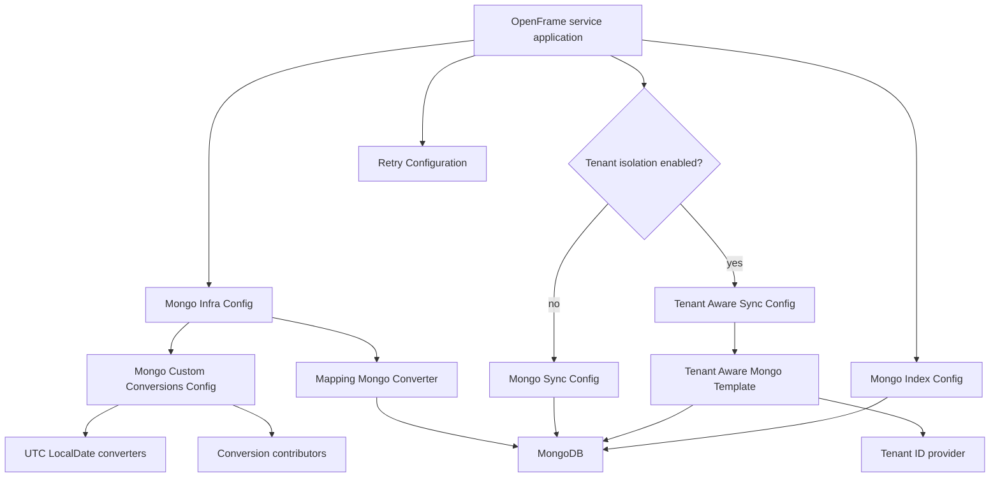
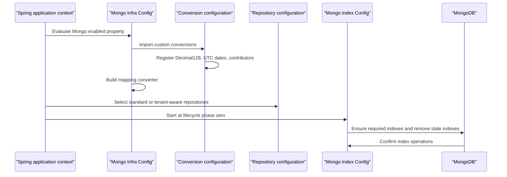
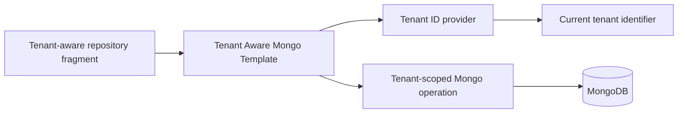

# Mongo Config And Conversion

Mongo Config And Conversion is the synchronous MongoDB infrastructure layer supplied by the **OpenFrame OSS Library** artifact `com.openframe.oss:openframe-data-mongo-sync` at version `7.0.11`. OpenFrame OSS Tenant assembles this library at runtime. The module establishes the application-wide Mongo mapping rules, repository activation mode, tenant-aware template wiring, retry support, and startup index maintenance used by the data-access layer.

Its central contract is consistency: logical dates use UTC, `BigDecimal` values are written as MongoDB Decimal128 values, map keys containing dots are encoded safely, and each service has one authoritative `MongoCustomConversions` bean. When tenant isolation is enabled, it also replaces the default `mongoTemplate` with a tenant-aware implementation so repository operations resolve through the active tenant context.

## Architecture Overview

### Startup Sequence

`MongoInfraConfig` is active only when `spring.data.mongodb.enabled` is explicitly `true`. It runs before Spring Boot's Mongo data auto-configuration, enables Mongo auditing, imports the shared conversion configuration, and constructs the mapping converter. Repository registration is selected independently by the tenant-isolation setting. `MongoIndexConfig` is a `SmartLifecycle` component at phase `0`, so it creates and reconciles indexes after context refresh but before the web server accepts traffic.

## Core Responsibilities

| Area | Components | Responsibility |
|---|---|---|
| Conversion policy | [LocalDateUtcMongoConverters](https://github.com/flamingo-stack/openframe-oss-lib/blob/16e7c1cbd9664e7d10ec5ebca7d53c9bd314decf/openframe-data-mongo-sync/src/main/java/com/openframe/data/config/LocalDateUtcMongoConverters.java), [MongoCustomConversionsConfig](https://github.com/flamingo-stack/openframe-oss-lib/blob/16e7c1cbd9664e7d10ec5ebca7d53c9bd314decf/openframe-data-mongo-sync/src/main/java/com/openframe/data/config/MongoCustomConversionsConfig.java), and [MongoConversionsContributor](https://github.com/flamingo-stack/openframe-oss-lib/blob/16e7c1cbd9664e7d10ec5ebca7d53c9bd314decf/openframe-data-mongo-sync/src/main/java/com/openframe/data/config/MongoConversionsContributor.java) | Defines the sole custom conversion registry, stable date encoding, Decimal128 handling, and extension mechanism. |
| Mongo infrastructure | [MongoInfraConfig](https://github.com/flamingo-stack/openframe-oss-lib/blob/16e7c1cbd9664e7d10ec5ebca7d53c9bd314decf/openframe-data-mongo-sync/src/main/java/com/openframe/data/config/MongoInfraConfig.java) | Enables auditing and configures the `MappingMongoConverter` used for document mapping and DBRefs. |
| Repository mode | [MongoSyncConfig](https://github.com/flamingo-stack/openframe-oss-lib/blob/16e7c1cbd9664e7d10ec5ebca7d53c9bd314decf/openframe-data-mongo-sync/src/main/java/com/openframe/data/config/MongoSyncConfig.java) and [TenantAwareSyncConfig](https://github.com/flamingo-stack/openframe-oss-lib/blob/16e7c1cbd9664e7d10ec5ebca7d53c9bd314decf/openframe-data-mongo-sync/src/main/java/com/openframe/data/config/TenantAwareSyncConfig.java) | Registers the repository package, selecting the standard repository set or the tenant-aware set. |
| Tenant template | [TenantIsolationAutoConfiguration](https://github.com/flamingo-stack/openframe-oss-lib/blob/16e7c1cbd9664e7d10ec5ebca7d53c9bd314decf/openframe-data-mongo-sync/src/main/java/com/openframe/data/config/TenantIsolationAutoConfiguration.java) | Supplies the primary, conventionally named `mongoTemplate` in tenant-isolation mode. |
| Index lifecycle | [MongoIndexConfig](https://github.com/flamingo-stack/openframe-oss-lib/blob/16e7c1cbd9664e7d10ec5ebca7d53c9bd314decf/openframe-data-mongo-sync/src/main/java/com/openframe/data/config/MongoIndexConfig.java) | Ensures essential indexes before traffic and removes obsolete indexes safely. |
| Retrying | [RetryConfiguration](https://github.com/flamingo-stack/openframe-oss-lib/blob/16e7c1cbd9664e7d10ec5ebca7d53c9bd314decf/openframe-data-mongo-sync/src/main/java/com/openframe/data/config/RetryConfiguration.java) | Enables Spring Retry so retry annotations in the data layer can be applied. |

## Conversion And Mapping Rules

### UTC Local Dates

`LocalDateUtcMongoConverters` converts a `LocalDate` to midnight UTC when writing and derives a `LocalDate` from a Mongo `Date` using UTC when reading. This avoids using the JVM default time zone, which would otherwise encode the same calendar date as different instants across pods in different regions. The invariant is particularly important for exact-date comparisons and deduplication.

### One Conversion Registry

`MongoCustomConversionsConfig` creates the one `MongoCustomConversions` bean expected by Spring Data MongoDB. It performs three ordered actions:

1. Configures `BigDecimal` persistence as Decimal128.
2. Registers the UTC date converter pair.
3. Obtains all `MongoConversionsContributor` beans in Spring order and lets each register additional converters through the same adapter.

A service must contribute to this registry rather than declare a second conversions bean. Competing conversion beans produce an ambiguous Spring context. The contributor interface is intentionally narrow: each implementation receives only the converter configuration adapter.

> `BigDecimal` values written under earlier application versions can coexist as strings with Decimal128 values because both forms can be read into `BigDecimal`. Queries and aggregations that compare or sum a mixed field require the historical string values to be migrated first.

### Mapping Converter

`MongoInfraConfig` creates `MappingMongoConverter` with a `DefaultDbRefResolver`, the mapping context, and the shared custom conversions. It also configures `__dot__` as the map-key replacement, allowing application map keys that contain dots to be stored without violating MongoDB field-name constraints. Mongo auditing is enabled with this infrastructure.

## Repository And Tenant-Isolation Modes

The two repository configurations are mutually exclusive when Mongo is enabled:

| Condition | Active configuration | Repository behavior |
|---|---|---|
| `spring.data.mongodb.enabled=true` and tenant isolation is disabled | `MongoSyncConfig` | Enables repositories in `com.openframe.data.repository` but excludes types marked as `TenantAwareRepository`. |
| `spring.data.mongodb.enabled=true` and `openframe.tenant-isolation.enabled=true` | `TenantAwareSyncConfig` | Enables the full repository package, including tenant-aware fragments. |

When `openframe.tenant-isolation.enabled=true`, `TenantIsolationAutoConfiguration` exposes a primary `TenantAwareMongoTemplate` as `mongoTemplate`. The template receives the database factory, Mongo converter, and a lazily injected `TenantIdProvider`. Lazy resolution avoids forcing a provider implementation to be constructed before the application context is ready; the provider is resolved when a tenant-scoped query needs the tenant identifier.

## Index Management

`MongoIndexConfig` owns explicit index setup that is required for correctness or query performance. Its operations are idempotent when existing indexes use the same name, keys, and options.

### Ensured Indexes

- `sso_identities`: unique `(provider, subject)` index, enforcing one user per external SSO identity.
- `oauth2_authorizations`: sparse index on `retiredRefreshTokens.value`, supporting unknown refresh-token lookup.
- `application_events`: indexes for user-and-time access and type-and-tag access.
- `scripts` and `script_schedules`: named partial unique indexes on `(tenantId, name)` for `ACTIVE` and `ARCHIVED` records. Soft-deleted names can therefore be reused.
- `knowledge_base_items`: two collation-aware indexes that support case-insensitive, natural-name ordering for folder-level or whole-knowledge-base listings.

The script partial filters deliberately use an inclusion list of the non-deleted statuses. MongoDB does not support the equivalent negation form in a partial-index expression. If the script status model gains another non-deleted state, the filter must be updated in the same change.

### Retired Indexes

At startup, the component attempts to drop obsolete indexes from tag and software collections. A missing index is handled as a debug-level no-op, permitting upgrades from both old and already-migrated databases. The configuration intentionally retains the ordinary script compound index created from mapping metadata; dropping it during startup can interrupt an index build being performed by another pod.

## Operational Considerations

- Mongo infrastructure is opt-in through `spring.data.mongodb.enabled`; it does not activate merely because Mongo dependencies are present.
- Tenant-isolation mode requires a `TenantIdProvider` implementation on the classpath. The OSS data layer provides the default provider described by the wider data module.
- Do not add another `MongoCustomConversions` bean. Implement `MongoConversionsContributor` instead.
- Ensure MongoDB availability before lifecycle startup in environments that run the index manager. Context refresh itself does not require index initialization, but lifecycle startup does.
- Treat index names and definitions as compatibility contracts. Changing key order, uniqueness, partial filters, collation, or names can cause conflicts during rolling deployment.
- `RetryConfiguration` only enables the Spring Retry mechanism; the retry policy is defined by the annotations and callers that use it.

## Relationship To The Wider Data Layer

Mongo Config And Conversion is infrastructure, not a domain repository implementation. It underpins the synchronous repositories, document mappings, retry listeners, and service-level data access supplied by the `openframe-data-mongo-sync` library. It also works with the shared Mongo document definitions from `openframe-data-mongo-common`. In OpenFrame OSS Tenant, applications that consume this artifact inherit the same conversion and repository-selection behavior, keeping persistence semantics consistent across services.
