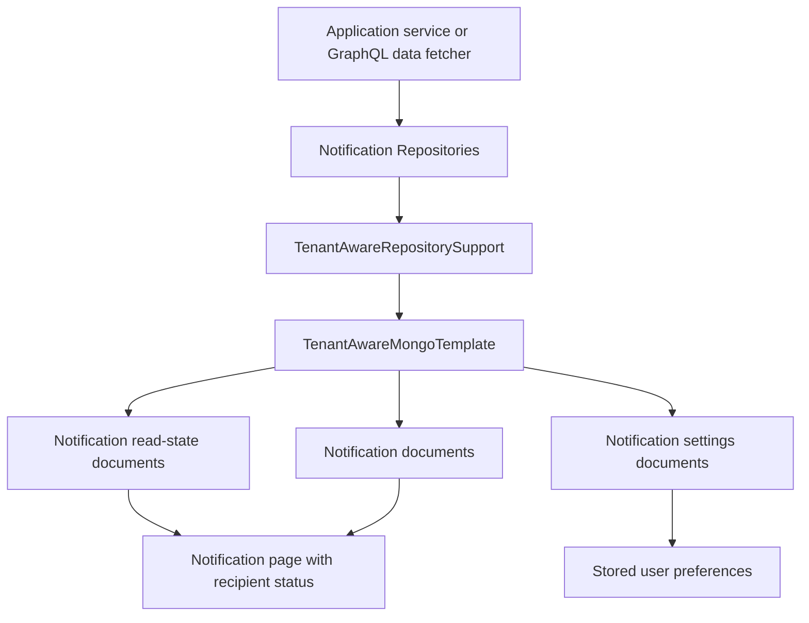
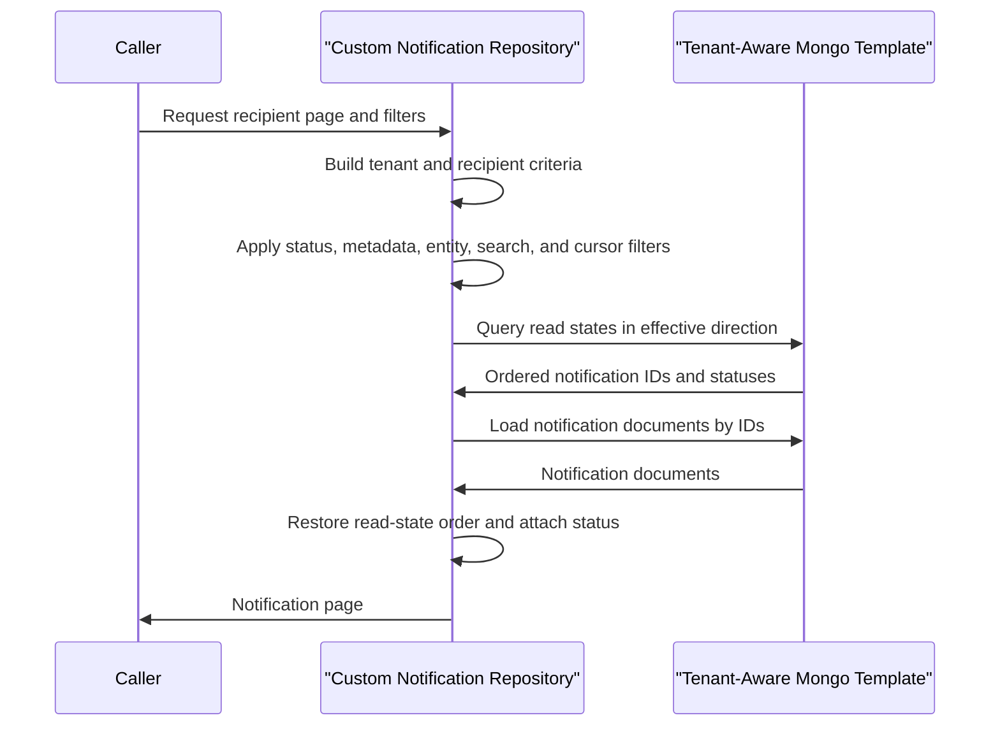
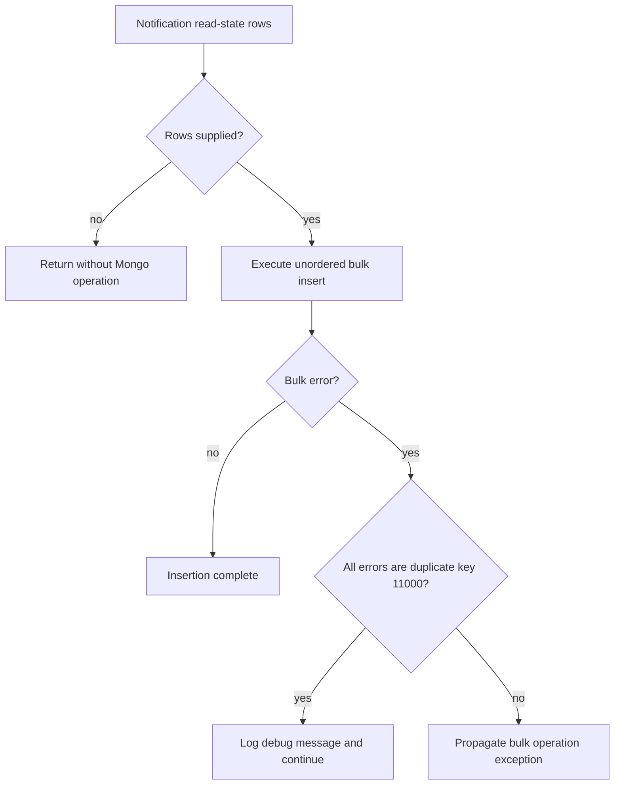
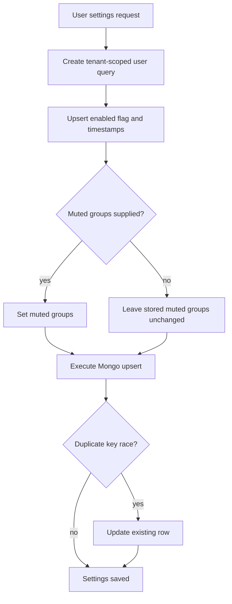

# Notification Repositories

Notification Repositories is the tenant-scoped MongoDB persistence layer for notification delivery state and user notification preferences. It is supplied by the `com.openframe.oss:openframe-data-mongo-sync` library, version `7.0.11`, which OpenFrame OSS Tenant consumes at run time. The implementations activate only when `openframe.tenant-isolation.enabled=true`.

The module separates immutable notification content from recipient-specific state. A page request first selects matching `NotificationReadState` records for one recipient, then loads the referenced `Notification` documents and returns them in the state-query order. This arrangement makes read, archive, delete, and unread status user or recipient specific without duplicating notification content.

## Scope and Responsibilities

- Build tenant-scoped queries for notification state.
- Filter a recipient's notifications by read status, category, type, severity, title search text, and an optional entity reference.
- Implement cursor pagination over notification identifiers, in forward or backward traversal.
- Reconstruct page order after fetching notification documents.
- Insert notification read-state rows in unordered bulk mode, tolerating an entirely duplicate batch.
- Persist per-user settings atomically, including global enablement and muted setting groups.
- Return category aggregation rows through the `CategoryCount` projection type.

## Architecture Overview

`TenantAwareRepositorySupport` and `TenantAwareMongoTemplate` provide the tenant boundary used by these implementations. The notification repository applies tenant criteria while selecting recipient state; settings writes rely on the tenant-aware template's scoped filtering. This keeps identically named recipients or users in separate tenant data sets.

## Components

| Component | Responsibility |
|---|---|
| [`CategoryCount`](https://github.com/flamingo-stack/openframe-oss-lib/blob/16e7c1cbd9664e7d10ec5ebca7d53c9bd314decf/openframe-data-mongo-sync/src/main/java/com/openframe/data/repository/notification/CategoryCount.java) | A Mongo aggregation projection mapping `_id` to a notification category and exposing its count. |
| [`CustomNotificationRepositoryImpl`](https://github.com/flamingo-stack/openframe-oss-lib/blob/16e7c1cbd9664e7d10ec5ebca7d53c9bd314decf/openframe-data-mongo-sync/src/main/java/com/openframe/data/repository/notification/impl/CustomNotificationRepositoryImpl.java) | Retrieves a recipient-specific notification page and count, applying filters and cursor navigation through read-state documents. |
| [`CustomNotificationReadStateRepositoryImpl`](https://github.com/flamingo-stack/openframe-oss-lib/blob/16e7c1cbd9664e7d10ec5ebca7d53c9bd314decf/openframe-data-mongo-sync/src/main/java/com/openframe/data/repository/notification/impl/CustomNotificationReadStateRepositoryImpl.java) | Inserts recipient read-state records in unordered bulk mode, treating a fully duplicate-key failure as an idempotent result. |
| [`CustomNotificationSettingsRepositoryImpl`](https://github.com/flamingo-stack/openframe-oss-lib/blob/16e7c1cbd9664e7d10ec5ebca7d53c9bd314decf/openframe-data-mongo-sync/src/main/java/com/openframe/data/repository/notification/impl/CustomNotificationSettingsRepositoryImpl.java) | Atomically creates or updates a user's enabled flag and muted notification setting groups. |

## Recipient Page Query Flow

The main repository deliberately queries `NotificationReadState` before `Notification`. Read-state documents contain recipient identity, recipient type, notification reference, and status, so they are the correct collection for recipient-specific filtering and cursor traversal.

### Filtering Semantics

`CustomNotificationRepositoryImpl` applies filters to the read-state query:

- **Recipient boundary:** `recipientId` and `recipientType` are always required alongside tenant criteria.
- **Read state:** no read filter excludes only `DELETED`; `true` selects `READ` and `ARCHIVED`; `false` selects `UNREAD`.
- **Metadata:** non-empty category, type, and severity collections are translated to inclusion filters.
- **Entity reference:** an entity constraint is added only when both an entity type and a nonblank entity ID are present. A partial reference is intentionally ignored rather than broadening the query to all records of a type.
- **Search:** a nonblank title query uses a case-insensitive regular expression with the input quoted, so search text is treated literally rather than as a regular-expression pattern.

### Pagination and Ordering

Pagination sorts read-state records by `notificationId`. The requested direction defaults to descending when absent. Backward navigation reverses the effective database direction, and cursor comparison follows that effective direction: descending pages use identifiers lower than the cursor, while ascending pages use identifiers greater than the cursor.

The second notification lookup uses an identifier set and does not promise Mongo result order. The implementation therefore maps loaded notification documents by ID, then iterates the ordered read-state map to produce `NotificationWithStatus` values in the page's original order. Invalid notification identifiers are skipped during ObjectId conversion, and read states whose notification documents are absent are omitted from the final page.

## Read-State Bulk Insertion

`CustomNotificationReadStateRepositoryImpl` provides a safe high-throughput insertion path.

Unordered bulk mode allows independent insert operations to proceed without requiring an ordered batch. When every reported failure is MongoDB duplicate-key error `11000`, the operation is considered idempotent and is not rethrown. Mixed error batches, empty error details, and non-duplicate failures remain visible to callers through the original exception.

## Notification Settings Persistence

`CustomNotificationSettingsRepositoryImpl.saveSettings` updates one settings record for the scoped tenant and user. It sets `enabled` and `updatedAt` on every write, while assigning `createdAt` only if the upsert creates the record. When muted groups are supplied, they replace the stored muted-group set. A null muted-group value has a distinct compatibility meaning: it denotes a legacy master-enable-only write, so the existing muted groups are preserved.

The duplicate-key fallback handles concurrent first writes against the unique tenant and user index: another writer may create the record between matching and insertion, after which a normal `updateFirst` applies the requested state.

## Integration Boundaries

This module is part of the `openframe-data-mongo-sync` artifact rather than application-specific source in this repository. It is available to services that assemble the shared Mongo synchronous data layer. The module itself does not expose an HTTP endpoint or publish events; higher layers, including the API service's notification data fetcher, use repository contracts to present notification data.

The persistence model depends on notification documents and read-state/settings documents provided by the shared data model. Maintain the following invariants when changing repository behavior:

1. Apply tenant scope before accessing recipient or user state.
2. Keep recipient status separate from notification content.
3. Preserve read-state ordering when joining notifications into page results.
4. Treat fully duplicate bulk read-state insert batches as idempotent, but never suppress unrelated persistence errors.
5. Preserve muted-group data when handling legacy writes that omit that field.
