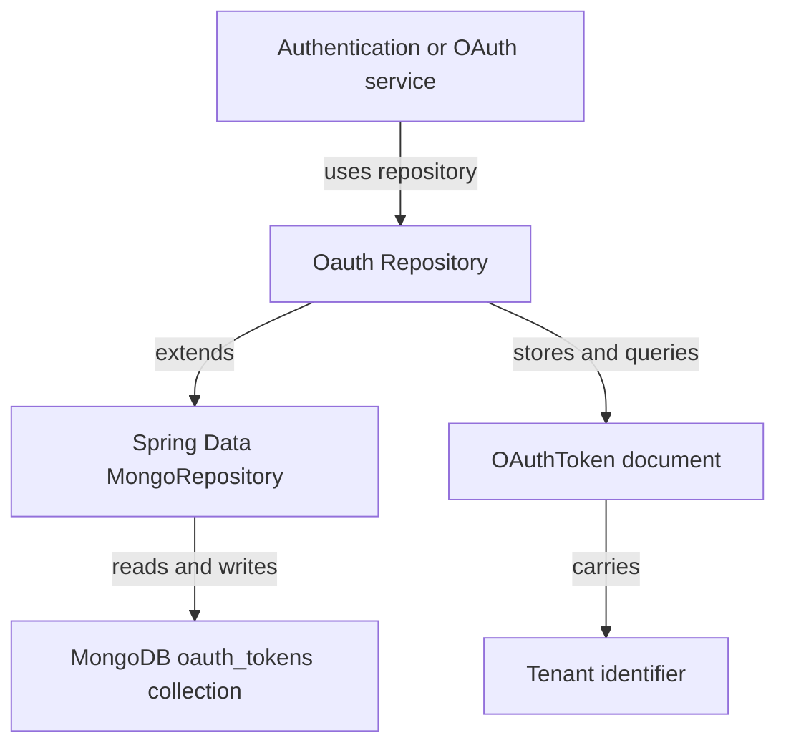
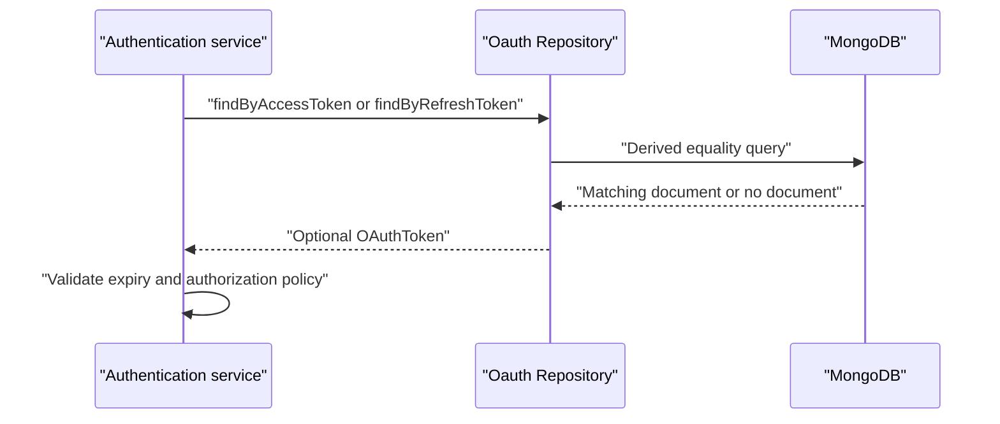

# Oauth Repository

Oauth Repository is the synchronous MongoDB persistence boundary for OAuth token records. It is supplied at runtime by the OpenFrame OSS Library artifact `com.openframe.oss:openframe-data-mongo-sync` version `7.0.11`, which this service consumes. The module declares a Spring Data repository over the tenant-scoped `OAuthToken` document and adds direct lookups for both access and refresh token values.

The implementation is an interface rather than a custom data-access class: Spring Data MongoDB supplies the `MongoRepository` implementation and derives queries from the two finder method names. The repository source is maintained in the [OpenFrame OSS Library](https://github.com/flamingo-stack/openframe-oss-lib/blob/16e7c1cbd9664e7d10ec5ebca7d53c9bd314decf/openframe-data-mongo-sync/src/main/java/com/openframe/data/repository/oauth/OAuthTokenRepository.java).

## Responsibilities

- Persist, retrieve, update, and delete `OAuthToken` documents through inherited `MongoRepository<OAuthToken, String>` operations.
- Resolve at most one stored record from an access token with `findByAccessToken`.
- Resolve at most one stored record from a refresh token with `findByRefreshToken`.
- Return `Optional` for both token lookups, making an absent or unrecognised token an explicit normal outcome instead of requiring a null check.
- Participate in the synchronous Mongo configuration and tenant-isolation infrastructure provided by the same library.

Oauth Repository does not issue tokens, validate a token's signature, enforce expiry, or expose an HTTP endpoint. Those concerns belong to callers and the authentication services that compose this persistence layer.

## Architecture and Placement

The module is part of the Mongo synchronous data layer. It operates on an `OAuthToken` document from the OpenFrame OSS Library's `openframe-data-mongo-common` artifact and relies on Spring Data MongoDB to implement its interface at application startup.

The repository's code declares `@Repository`, allowing Spring to discover it and translate supported persistence exceptions. Its generic identifier is `String`, corresponding to the document's Mongo identifier.

## Data Model

The document is mapped to the `oauth_tokens` MongoDB collection. Its fields support identifying a token set, associating it with a tenant and user, and determining whether each token has expired.

| Field | Role |
|---|---|
| `id` | Mongo document identifier used by inherited CRUD methods. |
| `tenantId` | Tenant scope. It is indexed on the document and the document implements the tenant-scoping contract. |
| `userId` | Identifies the associated user. |
| `accessToken` | Value accepted by `findByAccessToken`. |
| `refreshToken` | Value accepted by `findByRefreshToken`. |
| `accessTokenExpiry` | Expiry instant for the access token. |
| `refreshTokenExpiry` | Expiry instant for the refresh token. |
| `clientId` | OAuth client associated with the token set. |
| `scopes` | Granted OAuth scopes. |

Only `tenantId` is visibly annotated as indexed in the document definition supplied to this module. The repository declares equality lookups for the access and refresh token fields, but no index for those fields is shown in the provided document code. If token lookup is a latency-critical path, maintainers should verify MongoDB index configuration before adding assumptions about lookup performance.

## Repository Contract

| Operation | Return type | Behaviour |
|---|---|---|
| Inherited CRUD operations | Varies by `MongoRepository` method | Operate on `OAuthToken` documents using their string identifier. |
| `findByAccessToken(String accessToken)` | `Optional<OAuthToken>` | Derives an equality query for the `accessToken` property. |
| `findByRefreshToken(String refreshToken)` | `Optional<OAuthToken>` | Derives an equality query for the `refreshToken` property. |

The `Optional` result represents only whether a matching document was found. A caller must separately apply expiry checks using `accessTokenExpiry` or `refreshTokenExpiry`, as appropriate, and apply any tenant, client, user, or scope policy required by its authentication flow.

## Token Lookup Flow

A refresh-token flow uses the same pattern as an access-token flow; only the queried property and the relevant expiry field differ. Persistence does not itself mutate, rotate, or revoke a token. A caller performing those actions uses inherited save or delete operations after it has applied its domain rules.

## Tenant and Security Considerations

- Treat access and refresh tokens as secrets. Do not log raw values, include them in error messages, or expose persisted documents through diagnostics.
- Scope repository use to the tenant context established by the application. The record includes `tenantId`, and the broader synchronous Mongo module includes tenant-aware configuration, but callers remain responsible for preserving tenant boundaries in their workflows.
- Never equate a successful repository lookup with authorization. Validate expiration and any relevant client, user, scope, or revocation requirements before accepting a token.
- A derived finder returns one optional record. Data integrity controls should prevent duplicate token values where uniqueness is required by the OAuth design.

## Operational Notes

The repository is available only when Spring creates the Mongo synchronous persistence context and can connect to MongoDB. Failures from MongoDB occur during repository operations and should be handled by the calling service according to its authentication failure policy; Oauth Repository contains no retry, cache, or fallback behavior of its own.

The organization-wide code graph, indexed from the default branches, records no direct callers or tests for this interface at the documented snapshot. This is not evidence that the repository is unused at runtime: Spring Data repositories can be injected and invoked through framework-managed wiring that is not represented as a direct static call edge. Any change to finder signatures, token fields, or collection mapping should therefore be evaluated as a persistence-contract change.

## Source and Dependencies

- Repository interface: [OAuthTokenRepository.java](https://github.com/flamingo-stack/openframe-oss-lib/blob/16e7c1cbd9664e7d10ec5ebca7d53c9bd314decf/openframe-data-mongo-sync/src/main/java/com/openframe/data/repository/oauth/OAuthTokenRepository.java)
- Token document: supplied by the OpenFrame OSS Library artifact `com.openframe.oss:openframe-data-mongo-common` version `7.0.11`.
- Repository runtime: Spring Data MongoDB through `MongoRepository`.
- Persistence store: the `oauth_tokens` MongoDB collection.
