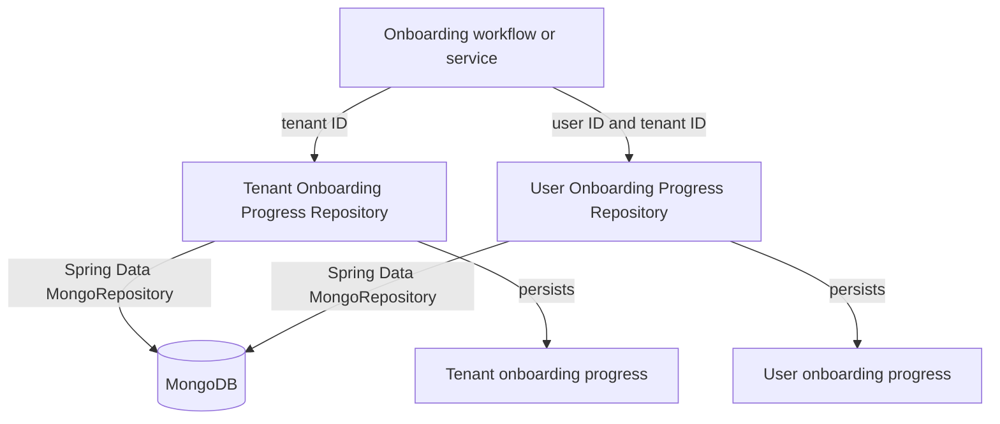
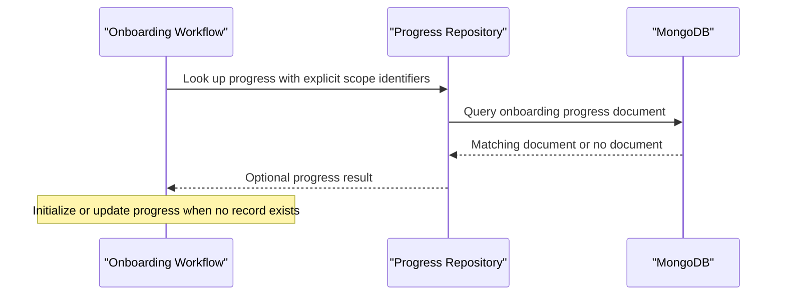

# Onboarding Repositories

## Purpose

Onboarding Repositories provide the MongoDB persistence boundary for onboarding progress in the OpenFrame tenant runtime. They are supplied by the `com.openframe.oss:openframe-data-mongo-sync` library at version `7.0.11`, which this repository consumes. The two repositories keep progress at distinct scopes:

- **Tenant onboarding progress** is one record per tenant and is looked up with an explicit tenant identifier.
- **User onboarding progress** is one record per user and tenant pair and is looked up with both identifiers.

Both interfaces extend Spring Data `MongoRepository`, so callers receive the standard document CRUD operations in addition to the onboarding-specific lookup method. They are deliberately ordinary Spring `@Repository` beans rather than tenant-aware repositories: the SaaS-side runtime disables tenant isolation and bypasses the tenant aspect. A caller must therefore always supply the tenant identifier when it reads progress.

## Architecture

The repositories sit in the synchronous Mongo data layer. They do not implement workflow decisions, tenant-context resolution, or authorization. Their responsibility is to retrieve and persist the relevant progress document; services above this layer select the onboarding step and provide scope identifiers.

## Repository Responsibilities

### Tenant Onboarding Progress Repository

[`TenantOnboardingProgressRepository`](https://github.com/flamingo-stack/openframe-oss-lib/blob/16e7c1cbd9664e7d10ec5ebca7d53c9bd314decf/openframe-data-mongo-sync/src/main/java/com/openframe/data/repository/onboarding/TenantOnboardingProgressRepository.java) manages `TenantOnboardingProgress` documents, with one document expected for each tenant.

Its domain-specific operation is `findByTenantId(String tenantId)`, which returns an `Optional`. The optional result makes an absent progress document an expected state that callers must handle, for example when onboarding has not yet been initialized. The explicit key is also important because no tenant-aware repository aspect contributes an implicit tenant constraint in this runtime.

The related tenant step vocabulary is defined by `TenantOnboardingStep` in the shared Mongo document library. The available stages are `MSP_SETUP`, `CUSTOMERS_SETUP`, `DEVICE_MANAGEMENT`, and `MEET_MINGO`.

### User Onboarding Progress Repository

[`UserOnboardingProgressRepository`](https://github.com/flamingo-stack/openframe-oss-lib/blob/16e7c1cbd9664e7d10ec5ebca7d53c9bd314decf/openframe-data-mongo-sync/src/main/java/com/openframe/data/repository/onboarding/UserOnboardingProgressRepository.java) manages `UserOnboardingProgress` documents, scoped to a user within a tenant.

Its domain-specific operation is `findByUserIdAndTenantId(String userId, String tenantId)`, which returns an `Optional`. Both values form the lookup scope, preventing a user identifier from being used without its tenant context. As with tenant progress, callers must explicitly provide the tenant identifier and define behavior for a missing record.

The shared `UserOnboardingStep` vocabulary covers `MEET_MINGO`, `DEVICES`, `TICKETS`, `SCRIPTING`, `MONITORING`, `LOGGING`, `INCIDENTS`, and `KNOWLEDGE_MANAGEMENT`.

## Progress Lookup Flow

## Operational Considerations

- **Always scope reads explicitly.** Use the tenant identifier for tenant progress and both the user and tenant identifiers for user progress.
- **Treat absence intentionally.** The lookup APIs return `Optional`, so callers should distinguish first-time onboarding from an existing progress record rather than assuming a document exists.
- **Keep scope boundaries separate.** Tenant progress represents organization-wide onboarding, while user progress represents an individual user's experience inside that tenant.
- **Use inherited persistence operations carefully.** `MongoRepository` supplies save, delete, and identifier-based retrieval; onboarding-specific code should preserve the intended one-per-tenant and one-per-user-and-tenant semantics when creating or updating documents.

## System Context

This module belongs to the `openframe-data-mongo-sync` library assembled into the OpenFrame OSS Tenant service. Its data documents and onboarding step enums come from the related shared Mongo document layer. The running tenant platform configures MongoDB as a shared datasource; the repository interfaces provide the synchronous Spring Data entry point for onboarding progress persistence.
