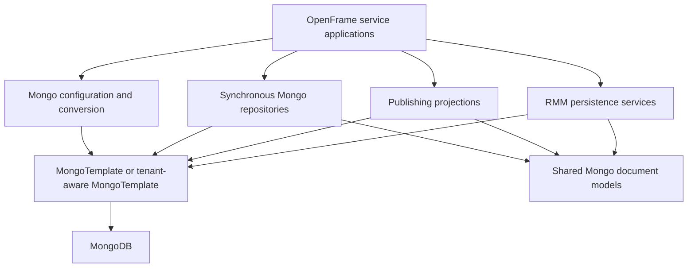
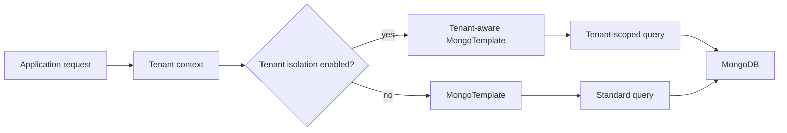
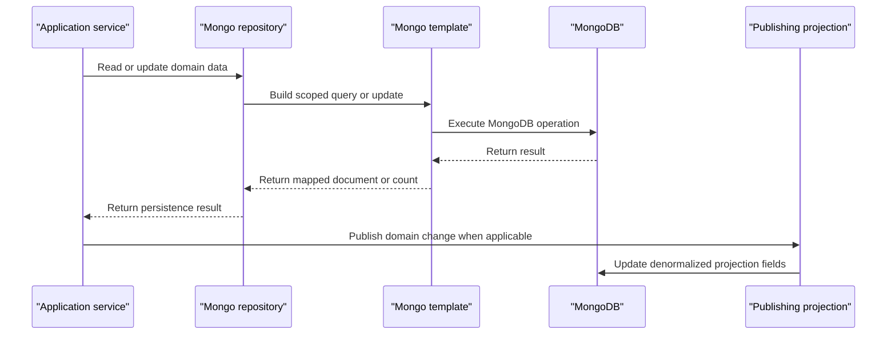

# Openframe Data Mongo Sync

**Openframe Data Mongo Sync** is the synchronous MongoDB persistence module used by OpenFrame services. It is supplied as the Maven artifact `com.openframe.oss:openframe-data-mongo-sync` at version `7.0.11` and provides MongoDB configuration, tenant-aware access, synchronous repositories, aggregation queries, projection support, retry observability, and RMM-oriented persistence services.

The module is assembled by OpenFrame OSS Tenant services rather than exposed as a standalone HTTP service.

## Purpose

Openframe Data Mongo Sync centralizes MongoDB persistence behavior for OpenFrame domains, including:

- Mongo conversion, mapping, auditing, index lifecycle, and retry configuration.
- Tenant-isolated synchronous repository access where tenant isolation is enabled.
- Repository implementations for machines, tickets, organizations, users, notifications, onboarding, OAuth, delivery, scripts, schedules, software, and time tracking.
- Publishing projections that maintain denormalized fields across related MongoDB documents.
- Aggregations and cursor-based query support for high-volume management and RMM data.

## Architecture

### Tenant-aware repository selection

When tenant isolation is enabled, the module registers tenant-aware repository support and routes Mongo operations through a tenant-aware template. Standard synchronous repository configuration is used when tenant isolation is disabled.

## Core Component Groups

| Area | Core components | Responsibility |
|---|---|---|
| Mongo infrastructure | `MongoInfraConfig`, `MongoSyncConfig`, `TenantAwareSyncConfig`, `TenantIsolationAutoConfiguration` | Activates synchronous Mongo repositories and selects standard or tenant-aware persistence behavior. |
| Conversion and mapping | `MongoCustomConversionsConfig`, `MongoConversionsContributor`, `LocalDateUtcMongoConverters` | Defines shared custom conversions, including UTC `LocalDate` conversion and MongoDB mapping rules. |
| Index and retry support | `MongoIndexConfig`, `RetryConfiguration`, `OptimisticLockingRetryListener` | Maintains Mongo indexes and provides retry lifecycle observability for optimistic-locking and transient data failures. |
| Device and machine persistence | `CustomMachineRepository`, `CustomMachineRepositoryImpl`, `AgentVersionService` | Supports device filtering, pagination, maintenance updates, machine selection, and reported agent-version lookup. |
| Ticket persistence | `CustomTicketRepository`, `CustomTicketRepositoryImpl` | Provides tenant-aware ticket filtering, search, cursor pagination, aggregate counts, and targeted updates. |
| Organization and user persistence | `CustomOrganizationRepository`, `CustomUserRepository`, `CustomInvitationRepository` | Provides query, search, sort, count, and cursor support for organizations, users, and invitations. |
| Delivery persistence | `MachineDeliveryRepository`, `MachineDeliveryPayloadRepository`, `MachineDeliveryRolloutRepository` | Persists machine-directed work, payloads, rollout state, and delivery sequencing. |
| Notification persistence | `CustomNotificationRepositoryImpl`, `CustomNotificationReadStateRepositoryImpl`, `CustomNotificationSettingsRepositoryImpl` | Stores notification state, recipient status, paging data, and user notification settings. |
| RMM persistence | Script, schedule, software, policy, and execution repositories | Provides inventory queries, execution history, package policy persistence, and software aggregation. |
| Publishing projections | Machine, organization, ticket, and user projection components | Synchronize denormalized values across related MongoDB documents. |

## Repository and Projection Flow

## Core Components Documentation

The module contains the following documented component areas:

- **Mongo Config And Conversion** — Mongo infrastructure, conversion registration, tenant-aware configuration, and index lifecycle.
- **Agent And Auth Repositories** — Agent log-key access and targeted authentication-user updates.
- **Assignment Repositories** — Tenant-scoped item assignment queries, counts, reverse lookup, and cursor pagination.
- **Connector Repositories** — Connector alert persistence and recreation-event retention.
- **Delivery Repositories** — Machine delivery lifecycle, payload storage, rollout progress, and sequence allocation.
- **Machine Repositories** — Managed-machine queries, facets, keyset pagination, and maintenance operations.
- **Machine Event And Projection Repositories** — Device-name and client-ownership synchronization to tickets.
- **Email Repositories** — Stored blocked-address and blocked-domain policy adapters.
- **Notification Repositories** — Notification page queries, recipient read state, and settings persistence.
- **Organization Repositories** — Organization filtering, search, sorting, counts, and cursor-based traversal.
- **Ticket Repositories** — Ticket filtering, ownership scope, aggregates, cursor pagination, and publishing-aware updates.
- **Timetracking Repositories** — Time-entry list queries, date-based cursors, reporting aggregates, and ticket totals.
- **User Invitation Repositories** — Tenant-scoped user and pending-invitation discovery.
- **Script And Schedule Repositories** — Script definitions, schedules, execution history, schedule runs, and facets.
- **Software And Aggregation Repositories** — Software inventory, CVE rollups, and software-action reporting.
- **Rmm Service Core** — Schedule targeting, package-manager handlers, software projection, vulnerability projection, and package matching.
- **Retry Support** — Retry observability for optimistic-locking and transient persistence failures.

## Related Modules

Openframe Data Mongo Sync works with these adjacent OpenFrame data modules:

| Module | Relationship |
|---|---|
| Openframe Data Mongo Common | Supplies shared MongoDB documents, repository contracts, enums, and tenant model types. |
| Openframe Data Mongo Reactive | Provides reactive MongoDB repositories for selected flows. |
| Openframe Data Device Aspect | Provides device-related persistence aspects and event behavior. |
| Openframe Data Redis | Provides Redis cache and key configuration separate from MongoDB persistence. |
| Openframe Stream Service Core | Processes stream events that can update Mongo-backed read models and RMM projections. |

## Operational Notes

- Mongo infrastructure activates only when MongoDB is enabled in the service configuration.
- Tenant-aware repositories require an active tenant context when tenant isolation is enabled.
- Custom conversions should be contributed through `MongoConversionsContributor` rather than by declaring competing conversion registries.
- Aggregation pipelines must preserve tenant criteria because they do not automatically inherit every template-level scope.
- Cursor values should be treated as opaque continuation state and reused only with the same filter and sort semantics.
- Publishing projections maintain denormalized copies but do not replace source-domain records as the authoritative data source.