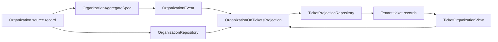
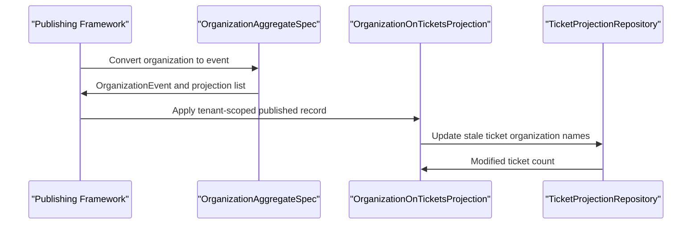
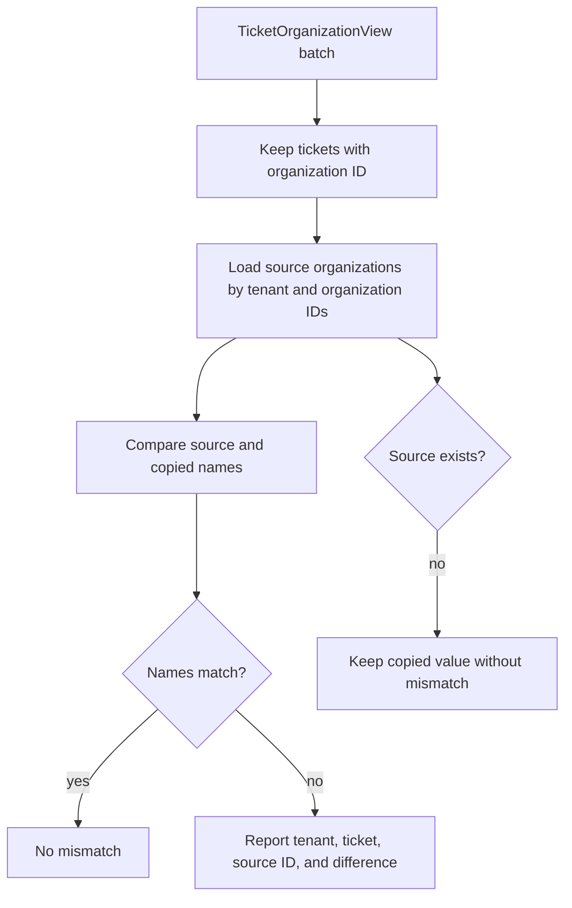

# Organization Publishing Repositories

## Purpose

Organization Publishing Repositories is the organization-to-ticket denormalization adapter supplied by the OpenFrame OSS Library. The OpenFrame OSS Tenant service consumes the `com.openframe.oss:openframe-data-mongo-sync` artifact at version `7.0.11`; this module turns an organization record into a tenant-scoped publishing event and keeps the copied organization name on related tickets current.

The module owns the publishing contract for aggregate type `organizations` and one projection, `organization-on-tickets`. It is deliberately narrow: organization records remain the source of truth, while tickets retain a query-friendly snapshot of the organization name.

## Architecture Overview

`OrganizationAggregateSpec` connects the source aggregate, its published representation, and its projection. The projection uses tenant ID and organization ID together when it reads source organizations or updates tickets, preventing one tenant's organization data from being applied to another tenant's ticket set.

## Components

| Component | Responsibility |
| --- | --- |
| [`OrganizationAggregateSpec`](https://github.com/flamingo-stack/openframe-oss-lib/blob/16e7c1cbd9664e7d10ec5ebca7d53c9bd314decf/openframe-data-mongo-sync/src/main/java/com/openframe/data/repository/organization/publishing/OrganizationAggregateSpec.java) | Declares the `organizations` aggregate type, converts `Organization` documents to events, and registers the ticket projection. |
| [`OrganizationEvent`](https://github.com/flamingo-stack/openframe-oss-lib/blob/16e7c1cbd9664e7d10ec5ebca7d53c9bd314decf/openframe-data-mongo-sync/src/main/java/com/openframe/data/repository/organization/publishing/OrganizationEvent.java) | Defines the public event payload: organization ID, name, default flag, and status. |
| [`OrganizationOnTicketsProjection`](https://github.com/flamingo-stack/openframe-oss-lib/blob/16e7c1cbd9664e7d10ec5ebca7d53c9bd314decf/openframe-data-mongo-sync/src/main/java/com/openframe/data/repository/organization/publishing/OrganizationOnTicketsProjection.java) | Updates stale ticket name snapshots, supports bounded batch processing, and reconciles ticket snapshots against current source organizations. |
| [`TicketOrganizationView`](https://github.com/flamingo-stack/openframe-oss-lib/blob/16e7c1cbd9664e7d10ec5ebca7d53c9bd314decf/openframe-data-mongo-sync/src/main/java/com/openframe/data/repository/organization/publishing/TicketOrganizationView.java) | Minimal ticket read model used during reconciliation: ticket ID, tenant ID, organization ID, and copied organization name. |

## Event Contract

`OrganizationAggregateSpec.toEvent` maps a source organization into `OrganizationEvent`.

| Event field | Source | Notes |
| --- | --- | --- |
| `organizationId` | Organization identifier | Identifies the organization within a tenant. |
| `name` | Organization name | The projection copies this value to matching tickets. |
| `isDefault` | Default-organization flag | Normalized to `false` when the source value is absent or false. The boxed field preserves the JSON property name `isDefault`. |
| `status` | Organization status | Carries source lifecycle state for event consumers. |

The event is a transport representation, not the organization document. In particular, projection application only needs the organization ID and name; the other fields remain available to other consumers of the published record.

## Projection Flow

When the framework applies a record, `OrganizationOnTicketsProjection` extracts the tenant ID, organization ID, and name. It then calls `updateOrganizationName`, which updates only tickets that match the tenant and organization IDs and whose stored name differs from the event name. The idempotent difference check avoids rewriting tickets that already contain the current snapshot.

### Large Projection Handling

The projection also supports controlled work sizing:

1. `countChanges` asks how many matching tickets still need synchronization, subject to a caller-supplied limit.
2. `applyBatch` reads a page of ticket IDs ordered by ID after an optional cursor.
3. It updates the selected stale records and returns the last processed ID.
4. A `null` cursor result indicates that no matching tickets remain.

The supporting ticket repository performs the count and ID-page reads from the MongoDB primary. This avoids making batching decisions from a lagging secondary read.

## Reconciliation

Reconciliation detects ticket snapshots that no longer match their source organization name.

The module loads source organizations for the reconciliation batch in one repository query and indexes them by `TenantScopedId`. It reports a mismatch only when the source organization exists and the source name differs from `TicketOrganizationView.organizationName`. A ticket whose source organization has been deleted is intentionally not reported: its copied value is retained rather than treated as a projection failure.

## Operational and Maintenance Notes

- Preserve the aggregate type string `organizations` and projection name `organization-on-tickets` when evolving this module, because they identify the publishing registration and projection behavior.
- Keep all organization-to-ticket lookups tenant-scoped. Reconciliation explicitly uses the compound tenant and organization identity, even when organization identifiers repeat across tenants.
- Do not rename the event's `isDefault` property without assessing event consumers. It is boxed specifically to preserve that serialized property name.
- Projection updates change only `organizationName`; ticket ownership, status, and other ticket fields are outside this module's scope.
- When adding event fields, distinguish between fields required for this projection and fields intended for other consumers. The current projection depends only on the event organization ID and name.

## System Context

This module is part of the Mongo synchronous data layer delivered by the OpenFrame OSS Library and assembled into OpenFrame OSS Tenant services through the `openframe-data-mongo-sync` dependency. It complements organization persistence and ticket persistence by maintaining a denormalized ticket view. The OpenFrame API and client services can therefore query ticket-facing organization names without this projection becoming the source of organization truth.
