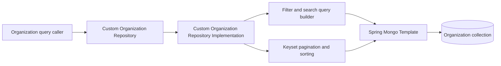
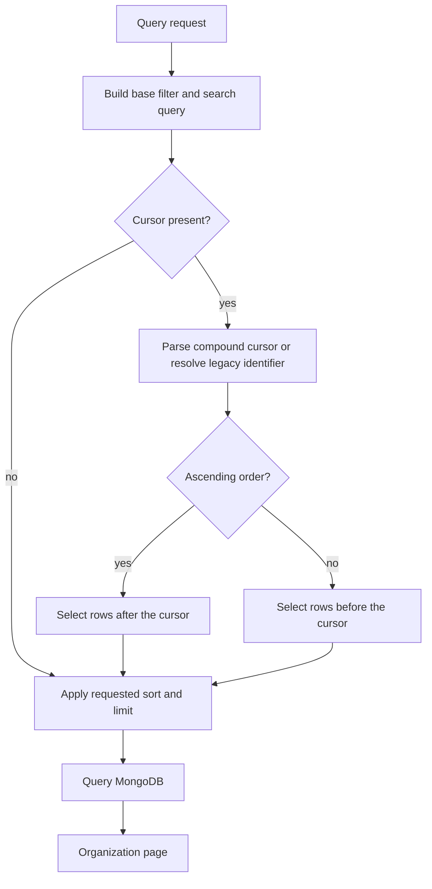

# Organization Repositories

## Purpose

Organization Repositories is the MongoDB query extension used to retrieve organization records with server-side filtering, text search, deterministic sorting, keyset pagination, and totals. It is implemented by the `com.openframe.oss:openframe-data-mongo-sync` library, version `7.0.11`, which this repository consumes through its service modules.

The module consists of a repository contract and its Spring Data MongoDB implementation:

- [`CustomOrganizationRepository`](https://github.com/flamingo-stack/openframe-oss-lib/blob/16e7c1cbd9664e7d10ec5ebca7d53c9bd314decf/openframe-data-mongo-sync/src/main/java/com/openframe/data/repository/organization/CustomOrganizationRepository.java) defines the custom query operations.
- [`CustomOrganizationRepositoryImpl`](https://github.com/flamingo-stack/openframe-oss-lib/blob/16e7c1cbd9664e7d10ec5ebca7d53c9bd314decf/openframe-data-mongo-sync/src/main/java/com/openframe/data/repository/organization/CustomOrganizationRepositoryImpl.java) turns those operations into `MongoTemplate` queries against `Organization` documents.

The repository deliberately performs filtering and pagination in MongoDB rather than loading all organizations into application memory.

## Architecture

### Component responsibilities

| Component | Responsibility |
| --- | --- |
| `CustomOrganizationRepository` | Declares base-query construction, unpaged filtered lookup, cursor-paged lookup, matching-document count, sort-field validation, and the default sort field. |
| `CustomOrganizationRepositoryImpl` | Applies the organization filter and search conditions, executes MongoDB queries, applies stable ordering, and translates cursor state into keyset criteria. |
| `OrganizationQueryFilter` | Supplies optional status, category, employee-count, contract, activity-window, and excluded-organization criteria. |
| `Organization` | The MongoDB document type returned by repository reads. |

## Query Semantics

### Base filtering

`buildOrganizationQuery` creates the reusable base query for both reads and counts. Criteria are collected and combined with a single logical AND, avoiding conflicting top-level criteria construction.

The supported filters are:

- **Status:** If a status is specified, the query matches it exactly. Without an explicit status, it returns organizations whose status is `ACTIVE` or absent, preserving compatibility with records that predate the status field.
- **Category:** Uses a case-insensitive exact match.
- **Employee range:** Applies inclusive lower and upper bounds to `numberOfEmployees` independently.
- **Contract activity:** An active contract has non-null start and end dates, starts on or before the current date, and ends on or after it. The inactive branch accepts absent dates, a future start date, or an expired end date.
- **Last activity:** Applies inclusive bounds to `updatedAt`, the persisted value that backs last-activity filtering.
- **Exclusions:** Omits organization identifiers supplied by `excludeOrganizationIds`.
- **Search:** A nonblank search term matches `name`, `organizationId`, or `category` case-insensitively. The input is regex-quoted before use, so it is treated as text rather than a regular-expression pattern.

`findOrganizationsWithFilters` executes this base query without pagination. `countOrganizations` counts the same base query before cursor and limit criteria are applied, ensuring the total represents every matching document.

## Cursor Pagination and Ordering

`findOrganizationsWithCursor` implements keyset pagination rather than offset pagination. It accepts the base query, an optional cursor, a page size, a sort field, and a direction. The permitted sort fields are `_id`, `name`, `organizationId`, `createdAt`, and `updatedAt`; the default is `_id`.

For a non-identifier sort field, the implementation adds `_id` as a secondary sort key. The cursor therefore represents both the primary sort value and the document identifier. The next-page criterion is:

- a primary sort value beyond the cursor in the requested direction, or
- the same primary sort value with an identifier beyond the cursor in that direction.

This tie-breaker prevents repeated or skipped rows where multiple organizations have the same primary sort value. A legacy cursor that contains only an identifier remains supported for a value-based sort: the repository loads the anchor organization, derives the compound cursor, and then applies the normal keyset criteria. An unresolvable cursor is rejected as invalid.

## Integration Boundaries

The module is part of the synchronous Mongo data layer. Its implementation depends on Spring Data's `MongoTemplate`, `Query`, `Criteria`, and `Sort` APIs, plus the organization document and filter model supplied by the shared data libraries. Application-facing organization controllers and GraphQL data fetchers should use higher-level services or repositories that compose this custom repository; this module owns persistence query mechanics rather than HTTP or GraphQL transport.

When extending organization discovery, preserve these boundaries:

1. Add filter logic to the base query so list retrieval and count retrieval remain consistent.
2. Validate any new sort field through `isSortableField` before passing it to MongoDB.
3. Maintain `_id` as the deterministic tie-breaker for non-identifier sorts.
4. Apply pagination only after the base filter is built, because the count must remain pagination-free.
5. Treat cursor values as opaque API state and retain backward compatibility when changing cursor encoding.

## Operational Characteristics

- Filtering, sorting, limiting, and counting execute in MongoDB.
- Status defaults to active organizations, including legacy documents with no status field.
- Search and category matching are case-insensitive; category is exact while search is a substring-style regular-expression match across three fields.
- Contract activity is evaluated using the application's current local date.
- Debug logging records the generated MongoDB query for both filtered and cursor-paged lookups.
