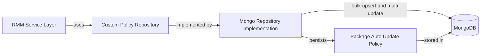
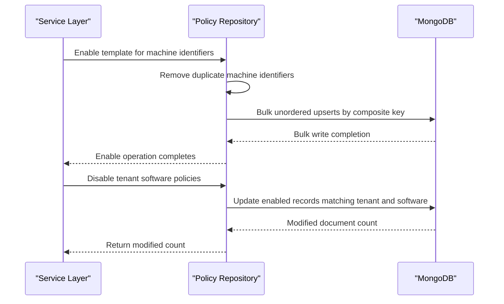

# Package Auto Update Policy Repositories

## Purpose

Package Auto Update Policy Repositories provide the MongoDB write operations that materialize package auto-update policy templates into machine-specific policy records and deactivate those records when their associated software is disabled or removed. The module is implemented by the `com.openframe.oss:openframe-data-mongo-sync` library, pinned by this service at version `7.0.11`.

The module contains the repository contract and its Spring Data MongoDB implementation. It does not evaluate policies, schedule updates, or install packages on devices; it persists state used by those layers.

## Architecture Overview



A service layer invokes the `CustomPackageAutoUpdatePolicyRepository` contract. Spring wires `CustomPackageAutoUpdatePolicyRepositoryImpl` as the repository bean. The implementation uses `MongoTemplate` because each operation efficiently updates a collection of policy documents.

## Components

### Repository Contract

[`CustomPackageAutoUpdatePolicyRepository`](https://github.com/flamingo-stack/openframe-oss-lib/blob/16e7c1cbd9664e7d10ec5ebca7d53c9bd314decf/openframe-data-mongo-sync/src/main/java/com/openframe/data/repository/rmm/CustomPackageAutoUpdatePolicyRepository.java) exposes two domain-oriented write operations:

- `enable(template, machineIds)` creates or refreshes enabled policy records for a collection of machines from a policy template.
- `disableBySoftwareId(tenantId, softwareId, actor)` deactivates enabled policies tied to one software record within a tenant and returns the number of changed documents.

The contract accepts a template plus machine identifiers, so callers do not need to construct one policy object per target machine.

### Mongo Repository Implementation

[`CustomPackageAutoUpdatePolicyRepositoryImpl`](https://github.com/flamingo-stack/openframe-oss-lib/blob/16e7c1cbd9664e7d10ec5ebca7d53c9bd314decf/openframe-data-mongo-sync/src/main/java/com/openframe/data/repository/rmm/CustomPackageAutoUpdatePolicyRepositoryImpl.java) is the Spring `@Repository` implementation. It:

- returns immediately when the machine collection is empty;
- de-duplicates machine identifiers before writing;
- uses unordered MongoDB bulk upserts for enabling;
- identifies a policy by tenant, machine, package manager, and package name;
- preserves creation metadata on existing records while refreshing mutable fields and update audit fields; and
- disables all enabled policies matching a tenant and software identifier in one multi-document update.

## Persistence Semantics

### Enabling Policies

For every distinct machine identifier, the implementation upserts a document using this composite identity:

```text
tenantId + machineId + packageManager + packageName
```

The upsert sets `enabled` to `true`, copies the template's Brew package type, settings, last-known version, and updater identity, and assigns a current `updatedAt` value. On insertion only, it also creates `createdBy` and `createdAt` values.

When the template supplies a software identifier, the upsert updates that association. When it does not, the implementation deliberately leaves an existing software association unchanged. This preserves a software link established by an earlier package-search-driven operation.

### Disabling Policies

Disabling selects documents that match the requested tenant identifier, software identifier, and `enabled` value of `true`. It writes `enabled: false`, the supplied actor as `updatedBy`, and a current `updatedAt` timestamp. Records already disabled are not modified, so the returned count represents active policies transitioned by the request.

## Data Flow



## Operational Considerations

- **Tenant isolation:** The enable key and disable query both include the tenant identifier. Callers must populate the template and arguments with the intended tenant.
- **Idempotent enables:** Repeating an enable request for the same composite key refreshes the existing policy instead of creating another one.
- **Batch behavior:** The enable operation uses unordered bulk writes. Independent upserts may not be processed in input order, and the repository does not expose per-machine results.
- **Audit fields:** Creation metadata is insertion-only; update metadata is refreshed on every successful enable or disable operation.
- **Deactivation scope:** Disabling is software-based, not package-name-based. It affects every enabled policy linked to the selected software record in the selected tenant.

## System Context

This module is supplied by the OpenFrame OSS Library, not defined directly in the tenant repository. The tenant deployment consumes `com.openframe.oss:openframe-data-mongo-sync` version `7.0.11`, where this repository runs as part of the Mongo-backed data layer. Higher-level RMM software and package-update processing decide when policies should be enabled or disabled; Package Auto Update Policy Repositories provide the persistence boundary for those decisions.

The policy document type belongs to the related `com.openframe.oss:openframe-data-mongo-common` library. The repository uses its tenant, package manager, package name, package-specific settings, audit identity, version, and optional software association fields.