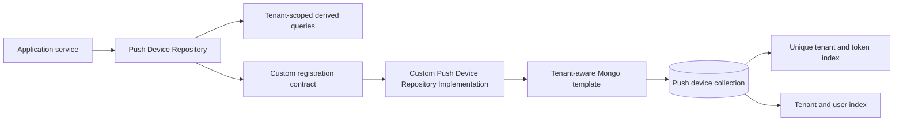
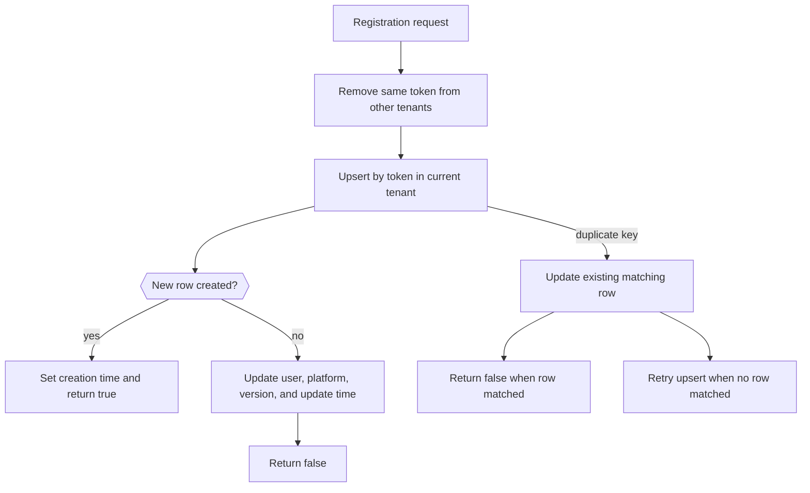

# Push Device Repositories

## Purpose

Push Device Repositories provide tenant-isolated MongoDB persistence for mobile push-notification registrations. The module records which push token is currently associated with a user, its platform, and the app version that most recently registered it. It deliberately exposes a narrow repository surface so that unsafe, unscoped bulk operations are not available to application code.

The implementation is supplied by the `com.openframe.oss:openframe-data-mongo-sync` library at version `7.0.11`, which this repository consumes. The two primary components are [PushDeviceRepository](https://github.com/flamingo-stack/openframe-oss-lib/blob/16e7c1cbd9664e7d10ec5ebca7d53c9bd314decf/openframe-data-mongo-sync/src/main/java/com/openframe/data/repository/push/PushDeviceRepository.java) and [CustomPushDeviceRepositoryImpl](https://github.com/flamingo-stack/openframe-oss-lib/blob/16e7c1cbd9664e7d10ec5ebca7d53c9bd314decf/openframe-data-mongo-sync/src/main/java/com/openframe/data/repository/push/impl/CustomPushDeviceRepositoryImpl.java).

## Architecture

The stored `PushDevice` document is tenant-scoped and contains an identifier, tenant identifier, user identifier, token, push platform, app version, creation time, and update time. Its database indexes enforce one token per tenant and make per-user registrations efficient. A token may therefore be registered by only one user within a tenant at a time.

## Components and Responsibilities

| Component | Responsibility |
| --- | --- |
| `PushDeviceRepository` | Defines safe derived lookup and deletion operations and composes the custom registration contract. |
| `CustomPushDeviceRepository` | Declares `registerToken`, the atomic insert-or-rebind operation that standard Spring Data method derivation cannot express. |
| `CustomPushDeviceRepositoryImpl` | Implements token movement, upsert-based registration, timestamp updates, and duplicate-key race recovery. |
| `TenantAwareMongoTemplate` | Applies the current tenant scope to ordinary repository operations and supports the controlled cross-tenant cleanup required when a token changes tenants. |

### Repository Interface

`PushDeviceRepository` extends Spring Data's minimal `Repository` marker rather than `MongoRepository`. This is a safety boundary: inherited methods such as `count()` and `deleteAll()` are not tenant-scoped and could otherwise observe or erase registrations belonging to every tenant.

The interface offers the following tenant-aware operations:

- `findByUserId(userId)` returns the current tenant's registrations for a user.
- `deleteByUserIdAndToken(userId, token)` deregisters at most one matching row. Requiring both values prevents a token that has been rebound to another user from being deleted by the prior user.
- `deleteByTokenIn(tokens)` removes registrations matching a supplied token collection within repository tenant scoping.
- `registerToken(userId, token, platform, appVersion)` inserts a registration or re-associates an existing token and returns `true` only when it created a new row.

## Registration Flow

The implementation first removes matching tokens held by other tenants. This is intentionally cross-tenant: the query explicitly includes a tenant identifier inequality so the token can move to the current tenant without leaving stale registrations elsewhere.

It then upserts the document by token in the current tenant. On every registration, it sets the user, platform, app version, and update timestamp. The creation timestamp is set only for an inserted document. App version is written verbatim, including `null`, so the stored metadata represents the client that registered most recently rather than retaining capabilities from an earlier version.

The unique `tenantId` and `token` index is authoritative, but concurrently issued upserts can still race during insertion. If an insert loses that race and raises `DuplicateKeyException`, the implementation updates the row that the winning request created. If that row is not yet matched, it makes one more upsert attempt. This converges the registration on one canonical document without using a read-modify-write `save` sequence.

## Tenant Isolation and Data Integrity

Tenant isolation is enabled for the custom implementation only when `openframe.tenant-isolation.enabled` is `true`. The repository is also annotated as tenant-aware, so normal reads and derived deletions are scoped to the active tenant.

The persistence rules are:

1. A registration token is unique within a tenant.
2. A re-registration can move a token to a different user in the same tenant.
3. A token observed under a new tenant is removed from prior tenants before the new tenant's registration is upserted.
4. Deregistration by user and token cannot remove a token once it has been re-associated with another user.
5. Bulk all-row repository methods are intentionally not inherited.

## Operational Considerations

- Treat `registerToken`'s boolean as a creation indicator, not as a general success value: both `true` and `false` can represent successful registration.
- Do not replace the upsert with entity `save` logic. The supplied implementation relies on the compound unique index and duplicate-key recovery to handle concurrency.
- Do not broaden the repository to inherit global delete operations unless tenant scoping is proven for each operation.
- Ensure deployments enable tenant isolation when registering push devices, because the custom implementation is conditional on that configuration.
- Cleanup and user-targeted deregistration have different intent: cross-tenant cleanup prevents stale ownership, while the user-and-token delete protects a token that has changed owners.

## System Position

This module belongs to the synchronous Mongo data layer. Higher-level services use it to maintain push-device state; the repository itself contains no HTTP, messaging, or notification-delivery behavior. Its job is to preserve a correct, tenant-safe mapping between users and device tokens so those higher layers can select valid notification targets.
