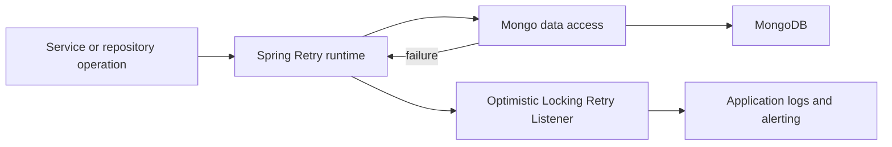
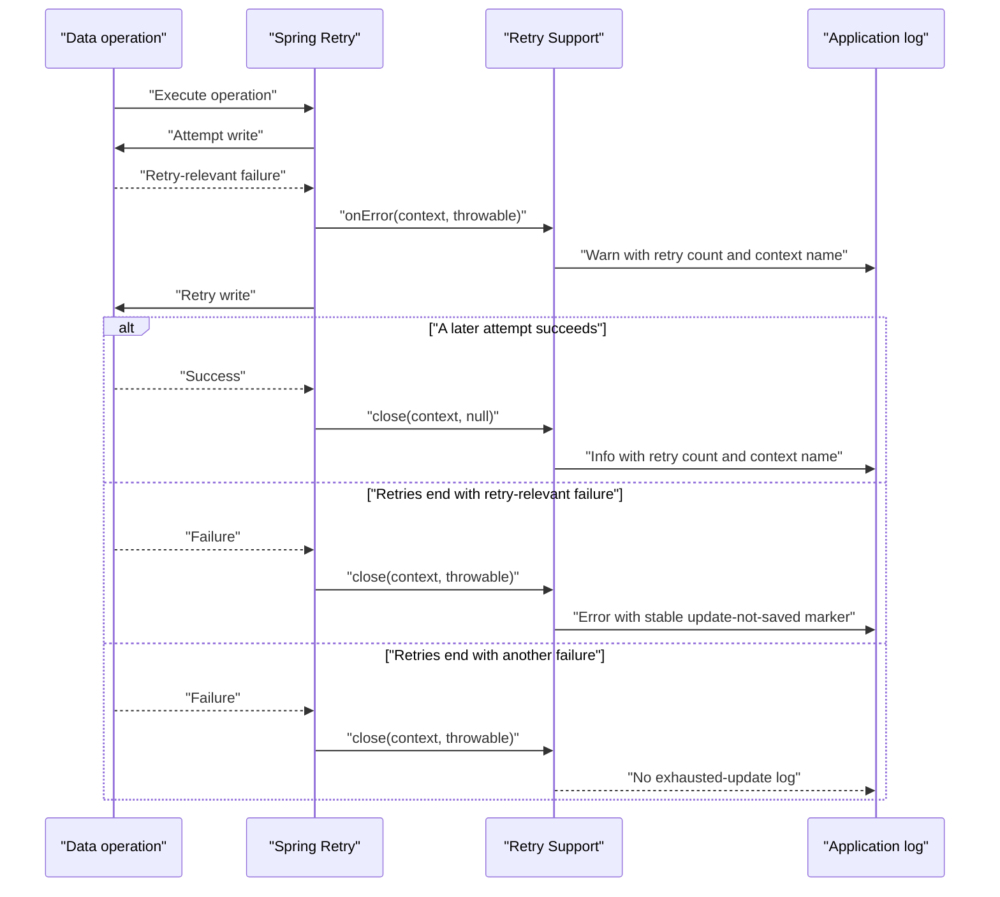
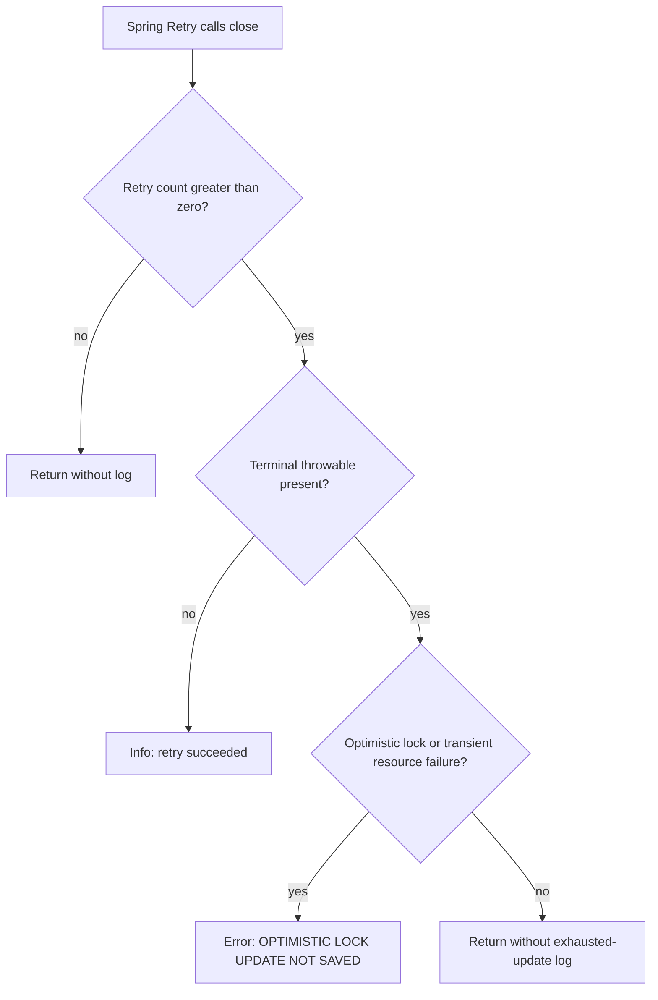

# Retry Support

Retry Support provides focused observability for Spring Retry operations that encounter database concurrency or transient data-access failures. It is implemented by `OptimisticLockingRetryListener` in the OpenFrame OSS Library's `openframe-data-mongo-sync` artifact, which this service consumes at version `7.0.11`.

Rather than deciding whether an operation should retry, Retry Support observes a retry lifecycle already configured by Spring. It records retry attempts, distinguishes a recovered operation from an exhausted optimistic-lock or transient-resource failure, and deliberately avoids reporting unrelated failures as lost background updates.

**Implementation source:** [OptimisticLockingRetryListener.java](https://github.com/flamingo-stack/openframe-oss-lib/blob/16e7c1cbd9664e7d10ec5ebca7d53c9bd314decf/openframe-data-mongo-sync/src/main/java/com/openframe/data/retry/OptimisticLockingRetryListener.java)

## Responsibilities

The Spring component is registered under the explicit bean name `optimisticLockingRetryListener`. Its responsibilities are limited to:

- Inspecting failures received by Spring Retry callbacks.
- Treating `OptimisticLockingFailureException` and `TransientDataAccessResourceException` as retry-relevant failures.
- Logging a warning for each failed retry attempt of either retry-relevant type.
- Logging an informational recovery message when a retried operation ultimately succeeds.
- Logging an error with the stable `OPTIMISTIC_LOCK_UPDATE_NOT_SAVED` marker only when a retry-relevant failure exhausts retries.

The listener does not choose retry counts, delays, backoff policy, transaction boundaries, or the persistence operation being retried. Those are responsibilities of the surrounding Spring Retry and data-access configuration.

## Position in the Data Layer

Retry Support is a narrow cross-cutting component within the synchronous Mongo data artifact. Repository or service operations execute under a Spring Retry policy; the retry runtime invokes the listener as attempts fail and when the execution closes.

The component is supplied by the OpenFrame OSS Library, not by a service-local class in this repository. The tenant services assemble this library with their Mongo synchronization data layer, so operational behavior is shared wherever that artifact and its retry configuration are active.

## Failure Classification

`isRetried` is the listener's classification boundary. A failure is relevant when it is an instance of either exception family below; subclasses also qualify through Java's `instanceof` semantics.

| Exception family | Listener treatment | Operational meaning of an exhausted log |
| --- | --- | --- |
| `OptimisticLockingFailureException` | Warn on each failed retry attempt; emit the stable error marker if retries end with this failure. | The attempted update was not saved after retry exhaustion. |
| `TransientDataAccessResourceException` | Warn on each failed retry attempt; emit the stable error marker if retries end with this failure. | The attempted update was not saved after retry exhaustion. |
| Any other throwable | The listener emits no retry-attempt warning and no exhausted-update error. | It is not represented as an optimistic-lock update loss by this listener. |

This filter is intentional: the `OPTIMISTIC_LOCK_UPDATE_NOT_SAVED` alert token has a precise meaning. It should signal an exhausted retry for the two data-access categories, not a general application failure.

## Retry Lifecycle and Logging

Spring Retry supplies a `RetryContext` to each callback. Retry Support reads the retry count and the `context.name` attribute from that context. The latter is rendered as the method or operation identifier in logs. If a retry configuration does not provide that attribute, the listener renders the value produced by `String.valueOf` rather than failing the retry callback.

### Callback behavior

| Callback | Condition | Effect |
| --- | --- | --- |
| `onError` | The throwable is retry-relevant. | Emits a warning containing the current retry count, operation name, and throwable text. |
| `onError` | The throwable is outside the two classified families. | Returns without logging. |
| `close` | Retry count is zero. | Returns without logging, including for a first-attempt success. |
| `close` | One or more retries occurred and `throwable` is absent. | Emits an informational message that the retry sequence succeeded. |
| `close` | One or more retries occurred and the terminal throwable is retry-relevant. | Emits an error beginning with `OPTIMISTIC_LOCK_UPDATE_NOT_SAVED`. |
| `close` | One or more retries occurred and the terminal throwable is unrelated. | Does not emit an exhausted-update error. |

## Exhaustion Decision Flow

The final log outcome is derived from both the retry count and the terminal throwable. This keeps successful recoveries visible while reserving the alert marker for confirmed, relevant exhaustion.

## Operational Guidance

### Monitoring

- Alert on the exact marker `OPTIMISTIC_LOCK_UPDATE_NOT_SAVED`. The constant is intentionally stable for log-based detection.
- Use the operation name and retry count in the log record to identify contention hotspots and estimate recovery frequency.
- Treat warning messages as evidence of contention or transient resource problems, not proof that an update was lost. A subsequent success produces the corresponding informational recovery message.
- Investigate marker-bearing errors because the listener reports that the relevant update was not saved after all configured retries.

### Configuration and Integration

- Ensure the applicable Spring Retry configuration invokes the bean named `optimisticLockingRetryListener` for operations where optimistic locking or transient resource failures are expected.
- Provide a meaningful retry context name when configuring retried operations so logs identify the operation clearly.
- Align retry limits and backoff with the write operation's idempotency and concurrency characteristics. The listener observes the outcome and cannot make an unsafe retry safe.
- Preserve the exception taxonomy at the retry boundary. Wrapping a relevant exception in an unrelated exception type prevents this listener from classifying it as retry-relevant.

## Maintenance Notes

Changes to this component affect alert semantics across consumers of the shared Mongo synchronization artifact. In particular:

- Do not change `OPTIMISTIC_LOCK_UPDATE_NOT_SAVED` casually; downstream alert rules can depend on its exact value.
- Keep the two exception-family filter narrow unless monitoring policy explicitly expands the definition of a lost background update.
- Keep `onError` and `close` classification consistent so attempt warnings and exhausted-update errors describe the same failure families.
- Test all terminal paths: no retry, recovery after at least one retry, exhaustion with each classified exception, and exhaustion with an unrelated exception.

## Summary

Retry Support is an observability adapter around Spring Retry for the Mongo synchronization layer. Its value lies in accurate signals: warnings for retryable data-access conflicts, recovery messages for successful failover, and a stable error marker only when an optimistic-lock or transient-resource retry sequence ends without saving the update.
