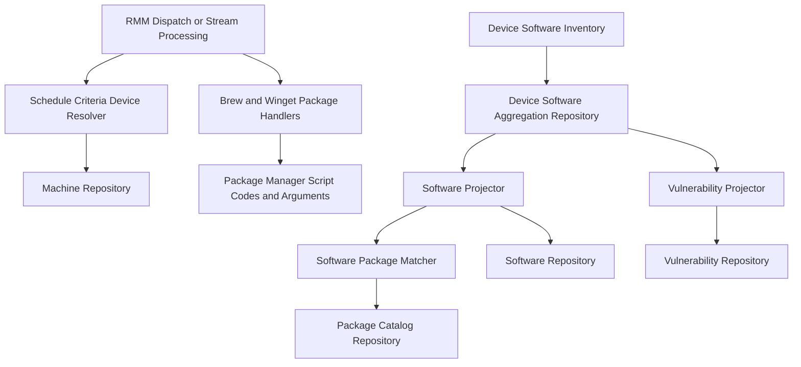
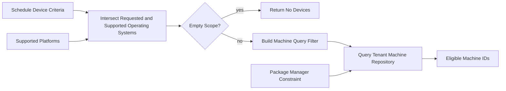
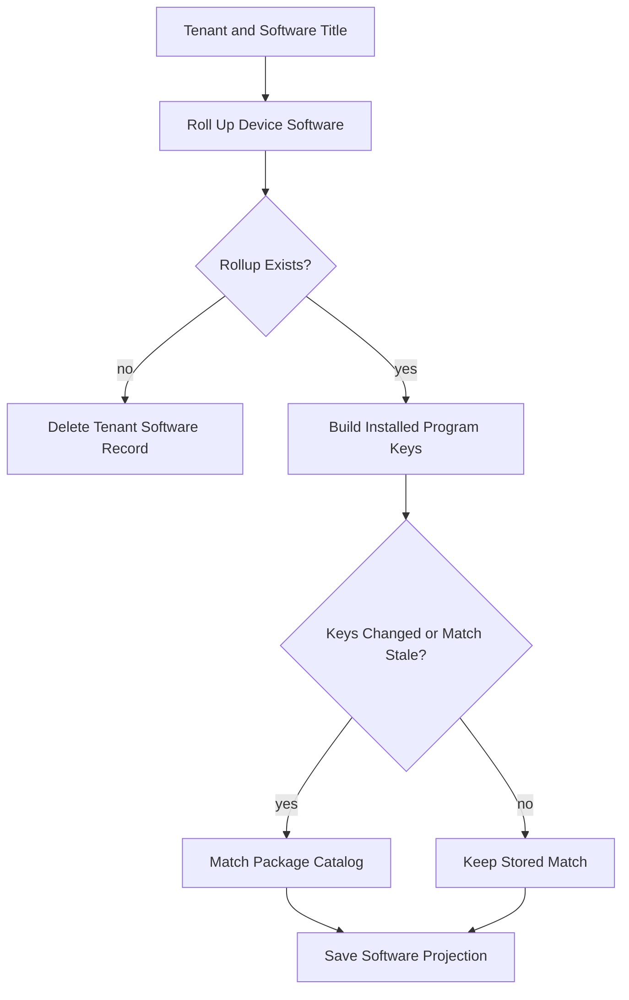
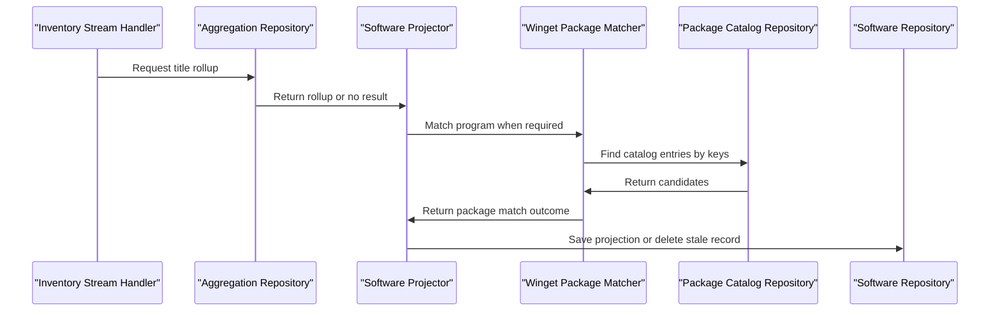

# Rmm Service Core

Rmm Service Core is the Mongo-backed Remote Monitoring and Management projection and selection layer assembled into OpenFrame OSS Tenant through the `com.openframe.oss:openframe-data-mongo-sync` library, pinned at version `7.0.11`. It resolves the device population for scheduled work, translates supported package-manager operations into agent script inputs, and maintains tenant-scoped software and vulnerability read models from aggregated device inventory.

The implementation is supplied by [OpenFrame OSS Library](https://github.com/flamingo-stack/openframe-oss-lib) and runs as part of the tenant services that include the Mongo synchronous data module. It is not an HTTP controller or an agent runtime: it provides reusable Spring components for higher-level RMM dispatch, stream processing, API queries, and repository-backed persistence.

## Responsibilities

- Resolve devices eligible for a schedule using tenant, organization, device type, operating-system, and optionally package-manager constraints.
- Validate and construct package-manager arguments for Brew and Winget installation or update actions.
- Turn device-level software aggregates into a single tenant software record, including version, device, CVE, and catalog-match information.
- Turn CVE aggregates into tenant vulnerability records with the affected software and device counts.
- Match installed Windows programs to Winget catalog entries conservatively, preferring identifiers over name-and-publisher matches and preserving ambiguous outcomes.

## Architecture

The module separates selection, command construction, and read-model projection. The selector reads machines but does not mutate them. Package handlers produce validated action details but do not execute commands. The projectors consume repository rollups and write tenant-level documents, allowing query-facing services to read consolidated software and vulnerability state rather than re-aggregate every device inventory record.

## Component Map

| Area | Core components | Role |
| --- | --- | --- |
| Schedule targeting | `ScheduleCriteriaDeviceResolver` | Builds machine criteria and resolves or counts eligible machine identifiers. |
| Package operations | `BrewPackageManagerHandler`, `WingetPackageManagerHandler` | Select script codes and construct manager-specific package arguments. |
| Software projection | `SoftwareProjector` | Creates, refreshes, or removes consolidated software records. |
| Vulnerability projection | `VulnerabilityProjector` | Creates, refreshes, or removes consolidated CVE records. |
| Package matching | `PackageMatcher`, `WingetPackageMatcher` | Defines catalog matching and implements Winget correlation rules. |

## Schedule Target Resolution

[ScheduleCriteriaDeviceResolver](https://github.com/flamingo-stack/openframe-oss-lib/blob/16e7c1cbd9664e7d10ec5ebca7d53c9bd314decf/openframe-data-mongo-sync/src/main/java/com/openframe/data/service/rmm/ScheduleCriteriaDeviceResolver.java) converts schedule criteria into a `MachineQueryFilter` and delegates lookup to `MachineRepository`.

Its platform-scope behavior is important for dispatch safety:

1. It starts with the operating systems requested by the schedule and the platforms supported by the caller.
2. When only one side supplies platforms, that side becomes the scope.
3. When both supply platforms, it uses their intersection.
4. An empty intersection short-circuits to no identifiers and a count of zero.
5. When neither side restricts platforms, repository queries receive no operating-system scope.

Organization identifiers and device types are added only when non-empty. The optional package-manager collection is passed to the identifier lookup as a manageability constraint. The `matches` method applies the same organization, device-type, and platform logic to an already loaded machine, which supports callers that need local eligibility checks.

## Package Manager Action Construction

The package handlers are conditional Spring components: each is active only when `openframe.rmm.software.enabled` is `true`. Both select an install or update script code from a `SoftwareAction`; their input validation and arguments differ by package manager.

### Brew

[BrewPackageManagerHandler](https://github.com/flamingo-stack/openframe-oss-lib/blob/16e7c1cbd9664e7d10ec5ebca7d53c9bd314decf/openframe-data-mongo-sync/src/main/java/com/openframe/data/service/rmm/software/BrewPackageManagerHandler.java) identifies itself as `BREW`. It requires a nonblank package name and a Brew package type. A CASK package produces `--cask` followed by the package name; a FORMULA package produces the package name alone. Invalid inputs raise a bad-request error rather than allowing an incomplete command to reach a device.

### Winget

[WingetPackageManagerHandler](https://github.com/flamingo-stack/openframe-oss-lib/blob/16e7c1cbd9664e7d10ec5ebca7d53c9bd314decf/openframe-data-mongo-sync/src/main/java/com/openframe/data/service/rmm/software/WingetPackageManagerHandler.java) identifies itself as `WINGET`. It requires a nonblank package name and produces an exact package-ID selection using `--id`, the package name, and `-e`. Although it accepts the same package-type argument shape as the shared handler contract, the Winget implementation does not use it.

## Software Projection

[SoftwareProjector](https://github.com/flamingo-stack/openframe-oss-lib/blob/16e7c1cbd9664e7d10ec5ebca7d53c9bd314decf/openframe-data-mongo-sync/src/main/java/com/openframe/data/service/rmm/software/SoftwareProjector.java) materializes one software document per tenant and software-title identifier.

For a valid tenant and title identifier, it requests a `SoftwareTitleRollup` from `DeviceSoftwareAggregationRepository`:

- If no rollup remains, it deletes the corresponding software document.
- Otherwise, it applies the title name, source, vendor, Windows installer keys, installer types, version information, device count, and CVE count.
- The latest version is selected with segment-aware version comparison.
- The current version is the version with the highest device count, with a newer version used to break ties.
- The older-version count is the number of distinct reported versions minus one, never below zero.

Catalog matching is deliberately cached but refreshed safely. The projector rebuilds the installed-program identity from the rollup and reruns matching when matching keys changed or when the stored match is more than one day old. This bounds repeated catalog lookups while ensuring catalog changes are reflected within the matching time-to-live window.

## Vulnerability Projection

[VulnerabilityProjector](https://github.com/flamingo-stack/openframe-oss-lib/blob/16e7c1cbd9664e7d10ec5ebca7d53c9bd314decf/openframe-data-mongo-sync/src/main/java/com/openframe/data/service/rmm/software/VulnerabilityProjector.java) applies the same reconciliation pattern to CVEs. For a valid tenant and nonblank CVE identifier, it requests a `CveRollup`:

- A missing rollup removes the stale tenant vulnerability document.
- A present rollup becomes a list of affected software entries containing title identifier, name, source, installed version, and affected-device count.
- The projector updates the total device count and update timestamp.
- It initializes the discovery timestamp only when first creating the vulnerability, preserving the original discovery point across later projections.

This preserves a queryable tenant vulnerability inventory as devices report, update, or remove installed software.

## Winget Catalog Matching

[PackageMatcher](https://github.com/flamingo-stack/openframe-oss-lib/blob/16e7c1cbd9664e7d10ec5ebca7d53c9bd314decf/openframe-data-mongo-sync/src/main/java/com/openframe/data/service/rmm/software/matching/PackageMatcher.java) is the matching contract: an implementation names the package manager it supports and returns one `PackageMatch` per submitted installed program, preserving input order.

[WingetPackageMatcher](https://github.com/flamingo-stack/openframe-oss-lib/blob/16e7c1cbd9664e7d10ec5ebca7d53c9bd314decf/openframe-data-mongo-sync/src/main/java/com/openframe/data/service/rmm/software/matching/WingetPackageMatcher.java) implements that contract for `WINGET`. It normalizes program keys, performs one catalog lookup for the batch, and evaluates each program against the returned entries.

The decision sequence is:

1. System components return an explicit no-package outcome.
2. For other programs, product codes, upgrade codes, and package family names are strong identifiers.
3. A normalized name plus normalized publisher is a weaker candidate and is considered only when both are present.
4. If an architecture-specific normalized name exists, it is evaluated before the plain normalized name; the plain name is used only when the architecture-specific search finds no candidates.
5. One candidate is accepted. With multiple candidates, exactly one strong candidate is accepted; otherwise the result is marked ambiguous.

The matcher normalizes keys using lowercase, locale-independent folding and relies on the package catalog repository to retrieve entries sharing any relevant identifier or normalized name. This conservative rule prevents weak textual similarity from silently choosing among multiple packages.

## Data Flow and Consistency Boundaries

Projection methods are tenant-scoped and treat absent aggregates as deletion signals. Callers should therefore invoke them after the underlying device-level aggregate reflects the latest inventory state. The resolver uses the same tenant boundary when querying machine identifiers, preventing criteria from crossing tenant data.

## Integration Context

Rmm Service Core is consumed as part of the `openframe-data-mongo-sync` dependency. Adjacent platform components provide the surrounding RMM workflow:

- The OpenFrame client service delivers and records package, script, and software operations.
- Stream processing handles RMM and device-software events that can cause aggregation and projection work.
- API services expose software, vulnerability, scheduling, and execution data to platform clients.
- Mongo repositories provide the aggregate inputs and persisted read models used by this module.

Those responsibilities remain outside Rmm Service Core; this module focuses on deterministic target selection, package argument construction, and repository-backed projection logic.

## Operational Notes

- Enable the software package handlers with `openframe.rmm.software.enabled=true` where package-driven RMM operations are required.
- Treat package identifiers and package types as validated dispatch inputs. Brew requires both the identifier and its CASK or FORMULA classification; Winget requires a nonblank identifier.
- Monitor software projections for catalog-match churn. A changed installed-program identity or a match older than one day intentionally triggers a rematch.
- Preserve the relationship between inventory aggregation and projection. A missing title or CVE rollup removes its corresponding tenant-level read model.
