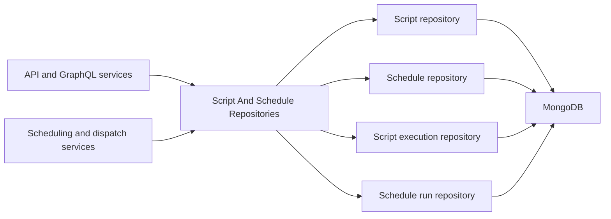
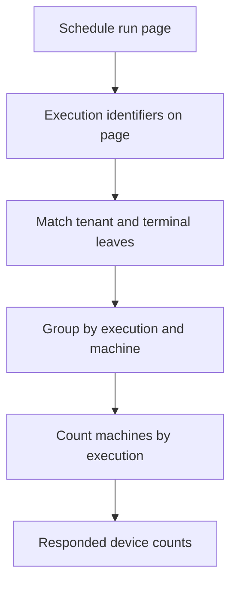

# Script And Schedule Repositories

## Purpose

Script And Schedule Repositories is the MongoDB query layer that supports remote-management script inventory, scheduled script inventory, execution history, and schedule-run history. It is implemented by the `openframe-data-mongo-sync` library from OpenFrame OSS Library (`com.openframe.oss:openframe-data-mongo-sync` version `7.0.11`), which this service consumes at runtime.

The module supplies MongoTemplate-backed operations where derived Spring Data methods would be insufficient: tenant-scoped filtering, safe cursor pagination, stable sort ordering, search, list counts, and filter-facet aggregations. It deliberately keeps these data-access concerns below API and scheduling services, so callers can use a consistent query contract without constructing MongoDB predicates themselves.

## Architecture

All list and aggregate queries are tenant-scoped. The repositories use `MongoTemplate` for predicate composition and aggregation pipelines, while document types such as scripts, schedules, and execution rows remain the persistence model owned by the data library.

## Repository Families

| Family | Primary responsibility | Key behaviours |
| --- | --- | --- |
| Script repository | Lists script definitions for a tenant. | Excludes system and software-managed scripts, hides soft-deleted scripts by default, resolves tag filters through tag assignments, and returns shell, platform, and author facets. |
| Schedule repository | Lists scheduled script definitions. | Filters schedules by status, platform, author, and start window; supports aggregate ordering by assigned-device count and special ordering for device-online schedules. |
| Script execution repository | Stores and queries per-device execution leaves. | Creates queued or running rows, provides owner-scoped history, supports execution facets, and summarizes leaf status for a schedule fire. |
| Schedule run repository | Queries one header row per schedule dispatch. | Paginates schedule fires, reports matching totals and facets, and aggregates distinct responding devices from execution leaves. |

## Query Contract

### Tenant isolation and filtering

Every public list, count, facet, and aggregation operation accepts a tenant identifier and applies it to its MongoDB criteria. Script and schedule lists exclude `DELETED` records unless a caller explicitly provides a status filter that includes them. Script listing also excludes `SYSTEM` and `SOFTWARE` script types, protecting managed scripts from the standard inventory view.

Filters are composed consistently across listing and count operations. This allows a caller to show a complete matching count while loading a cursor-paginated page. Search terms are quoted before becoming case-insensitive regular expressions, so user input is handled as a literal substring rather than executable regular-expression syntax.

### Cursor pagination

The module uses keyset pagination rather than offset pagination. Callers request one item beyond the visible page size to determine whether another page exists. A forward scan uses the requested sort direction, while backward pagination flips the scan direction and the caller reverses the returned rows for display.

For a simple identifier sort, the cursor is the MongoDB object identifier. Sorts with duplicate values use a compound cursor containing the sort value and object identifier. The object identifier acts as a deterministic tie-breaker, preventing skipped or duplicated rows at a tie boundary.

| Repository | Allowed sort fields | Cursor handling |
| --- | --- | --- |
| Script | Identifier, name, created time, updated time | Identifier keyset boundary. Invalid identifiers are logged and treated as a first-page request. |
| Schedule | Identifier, name, start time, recurrence, device count | Compound keysets where required, including aggregate pipelines for device counts and trigger-aware start-time ordering. Invalid cursors fall back to a first-page request. |
| Script execution | Identifier, dispatch time, finish time, status-change time | Compound cursor for time sorts, including explicit null ordering. Invalid cursors fail fast with a bad-request error. |
| Schedule run | Identifier, dispatch time | Identifier or dispatch-time-plus-identifier cursor. Malformed cursors fail fast with a bad-request error. |

The different invalid-cursor policies are intentional implementation details of their respective repositories. Consumers should therefore validate and preserve opaque cursors rather than constructing them.

## Script Definitions

[Custom Script Repository](https://github.com/flamingo-stack/openframe-oss-lib/blob/16e7c1cbd9664e7d10ec5ebca7d53c9bd314decf/openframe-data-mongo-sync/src/main/java/com/openframe/data/repository/rmm/CustomScriptRepository.java) defines the query contract, and [Custom Script Repository Implementation](https://github.com/flamingo-stack/openframe-oss-lib/blob/16e7c1cbd9664e7d10ec5ebca7d53c9bd314decf/openframe-data-mongo-sync/src/main/java/com/openframe/data/repository/rmm/CustomScriptRepositoryImpl.java) implements it.

The implementation builds a shared predicate for page and count queries:

1. Restrict to the requested tenant.
2. Shield system and software-managed scripts from the regular list.
3. Apply the explicit status filter, or hide soft-deleted records by default.
4. Apply shell, supported-platform, creator, tag, and name-search constraints when supplied.
5. Apply the keyset boundary and allowed sort only for the page query.

Tag filtering is resolved within the repository: matching script entity identifiers are read from the `tag_assignments` collection and then applied as an identifier filter. This makes tag filtering part of the persistence contract instead of requiring upstream services to perform a separate lookup.

Facet queries omit only their own filter dimension. For example, the shell facet retains platform, author, tag, and status restrictions but does not constrain shell. Platform facets unwind the supported-platforms array before grouping; author and shell facets group directly. Null facet values are omitted.

## Script Schedules

[Custom Script Schedule Repository](https://github.com/flamingo-stack/openframe-oss-lib/blob/16e7c1cbd9664e7d10ec5ebca7d53c9bd314decf/openframe-data-mongo-sync/src/main/java/com/openframe/data/repository/rmm/CustomScriptScheduleRepository.java) and its [implementation](https://github.com/flamingo-stack/openframe-oss-lib/blob/16e7c1cbd9664e7d10ec5ebca7d53c9bd314decf/openframe-data-mongo-sync/src/main/java/com/openframe/data/repository/rmm/CustomScriptScheduleRepositoryImpl.java) provide the schedule inventory query path.

Most sorts use a normal tenant-scoped query with a stable identifier tie-breaker. Two sorts require specialized aggregation flows:

- **Device count:** A lookup joins each schedule to its machine-assignment records, computes the array size, applies a device-count plus identifier cursor, then sorts and limits the result.
- **Start time:** A synthetic trigger bucket places time-based schedules and device-online schedules into a deterministic sequence. Device-online schedules naturally have no start time, so the cursor also records bucket, start-time value, and identifier.

The platform and author facets use the same filter semantics as the list, excluding only the dimension being counted. A start-time range naturally excludes device-online schedules because they do not carry a start time.

## Execution History

[Custom Script Execution Repository](https://github.com/flamingo-stack/openframe-oss-lib/blob/16e7c1cbd9664e7d10ec5ebca7d53c9bd314decf/openframe-data-mongo-sync/src/main/java/com/openframe/data/repository/rmm/CustomScriptExecutionRepository.java) and its [implementation](https://github.com/flamingo-stack/openframe-oss-lib/blob/16e7c1cbd9664e7d10ec5ebca7d53c9bd314decf/openframe-data-mongo-sync/src/main/java/com/openframe/data/repository/rmm/CustomScriptExecutionRepositoryImpl.java) manage per-machine execution rows.

A dispatch creates one execution leaf per target machine using either `QUEUED` or `RUNNING` as the initial status. Each row records dispatch metadata such as script, schedule, machine, privilege, timeout, initiator, source, and optional package-management context.

History queries can be scoped by script, schedule, or software ownership. Their filter model supports status, initiator, machine, dispatch-time range, source exclusion, test-run exclusion, and text search across execution identifier, machine identifier, standard output, and standard error. Facets group by status, initiator, or machine and preserve every other active filter.

For a schedule fire, `countLeavesByStatus` summarizes leaves into:

- **In progress:** queued plus running rows.
- **Failed:** failed rows.
- **Script errors:** rows whose script execution itself reported an error.

Its `settledStatus` resolves the final header state by prioritizing failures, then script errors, then success. The lookup methods that identify a leaf by machine, execution, and script request primary read preference, which avoids observing stale data immediately after execution-state writes.

## Schedule Runs

[Custom Schedule Script Execution Repository](https://github.com/flamingo-stack/openframe-oss-lib/blob/16e7c1cbd9664e7d10ec5ebca7d53c9bd314decf/openframe-data-mongo-sync/src/main/java/com/openframe/data/repository/rmm/CustomScheduleScriptExecutionRepository.java) and its [implementation](https://github.com/flamingo-stack/openframe-oss-lib/blob/16e7c1cbd9664e7d10ec5ebca7d53c9bd314decf/openframe-data-mongo-sync/src/main/java/com/openframe/data/repository/rmm/CustomScheduleScriptExecutionRepositoryImpl.java) serve the Schedule Runs view, where each record represents one firing of a schedule.

The repository filters headers by tenant, schedule identifier, optional status set, inclusive dispatch-time range, and case-insensitive execution-identifier search. It exposes a matching count and status or initiator facets. A facet intentionally drops its own filter arm while retaining date and search constraints, so users can see all alternative filter values that remain available.

The responded-device metric is calculated against the execution-leaf collection rather than the schedule-run headers:

A terminal leaf is any row whose status is not `RUNNING`. The aggregation first groups by execution identifier and machine identifier, which collapses multiple script leaves from the same device. It then counts the distinct machines per execution identifier. This produces page-wide progress counts in one aggregation rather than an N+1 query pattern; absent execution identifiers represent zero responding devices.

## Operational Considerations

- Keep filter, count, and facet calls on the same tenant and logical query scope; their contracts are designed to agree on what qualifies as a match.
- Treat pagination cursors as opaque. They encode MongoDB identifiers and, for compound sorts, timestamp or sort values required for stable continuation.
- Preserve the explicit identifier tie-breaker whenever adding a sortable field. Sorting only on a non-unique field is not sufficient for correct keyset pagination.
- Add new filter facets by following the existing rule: retain all other filtering dimensions, but exclude the dimension being aggregated.
- Use aggregation for page-wide derived values such as responded-device progress, rather than loading child rows per header.
