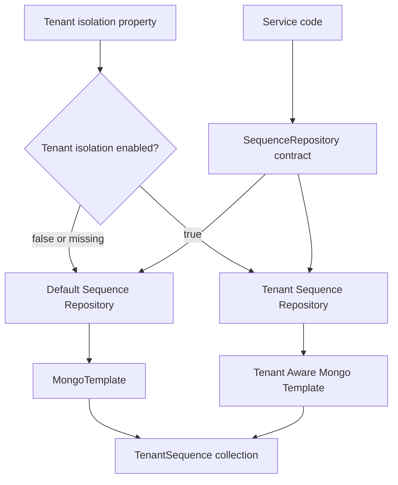
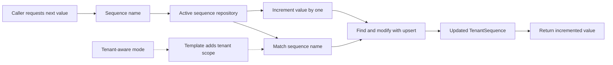

# Sequence Repositories

Sequence Repositories provide monotonic, database-backed integer counters for the MongoDB persistence layer. The module exposes one sequence operation, `getNextValue(sequenceName)`, through the shared `SequenceRepository` contract and selects exactly one implementation at application startup according to tenant-isolation configuration.

The implementation is supplied by the OpenFrame OSS Library artifact `com.openframe.oss:openframe-data-mongo-sync` at version `7.0.11`. It runs as part of this repository's services rather than being implemented in this repository.

## Purpose and Guarantees

A caller supplies a logical sequence name. The active repository locates that sequence's `TenantSequence` document, atomically increments its `value` field, creates the document when it is absent, and returns the incremented value. The use of MongoDB `findAndModify` with `returnNew` and `upsert` means the returned value is the post-increment value from the same database operation.

The module deliberately changes its scope, not its public operation, between deployment modes:

- **Default mode:** `DefaultSequenceRepository` is active when `openframe.tenant-isolation.enabled` is `false` or unspecified. A sequence is identified by its name alone, providing one counter per name for a single-tenant or OSS deployment.
- **Tenant-isolated mode:** `SequenceRepositoryImpl` is active only when `openframe.tenant-isolation.enabled` is `true`. It delegates to `TenantAwareMongoTemplate`, which automatically adds the current tenant scope to queries for `TenantSequence` and stamps the tenant when an upsert creates the document. This gives each tenant an independent counter for the same sequence name.

## Architecture

Spring evaluates the conditional repository annotations during bean creation. The conditions are complementary: the default implementation matches an absent property as well as an explicit `false` value, while the tenant-aware implementation requires explicit `true`. Consequently, normal configuration produces one active `SequenceRepository` bean rather than two competing implementations.

## Components

### Default Sequence Repository

[`DefaultSequenceRepository`](https://github.com/flamingo-stack/openframe-oss-lib/blob/16e7c1cbd9664e7d10ec5ebca7d53c9bd314decf/openframe-data-mongo-sync/src/main/java/com/openframe/data/repository/sequence/DefaultSequenceRepository.java) is the repository for non-isolated deployments.

- Uses Spring `MongoTemplate` directly.
- Queries a `TenantSequence` by `name` only.
- Increments `value` by one through an atomic `findAndModify` operation.
- Requests the updated document and enables upsert, so callers receive the new integer whether the sequence already existed or is first created.
- Emits a debug log with the sequence name and the returned counter value.

### Tenant Sequence Repository

[`SequenceRepositoryImpl`](https://github.com/flamingo-stack/openframe-oss-lib/blob/16e7c1cbd9664e7d10ec5ebca7d53c9bd314decf/openframe-data-mongo-sync/src/main/java/com/openframe/data/repository/sequence/SequenceRepositoryImpl.java) is the tenant-aware counterpart.

Its increment operation has the same query, update, upsert, return, and debug logging behavior as the default repository. The difference is the persistence adapter: `TenantAwareMongoTemplate` applies tenant scoping to the query and the tenant-stamping callback assigns the tenant identifier when an upsert creates a `TenantSequence`. The repository therefore does not manually construct a composite key or manually set a tenant field.

## Counter Allocation Flow

In tenant-aware mode, the template's scope is part of the database operation before the document is located or created. In default mode, no tenant condition is added. In both modes, a sequence name must be treated as the stable logical identity of the counter: changing it starts or addresses a different counter.

## Operational Notes

- The counter is persisted in MongoDB; it is not an in-memory process counter.
- The returned integer comes from the updated `TenantSequence` document, so callers do not need a separate read after allocation.
- Upsert removes the need for explicit sequence initialization, but it also means a new name creates a new counter on first use.
- Debug-level logs provide allocation visibility without changing the returned value or persistence semantics.
- Tenant isolation must be configured consistently across a deployment. Switching the property changes which scope identifies an existing counter and can therefore change the counter namespace observed by callers.

## System Placement

Sequence Repositories are part of the synchronous Mongo persistence library consumed by the OpenFrame OSS Tenant services. The shared data layer also provides Mongo configuration, tenant-aware persistence infrastructure, and domain-specific repositories. This module is narrowly responsible for allocating counters; it neither defines the business entities using those counters nor exposes an HTTP or messaging interface.
