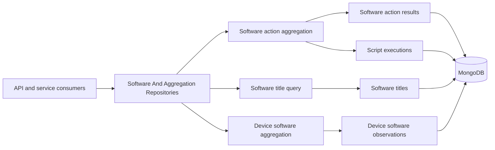
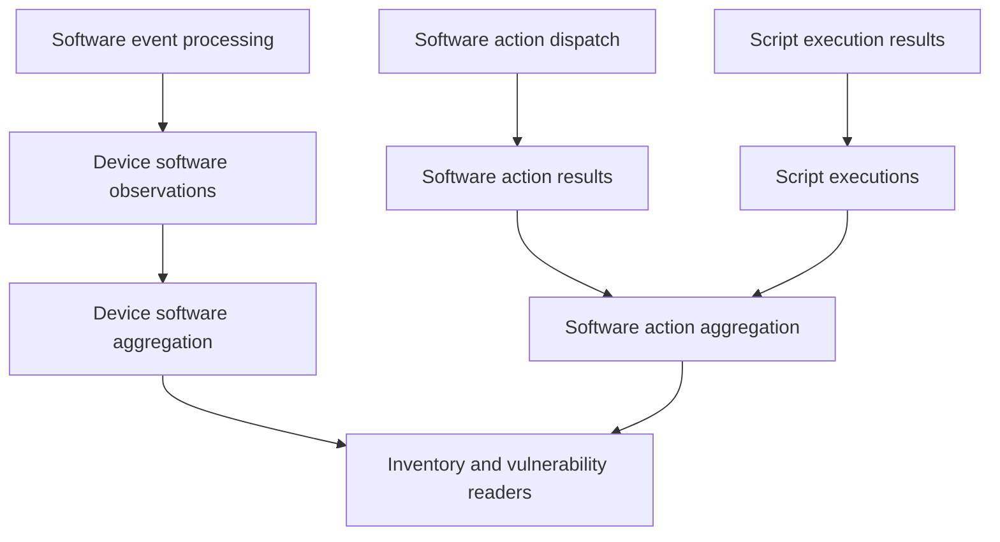

# Software And Aggregation Repositories

Software And Aggregation Repositories is the MongoDB read-model layer for remote-management software inventory and software-action reporting. It is supplied at runtime by the `com.openframe.oss:openframe-data-mongo-sync` library, pinned to version `7.0.11` by OpenFrame OSS Tenant. The module turns tenant-scoped software, device-software, and script-execution documents into the filtered pages and rollups required by inventory, vulnerability, and action-history consumers.

The implementations use Spring Data `MongoTemplate` aggregation pipelines rather than exposing raw collections to callers. This keeps aggregation rules—especially connection eligibility, distinct-device counting, and live action status reconciliation—centralized in the persistence layer.

## Scope and Responsibilities

- List software-action summaries with pagination, validated sort fields, search, facets, and status reconciliation from execution records.
- Query software titles that are installed on one or more devices, with optional vulnerability and manageability filters.
- Roll device-software observations into title-level inventory and CVE-level exposure views.
- Enforce tenant filtering in every repository query and aggregation entry point.

## Architecture Overview

## Repository Boundaries

| Area | Primary implementation | Responsibility |
| --- | --- | --- |
| Software action history | `SoftwareActionAggregationRepositoryImpl` | Builds an action summary from persisted action results and their execution leaves, then supports filtered, sorted, paginated lists and facets. |
| Software title inventory | `CustomSoftwareRepository` and `CustomSoftwareRepositoryImpl` | Returns a page of installed software titles filtered by tenant, title text, vulnerability state, and manageability. |
| Device-software rollups | `DeviceSoftwareAggregationRepositoryImpl` | Produces title and CVE summaries from connected-device observations and can return affected machine IDs. |

## Detailed Submodules

- [Software Action Aggregation](software_and_aggregation_repositories/software_action_aggregation/software_action_aggregation.md) documents action-history filtering, execution-leaf reconciliation, and summary projection.
- [Software Title Repository](software_and_aggregation_repositories/software_title_repository/software_title_repository.md) documents inventory title pagination and manageability classification.
- [Device Software Aggregation](software_and_aggregation_repositories/device_software_aggregation/device_software_aggregation.md) documents connected-device title and CVE rollups.

## Position in the System

The module is part of the synchronous Mongo data library. Software inventory is populated by the stream-processing path and queried by application services such as the API software read models. Action summaries correlate software-action records with script execution data. This module therefore provides a database-facing read boundary: it does not dispatch actions, execute package managers, or expose HTTP endpoints.

## Data and Isolation Rules

All public lookup paths begin with a tenant identifier. The title query additionally requires `devicesCount` to be greater than zero, so titles without observed installations are excluded. Device-based aggregation considers only records whose machine is currently marked connected. As a result, rollup counts describe the active connected-device population, whereas title listing uses the stored title-level device count.

## Implementation Source

The runtime code belongs to the OpenFrame OSS Library rather than this repository. The verified sources are:

- [Software Action Aggregation Repository Implementation](https://github.com/flamingo-stack/openframe-oss-lib/blob/16e7c1cbd9664e7d10ec5ebca7d53c9bd314decf/openframe-data-mongo-sync/src/main/java/com/openframe/data/repository/rmm/SoftwareActionAggregationRepositoryImpl.java)
- [Custom Software Repository](https://github.com/flamingo-stack/openframe-oss-lib/blob/16e7c1cbd9664e7d10ec5ebca7d53c9bd314decf/openframe-data-mongo-sync/src/main/java/com/openframe/data/repository/rmm/software/CustomSoftwareRepository.java)
- [Custom Software Repository Implementation](https://github.com/flamingo-stack/openframe-oss-lib/blob/16e7c1cbd9664e7d10ec5ebca7d53c9bd314decf/openframe-data-mongo-sync/src/main/java/com/openframe/data/repository/rmm/software/CustomSoftwareRepositoryImpl.java)
- [Device Software Aggregation Repository Implementation](https://github.com/flamingo-stack/openframe-oss-lib/blob/16e7c1cbd9664e7d10ec5ebca7d53c9bd314decf/openframe-data-mongo-sync/src/main/java/com/openframe/data/repository/rmm/software/DeviceSoftwareAggregationRepositoryImpl.java)
