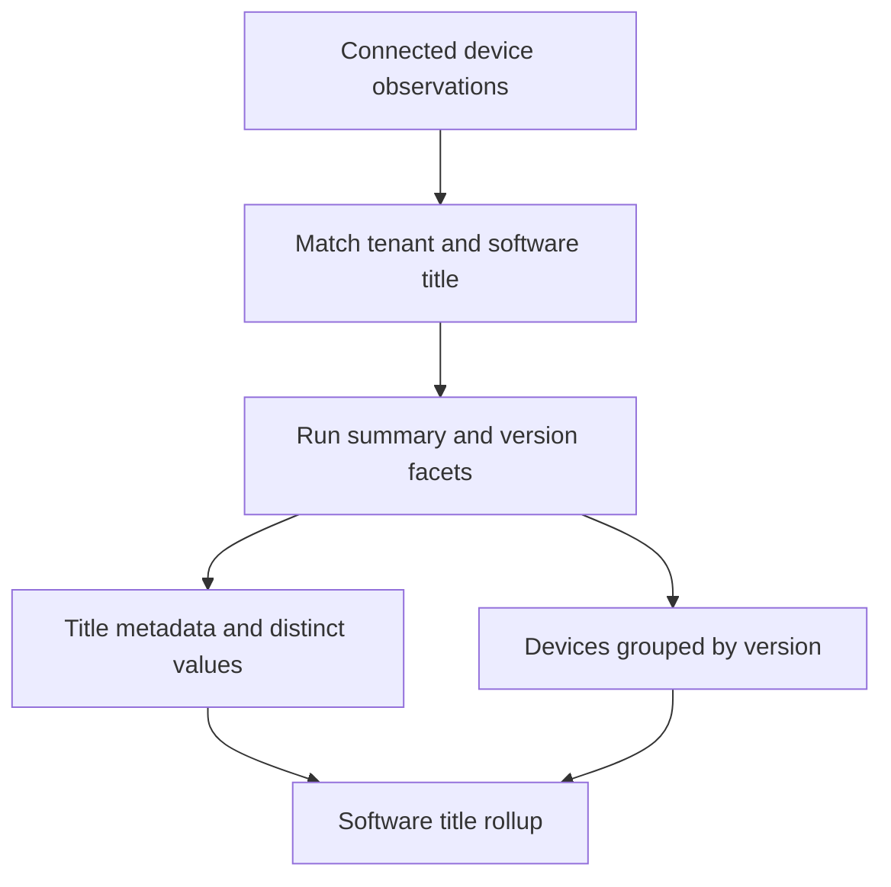
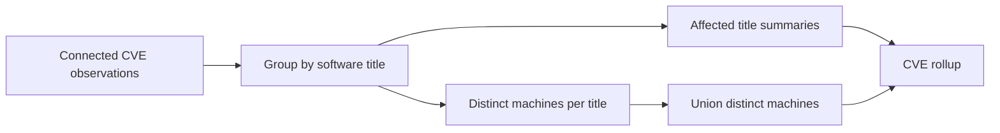

# Device Software Aggregation

Device Software Aggregation derives software-title and vulnerability exposure summaries from `DeviceSoftware` observations. `DeviceSoftwareAggregationRepositoryImpl` uses MongoDB aggregation pipelines for summary reads and a distinct query for affected-device lookup.

## Connected-Device Scope

Both `rollUpTitle` and `rollUpCve` constrain their source observations by tenant ID and `machineConnected: true`. A disconnected machine therefore does not contribute to these real-time rollups. `machineIdsWithCve` applies the same connected-machine constraint before returning distinct machine IDs.

## Software Title Rollup

`rollUpTitle` matches one software title, sorts observations by machine ID, and uses a facet to compute a main summary and a per-version device count in one aggregation.

The summary calculates device count, representative name/source/vendor/upgrade code, distinct versions, CVE count, ARP keys, package-family names, installer types, and system-component state. Array unions remove duplicated values across device observations. Null values are excluded from distinct counts. A title is considered a system component only when the field was reported and every reported value is true.

## CVE Rollup

`rollUpCve` starts with connected observations containing the requested CVE. It groups first by software title to assemble title-specific metadata and distinct machine sets, then groups all title results into one CVE rollup. The final device count is the cardinality of the union of these machine sets, which prevents a device with multiple affected titles from being counted more than once.

## Direct Affected-Machine Query

`machineIdsWithCve` uses `findDistinct` on `machineId`, filters out null identifiers, and returns the remaining identifiers. This avoids constructing a full aggregation when the caller needs only the affected connected devices.

## Source

[Device Software Aggregation Repository Implementation](https://github.com/flamingo-stack/openframe-oss-lib/blob/16e7c1cbd9664e7d10ec5ebca7d53c9bd314decf/openframe-data-mongo-sync/src/main/java/com/openframe/data/repository/rmm/software/DeviceSoftwareAggregationRepositoryImpl.java) is supplied by the OpenFrame OSS Library.