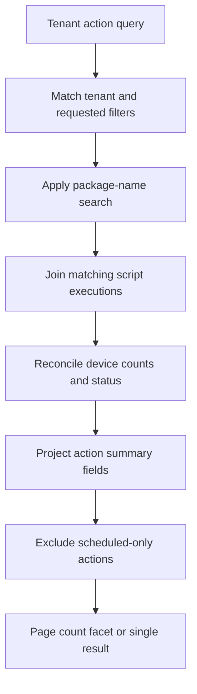
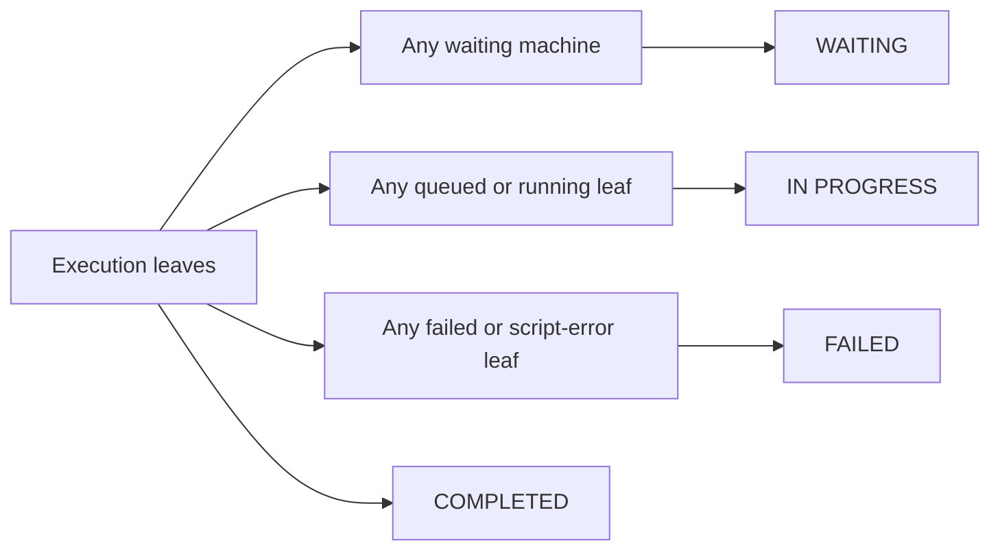

# Software Action Aggregation

Software Action Aggregation provides a tenant-scoped summary of package-management actions. `SoftwareActionAggregationRepositoryImpl` joins persisted software-action result rows to their `script_executions` leaves and calculates the current action state at read time.

## Responsibilities

- Return action-summary pages through `findPage`, using bounded sorting, offset pagination, and a deterministic `executionId` tie-breaker.
- Return a matching-record count through `count` and grouped values through `facet`.
- Locate one reconciled summary through `findByExecutionId`.
- Reject unsupported sort fields by falling back to `dispatchedAt`; the accepted fields are `dispatchedAt`, `status`, `packageName`, and `totalMachineCount`.

## Aggregation Pipeline

### Filters

The initial match always constrains `tenantId`. Optional filters limit action values, action kinds, package-manager engines, and an escaped case-insensitive package-name search. A kind filter accommodates older rows by treating a missing `kind` as the stored action value. Status filtering occurs after reconciliation and never returns `SCHEDULED` rows in a normal listing.

### Execution Reconciliation

The lookup matches execution leaves by tenant ID and execution ID, excludes leaves without a software-action marker, and groups by distinct machine ID. It derives:

- **Responded machines** from terminal execution statuses: success, script error, or failed.
- **Waiting machines** from running leaves marked as waiting.
- **Live status** with waiting taking precedence over in progress, failed, and completed.
- **Dispatch and completion timestamps** from the action row or, for scheduled work, the execution leaves.

The status outcomes in the lower three nodes are considered only when no higher-precedence condition is present. If no execution leaves exist, the repository preserves the action row's stored status. `finishedAt` is only populated when the resolved status is completed or failed.

## Summary Projection

The response maps aggregation documents to `SoftwareActionSummary`. Its fields include the execution ID, package manager, package name, version, action and kind, status, total/responded/waiting machine counts, dispatch and finish times, initiator, bundle ID, and schedule ID.

## Source

[Software Action Aggregation Repository Implementation](https://github.com/flamingo-stack/openframe-oss-lib/blob/16e7c1cbd9664e7d10ec5ebca7d53c9bd314decf/openframe-data-mongo-sync/src/main/java/com/openframe/data/repository/rmm/SoftwareActionAggregationRepositoryImpl.java) is supplied by the OpenFrame OSS Library.