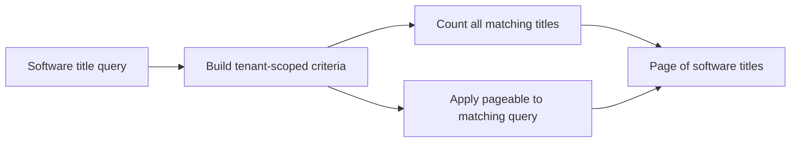
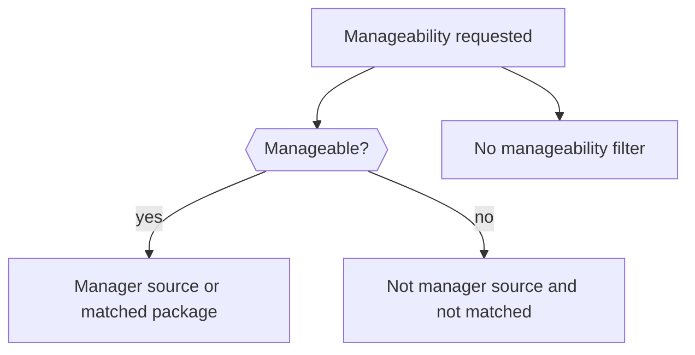

# Software Title Repository

Software Title Repository defines and implements the title-listing query used for software inventory. `CustomSoftwareRepository` exposes `findTitles`, while `CustomSoftwareRepositoryImpl` applies the query through `MongoTemplate` and returns a Spring Data `Page` of `Software` records.

## Query Contract

`findTitles` receives a `SoftwareTitleQuery` and `Pageable` value. The implementation first counts all matching rows before applying the page offset and limit, then retrieves the requested page and creates a `PageImpl`. Counting first is important because a paged query would otherwise produce an incorrect total.

## Base Criteria

Every query requires both of the following:

- Matching `tenantId`.
- `devicesCount` greater than zero, which removes titles that have no recorded installations.

When a name prefix or fragment is present in `nameLower`, the query uses `Pattern.quote` to treat user-provided text literally rather than as a regular-expression expression. The vulnerable-only option adds `cveCount` greater than zero.

## Manageability Classification

The optional `manageable` flag selects a composite criterion:

| Requested state | Matching rule |
| --- | --- |
| Manageable | The title source is one of the supplied manager sources, or its package-match state is `MATCHED`. |
| Unmanaged | The source is not among manager sources and the package-match state is not `MATCHED`. This also includes titles that do not yet have a package-match record. |
| Unspecified | No manageability condition is applied. |

The no-filter path applies when the query leaves manageability unspecified.

## Components

- `CustomSoftwareRepository` is the narrow repository contract.
- `CustomSoftwareRepositoryImpl` owns query construction, total counting, and page retrieval.

## Source

- [Custom Software Repository](https://github.com/flamingo-stack/openframe-oss-lib/blob/16e7c1cbd9664e7d10ec5ebca7d53c9bd314decf/openframe-data-mongo-sync/src/main/java/com/openframe/data/repository/rmm/software/CustomSoftwareRepository.java)
- [Custom Software Repository Implementation](https://github.com/flamingo-stack/openframe-oss-lib/blob/16e7c1cbd9664e7d10ec5ebca7d53c9bd314decf/openframe-data-mongo-sync/src/main/java/com/openframe/data/repository/rmm/software/CustomSoftwareRepositoryImpl.java)