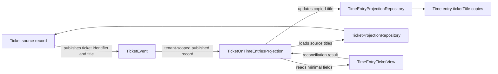
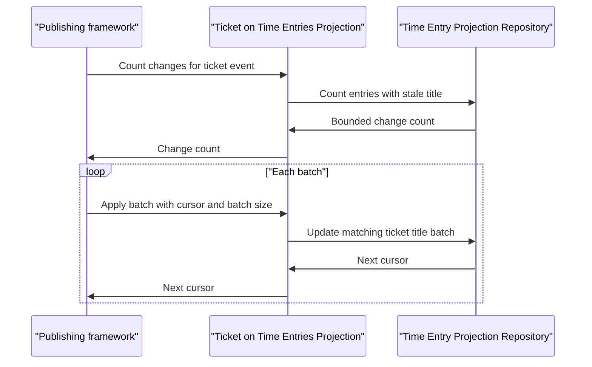
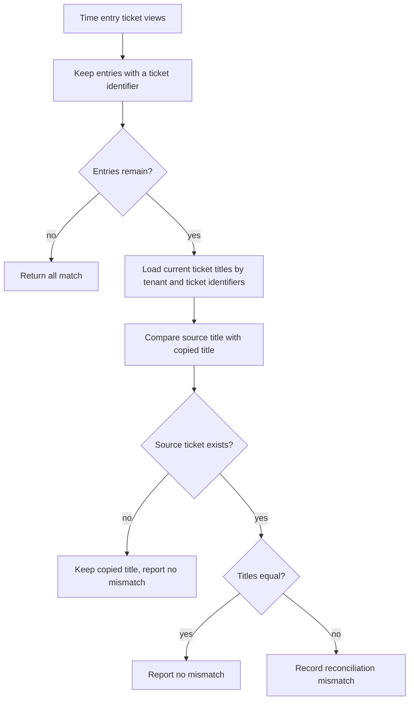

# Ticket Publishing Repositories

Ticket Publishing Repositories is the ticket-to-time-entry denormalization projection supplied by the OpenFrame OSS Library's `openframe-data-mongo-sync` artifact. The tenant service consumes that artifact at version `7.0.11` and runs the projection as part of its MongoDB-backed data layer.

Its responsibility is deliberately narrow: when a published ticket event provides a ticket identifier and title, it propagates that title to the copied `ticketTitle` field on all matching time entries in the same tenant. This makes time-entry reads self-contained while retaining a reconciliation path to detect copies that have drifted from an existing ticket.

## Scope and Source

All three components are library code from the OpenFrame OSS Library, rather than source files maintained directly in this repository:

- [Ticket Event](https://github.com/flamingo-stack/openframe-oss-lib/blob/16e7c1cbd9664e7d10ec5ebca7d53c9bd314decf/openframe-data-mongo-sync/src/main/java/com/openframe/data/repository/ticket/publishing/TicketEvent.java) is the public event payload.
- [Ticket on Time Entries Projection](https://github.com/flamingo-stack/openframe-oss-lib/blob/16e7c1cbd9664e7d10ec5ebca7d53c9bd314decf/openframe-data-mongo-sync/src/main/java/com/openframe/data/repository/ticket/publishing/TicketOnTimeEntriesProjection.java) applies, batches, and reconciles the copied title.
- [Time Entry Ticket View](https://github.com/flamingo-stack/openframe-oss-lib/blob/16e7c1cbd9664e7d10ec5ebca7d53c9bd314decf/openframe-data-mongo-sync/src/main/java/com/openframe/data/repository/ticket/publishing/TimeEntryTicketView.java) is the minimal read model used for reconciliation.

The module complements the ticket repository and time-tracking repository areas in the Mongo synchronization layer. It does not create, update, or delete tickets or time entries as domain entities; it only maintains the denormalized ticket title held by time entries.

## Architecture

The projection is named `ticket-on-time-entries`. Its work is tenant scoped: the tenant identifier comes from the published record, and every update or source-title lookup is evaluated within that tenant context. Therefore, identical ticket identifiers in separate tenants cannot cause a cross-tenant title update.

## Core Components

| Component | Responsibility |
| --- | --- |
| `TicketEvent` | A compact `PublishedEvent` payload containing `ticketId` and `title`. Lombok supplies its data accessors, builder, no-argument constructor, and all-arguments constructor. |
| `TicketOnTimeEntriesProjection` | A Spring component implementing `Projection<TicketEvent, TimeEntryTicketView>`. It updates titles, exposes bounded batch processing, identifies its target classes, and reconciles stored copies against ticket source records. |
| `TimeEntryTicketView` | A minimal projection view containing the time-entry identifier, tenant identifier, ticket identifier, and copied ticket title. It prevents reconciliation from loading unrelated time-entry fields. |

## Projection Processing

### Immediate application

For a published record, `apply` extracts the record tenant, the event ticket identifier, and the event title. It then calls the time-entry projection repository to update the `ticketTitle` of every time entry matching that tenant and ticket. The returned count is logged at debug level, making the projection's fan-out observable without changing the published payload.

### Bounded and resumable processing

The publishing framework can measure and execute large updates incrementally:

1. `countChanges` asks the time-entry projection repository how many matching entries would need a title change, subject to the supplied limit.
2. `applyBatch` updates a bounded page of matches using `batchSize` and the caller-provided `lastId` cursor.
3. The repository returns the next cursor value, allowing the framework to resume the same ticket-title propagation without loading the complete affected set into the projection.

The exact selection, update, and cursor semantics are implemented by `TimeEntryProjectionRepository`, which is outside this module. This module passes the tenant, ticket identifier, title, cursor, and batch size through to that repository.

## Reconciliation

Reconciliation validates that the denormalized title on a time entry still agrees with the corresponding ticket record.

1. The projection excludes time entries with no ticket identifier because they have no ticket copy to validate.
2. It collects the tenant and ticket identifiers represented by the remaining views.
3. It loads current ticket titles in one repository query through `TicketProjectionRepository.findTitles`.
4. It keys loaded titles by `TenantScopedId`, combining tenant and ticket identifiers.
5. For each time entry, it compares the source title with `ticketTitle` using null-safe equality.
6. A different value becomes a `ReconciliationResult.Mismatch` containing the tenant, time-entry identifier, ticket identifier, and a diagnostic message.

A missing source ticket is intentionally **not** reported as a mismatch. The projection preserves the copied title on the time entry after its source ticket is deleted, so reconciliation treats source absence as an accepted historical-reference state rather than drift.

## Data Contract and Boundaries

`TicketEvent` currently exposes only two public fields:

| Field | Meaning |
| --- | --- |
| `ticketId` | Identifier used to locate time entries that reference the ticket. |
| `title` | Current ticket title copied to each matching time entry. |

The event's minimal shape means this projection responds only to title data. Changes to other ticket attributes have no effect here unless the event contract and projection are extended together. As a public publishing payload, field changes should be treated as compatibility-sensitive for event consumers.

The projection declares `TimeEntry` as its projected entity class and `TimeEntryTicketView` as its projected view class. This declaration lets the publishing framework use a narrow read model for reconciliation while associating the projection with time-entry records.

## Operational Characteristics

- **Tenant isolation:** Updates and reconciliation are keyed by tenant identifiers. Source-title lookup uses `TenantScopedId` rather than ticket identifier alone.
- **Idempotent target state:** Applying the same ticket event again requests the same copied title, so normal replay converges on the same stored value.
- **Scalable fan-out:** Change counting and cursor-based batching support tickets referenced by many time entries.
- **Deletion-tolerant history:** A time entry retains its title copy if its source ticket no longer exists.
- **Drift visibility:** Reconciliation reports existing source tickets whose title differs from their copied time-entry title.
- **Limited write scope:** The module updates only the copied title through the projection repository; it does not mutate the ticket source record.

## Maintenance Guidance

When changing this module, keep event, update, and reconciliation semantics aligned:

- Add an event field only when a projection needs to propagate or validate that value.
- Preserve tenant-qualified lookup and update behavior for every new field.
- If a new denormalized value can fan out broadly, provide both count and cursor-based batch behavior through the target projection repository.
- Define how reconciliation handles a deleted source explicitly. The current title behavior intentionally retains historical copies.
- Keep `TimeEntryTicketView` minimal, but include every field required to construct stable mismatch diagnostics and source lookup keys.
- Test title changes across multiple tenants, no matching time entries, batch continuation, matching copies, divergent copies, and a deleted source ticket.
