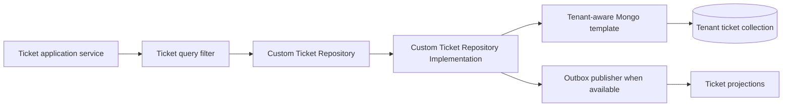
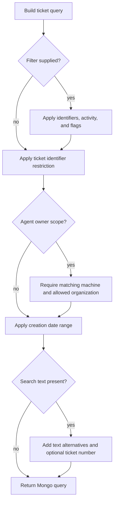
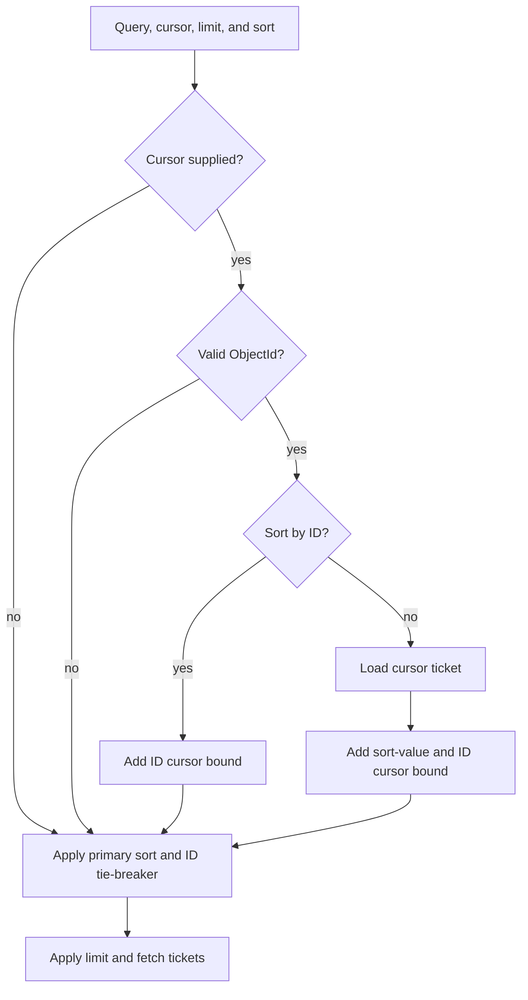
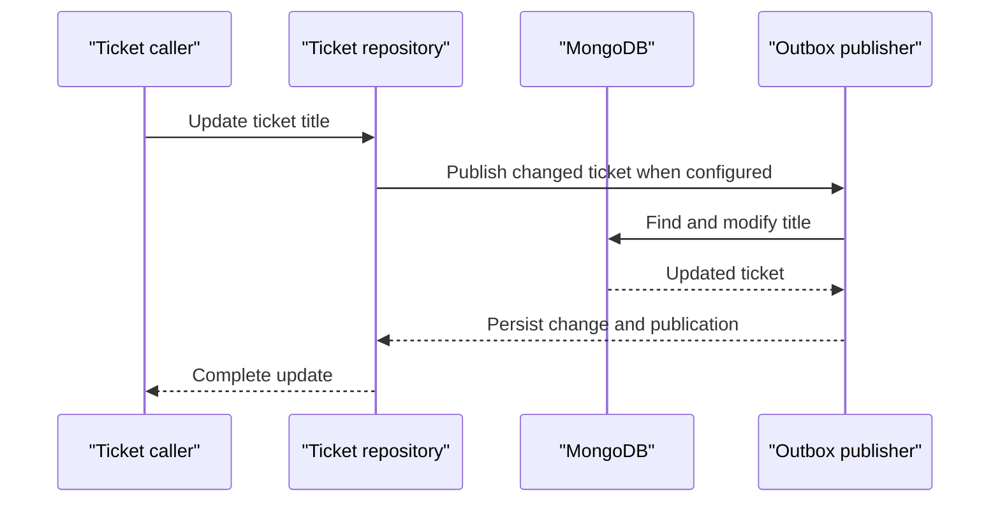

# Ticket Repositories

## Purpose

Ticket Repositories is the tenant-aware MongoDB persistence extension for ticket records. It is supplied at runtime by the `com.openframe.oss:openframe-data-mongo-sync` library, version `7.0.11`, consumed by this repository. The module converts ticket filtering, text search, ownership scope, cursor paging, aggregation, and targeted ticket updates into MongoDB operations while preserving tenant isolation.

The module has two source components:

- [Custom Ticket Repository](https://github.com/flamingo-stack/openframe-oss-lib/blob/16e7c1cbd9664e7d10ec5ebca7d53c9bd314decf/openframe-data-mongo-sync/src/main/java/com/openframe/data/repository/ticket/CustomTicketRepository.java) defines the repository extension contract.
- [Custom Ticket Repository Implementation](https://github.com/flamingo-stack/openframe-oss-lib/blob/16e7c1cbd9664e7d10ec5ebca7d53c9bd314decf/openframe-data-mongo-sync/src/main/java/com/openframe/data/repository/ticket/CustomTicketRepositoryImpl.java) implements that contract using the tenant-aware Mongo template.

## Position in the System

The repository is part of the ticket data path in the OpenFrame tenant service. Ticket-facing application services construct a `TicketQueryFilter` and invoke repository behavior through the Spring Data repository extension. The implementation queries the tenant-scoped `Ticket` collection and, for title changes when publishing is configured, coordinates the mutation with the outbox publisher so projection consumers can receive the change.

The repository implementation is enabled only when `openframe.tenant-isolation.enabled` is `true`. It inherits tenant criteria from `TenantAwareRepositorySupport`; therefore aggregate queries and collection-wide counts explicitly include the current tenant criterion. Normal repository operations performed through the tenant-aware template also remain within the active tenant context.

## Component Responsibilities

| Component | Responsibility |
|---|---|
| `CustomTicketRepository` | Defines query construction, cursor-page retrieval, counts, status reassignment, copied-display-field updates, activity stamps, and sort validation. |
| `CustomTicketRepositoryImpl` | Builds MongoDB `Query`, `Criteria`, `Update`, and aggregation operations, executes them through `TenantAwareMongoTemplate`, and optionally emits title mutations through the outbox. |
| `TicketQueryFilter` | Provides collection filters such as ticket numbers, statuses, organization, assignee, device, creation source, activity state, and boolean flags. It belongs to the Mongo common library artifact. |
| `ClientOwnerScope` | Restricts agent-visible ticket searches to a machine and, where supplied, an organization ownership snapshot. |
| `TicketAggregateSpec` and `OutboxPublisher` | Provide the optional publication path for title changes, keeping the write consistent with ticket projections when publishing is enabled. |

## Query Construction

`buildTicketQuery` composes the following constraints into one MongoDB query when values are supplied:

- Ticket number, status identifier and status kind.
- Organization, assignee, device, and creation-source identifiers.
- A fixed set of allowed ticket identifiers, used to narrow a query before paging.
- Creation time range, with an agent's organization-assignment time acting as an additional lower bound.
- Case-insensitive literal text matching on title, device hostname, organization name, and assignee name. An all-digit search term is also matched exactly as a ticket number.
- Boolean flags for user escalation and pending approval. A request for `false` accepts an absent flag as false, which preserves compatibility with older ticket records.

### Agent Ownership Scope

An unrestricted administrative request passes no owner scope. For an agent request, the repository requires `owner.machineId` to match. If the scope has an organization identifier, `owner.organizationId` must equal that identifier or be absent. The latter deliberately permits tickets created before the ownership snapshot was backfilled.

### Activity Filtering

Activity criteria support stale, active, and awaiting-external tickets. Staleness can vary by status identifier and has a fallback cutoff for statuses without an explicit mapping. A ticket with no `lastActivityAt` is evaluated using `createdAt`; this preserves sensible filtering for older tickets that predate activity tracking. Tickets awaiting a client or external response are identified by a non-null `awaitingClientSince` value.

## Cursor Pagination and Sorting

`findTicketsWithCursor` implements keyset pagination using the MongoDB `_id` field as the stable tie-breaker. The default sort field is `_id`; supported explicit sort fields are ticket number, status kind, organization name, assignee name, device hostname, creation time, update time, resolution time, last activity time, and order.

For a sort other than `_id`, the implementation loads the cursor ticket to obtain its primary sort value. It then selects records beyond that value, plus records with the same value and an `_id` beyond the cursor in the requested direction. This avoids duplicate or skipped rows among equal primary sort values. If the supplied cursor is malformed or no cursor record exists, the implementation logs a warning and falls back to an `_id` bound.

Callers should validate a requested sort field with `isSortableField` and use `getDefaultSortField` when no valid field is provided. This prevents arbitrary document properties from becoming a sort expression.

## Counts and Ticket Metrics

The module provides both query-specific and tenant-wide metrics:

- `countTickets` counts the result of a prebuilt query.
- `countTicketsByStatusKind` groups the current tenant's tickets by status kind. Unknown persisted enum values are ignored after a warning.
- `countTicketsByStatusId` groups by concrete status identifier.
- `getTotalCount` counts every ticket in the current tenant.
- `getAverageResolutionTimeMs` averages `resolvedAt - createdAt` for tickets with both timestamps and returns no value when there are no qualifying records.

These aggregations use explicit tenant criteria because they operate directly against the ticket collection rather than extending a caller-provided query.

## Update Semantics

### Status and Denormalized Fields

`reassignTicketsToStatus` supports reassignment from one status or from a supplied query. It updates status identifier, status kind, and `updatedAt` in a bulk operation.

The repository also maintains denormalized ticket display fields when related entities change:

- Assignee identifier to assignee name.
- Resolver identifier to resolver name.
- Organization identifier to organization name.
- Device identifier to device hostname.

These bulk updates only target documents whose copied value differs. They use the mapped `Ticket` entity so Spring's version behavior protects a stale full-document save from silently overwriting a concurrently refreshed copy.

### Activity and Approval Updates

`updateLastActivityAt` and `updateActivityAndAwaiting` use `findAndModify` and return the newly stamped ticket. The returned document gives a downstream broadcaster a consistent view of status and client-wait timestamps from the same database round trip. These targeted updates intentionally do not change `updatedAt`, because that field represents a user-visible ticket status change rather than every message or chat activity event.

Both activity methods increment the optimistic-lock version by zero to prevent Spring Data from adding its usual version increment. Consequently, activity arriving concurrently with a user edit does not cause the user save to fail. `updatePendingApproval` uses the same zero increment because that flag is derived during saves and should not create artificial conflicts.

### Title Updates and Publishing

Title changes update the title and `updatedAt`. When both an outbox publisher and ticket aggregate specification are available, the write runs through `publishChanged`; this allows ticket projections to observe title edits just as they would after a normal repository save. If a concurrent ticket save produces an optimistic-lock failure, the implementation retries the plain title assignment through the publisher because the assignment itself is safe to repeat.

If publishing dependencies are unavailable, the repository performs the title write directly and does not attempt an outbox publication.

## Operational Considerations

- The implementation is conditional on tenant isolation. Deployments that disable `openframe.tenant-isolation.enabled` do not create this component.
- Search input is quoted before being used in regular expressions, so a search term is treated literally rather than as user-provided regex syntax.
- The upper creation-date boundary is exclusive, while the lower boundary is inclusive.
- Invalid cursor identifiers do not fail the request. They are logged and the unbounded query proceeds, which callers should account for when validating API input.
- Repository methods use the library's tenant-aware Mongo integration and are not standalone ticket business logic. Status-transition validation, authorization, and ticket lifecycle policy belong to the calling service layer.

## Source and Runtime Dependency

This repository consumes the implementation from the OpenFrame OSS Library rather than defining it locally. The active source revision documented here is `16e7c1cbd9664e7d10ec5ebca7d53c9bd314decf` in the OpenFrame OSS Library, delivered through `com.openframe.oss:openframe-data-mongo-sync` version `7.0.11`.
