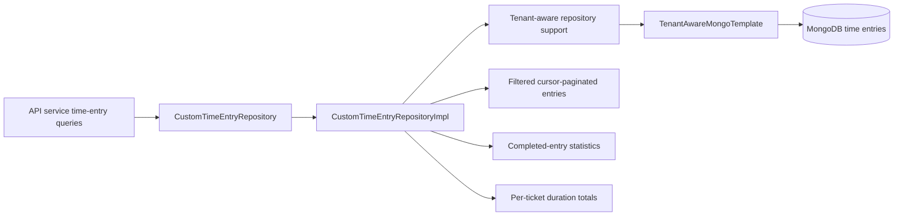
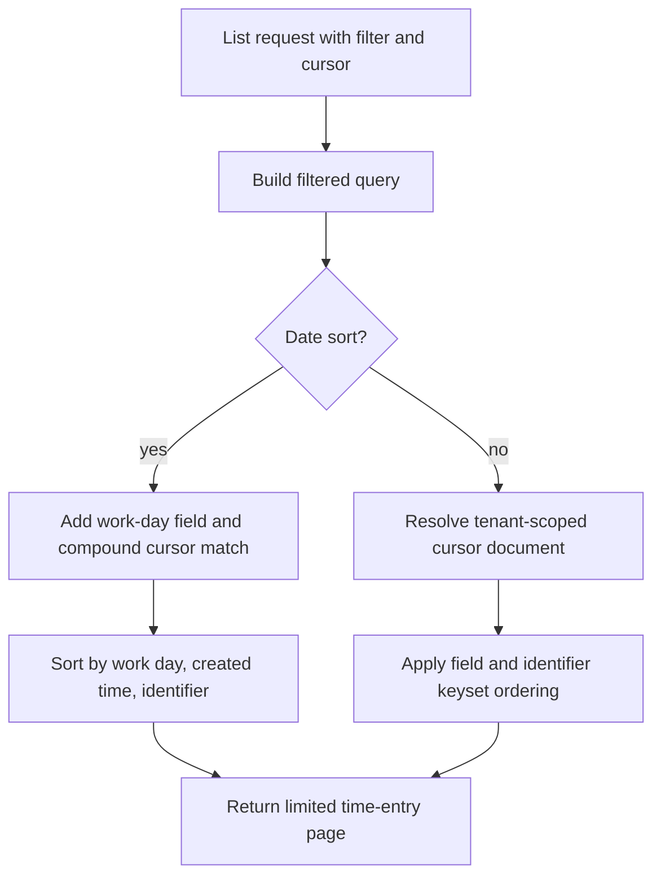
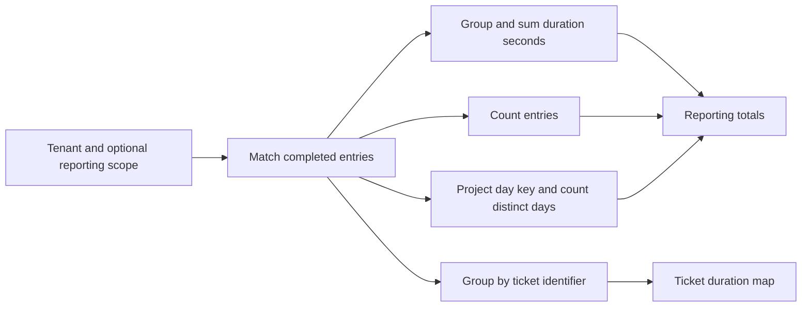

# Timetracking Repositories

Timetracking Repositories provide the tenant-scoped MongoDB query and aggregation operations behind time-entry listing, reporting, and ticket-level duration totals. The module is implemented by the `openframe-data-mongo-sync` library from [OpenFrame OSS Library](https://github.com/flamingo-stack/openframe-oss-lib) and is consumed at run time by this tenant service through `com.openframe.oss:openframe-data-mongo-sync` version `7.0.11`.

The public [CustomTimeEntryRepository interface](https://github.com/flamingo-stack/openframe-oss-lib/blob/16e7c1cbd9664e7d10ec5ebca7d53c9bd314decf/openframe-data-mongo-sync/src/main/java/com/openframe/data/repository/timetracking/CustomTimeEntryRepository.java) defines the repository contract. Its [CustomTimeEntryRepositoryImpl implementation](https://github.com/flamingo-stack/openframe-oss-lib/blob/16e7c1cbd9664e7d10ec5ebca7d53c9bd314decf/openframe-data-mongo-sync/src/main/java/com/openframe/data/repository/timetracking/CustomTimeEntryRepositoryImpl.java) translates that contract into tenant-aware MongoDB queries and aggregation pipelines.

## Responsibilities

- Build filters for users, tickets, organizations, sources, start-time windows, search text, and active or completed state.
- Return cursor-paginated time-entry lists with stable ordering.
- Calculate completed-entry duration, count, and active-day statistics for reporting scopes.
- Aggregate completed duration by ticket while returning zero totals for requested tickets that have no completed entries.
- Enforce an allowlist of sortable fields and provide a default sort field.
- Scope every implementation query to the current tenant through `TenantAwareMongoTemplate` and inherited tenant criteria.

## Architecture

The API service includes a `TimeEntryDataFetcher`, while ticket publication supplies time-entry ticket projections. Those components sit above or alongside this persistence module; this module remains focused on MongoDB filtering, pagination, and aggregation rather than transport or presentation concerns.

## Core Components

| Component | Responsibility |
|---|---|
| `CustomTimeEntryRepository` | Declares query construction, cursor retrieval, counting, statistics, ticket totals, and sort-validation operations. |
| `CustomTimeEntryRepositoryImpl` | Provides MongoDB-backed behavior and is enabled only when `openframe.tenant-isolation.enabled` is `true`. |
| `TenantAwareRepositorySupport` | Supplied by the library's persistence infrastructure; provides the tenant criterion that protects queries and aggregations from crossing tenant boundaries. |
| `TenantAwareMongoTemplate` | Applies tenant-aware MongoDB access for document lookup, queries, counts, and aggregation execution. |

## Query Construction

`buildTimeEntryQuery` converts a `TimeEntryQueryFilter` into a MongoDB `Query` without adding filtering criteria for absent or empty filter values. It supports these inputs:

| Filter concern | Repository behavior |
|---|---|
| User, ticket, organization, and source identifiers | Adds an `in` criterion when the supplied list is non-empty. |
| Start-time range | Applies an inclusive lower bound and an exclusive upper bound to `startedAt`. |
| State | Active entries require a null `endedAt`; completed entries require a non-null `endedAt`. |
| Text search | Performs case-insensitive literal matching across notes and ticket title. Numeric search text is also compared to ticket number. |

Search text is wrapped with `Pattern.quote`, so a user-provided string is treated as literal text rather than executable regular-expression syntax.

## Cursor Pagination and Sorting

The repository validates requested fields using its explicit sortable-field allowlist: `_id`, `date`, `startedAt`, `endedAt`, `durationSeconds`, `createdAt`, and `updatedAt`. The default is `date`.

For ordinary fields, the repository uses keyset pagination. It resolves the cursor document within the current tenant, compares the requested sort value, and uses `_id` as a deterministic tie-breaker. Invalid cursors are logged and do not prevent the request from completing.

The `date` sort uses a dedicated aggregation pipeline. It derives a calendar-day key from `startedAt`, then orders by:

1. Derived work day.
2. `createdAt`.
3. `_id`.

Its composite cursor encodes the day key, creation timestamp in milliseconds, and object identifier. Reapplying the same sort direction to each keyset comparison prevents duplicates and gaps as callers continue to later pages.

## Reporting Aggregations

Statistics are intentionally limited to completed entries. `buildStatsMatchCriteria` begins with the current tenant and a non-null `endedAt`, then optionally narrows by user IDs, organization IDs, and a `startedAt` range when both range endpoints are supplied.

| Operation | Result |
|---|---|
| `sumDurationSeconds` | Sum of `durationSeconds` for completed entries in the requested scope. Returns zero when no matching aggregation result exists. |
| `countCompletedEntries` | Count of completed entries in the requested scope. |
| `countDistinctActiveDays` | Number of distinct calendar-day values derived from `startedAt` for completed entries. |
| `sumDurationSecondsByTicketIds` | Map of requested ticket IDs to summed completed duration. The map is initialized with zero values so tickets without matching entries remain present. |

## Tenant Isolation and Operational Notes

The implementation is conditional on `openframe.tenant-isolation.enabled=true`. All aggregate paths explicitly include tenant criteria. Ordinary document operations use `TenantAwareMongoTemplate`; notably, cursor lookup uses `findOne` rather than a non-tenant-aware identifier lookup, preventing a cursor identifier from resolving a document outside the active tenant.

When extending this repository:

- Add a field to `SORTABLE_FIELDS`, `getSortFieldValue`, and keyset handling together; otherwise accepted sorting and cursor evaluation can diverge.
- Preserve exclusive upper bounds for time ranges and cursor comparisons to avoid page overlap.
- Apply tenant criteria to every new aggregation pipeline, including summary and grouping operations.
- Keep duration statistics constrained to entries with `endedAt`, matching the module's definition of completed work.
- Treat date sorting as a compound ordering contract. Any change to its derived day key, tie-breakers, or cursor format requires matching updates to cursor creation by callers.

## System Placement

Timetracking Repositories are part of the Mongo synchronous data layer assembled into OpenFrame OSS Tenant. They persist and query time-entry documents used by higher-level time-tracking API workflows, ticket-related duration summaries, and the time-tracking test coverage represented by `TimeTrackingTest`. The repository does not expose HTTP or GraphQL endpoints itself; those interfaces belong to services that invoke the data layer.

## Documentation Scope

This module contains a closely coupled repository contract and implementation rather than independently navigable submodules. Their responsibilities and interaction are documented together in this page.
