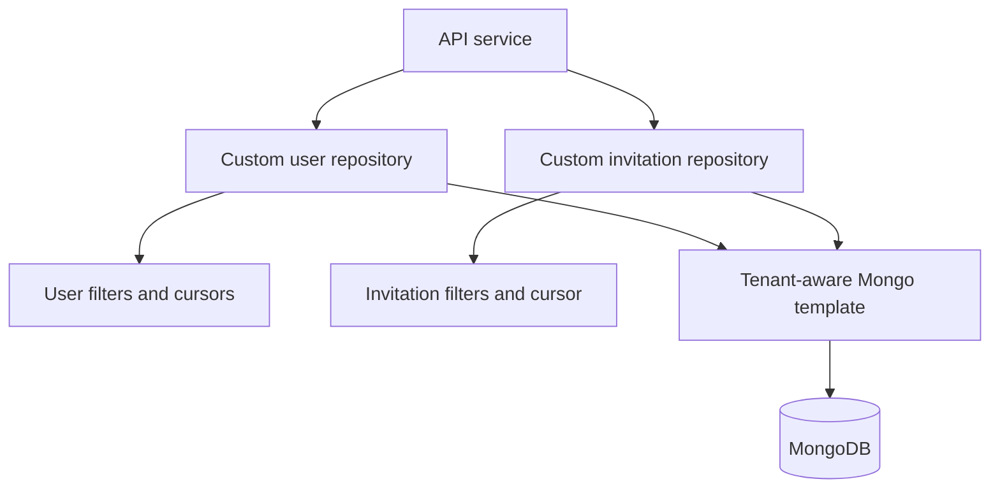
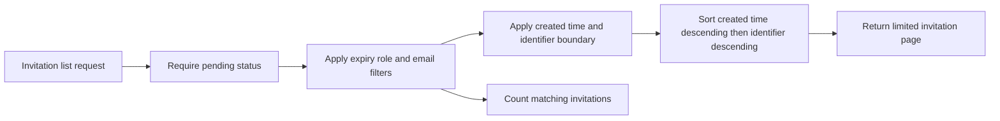
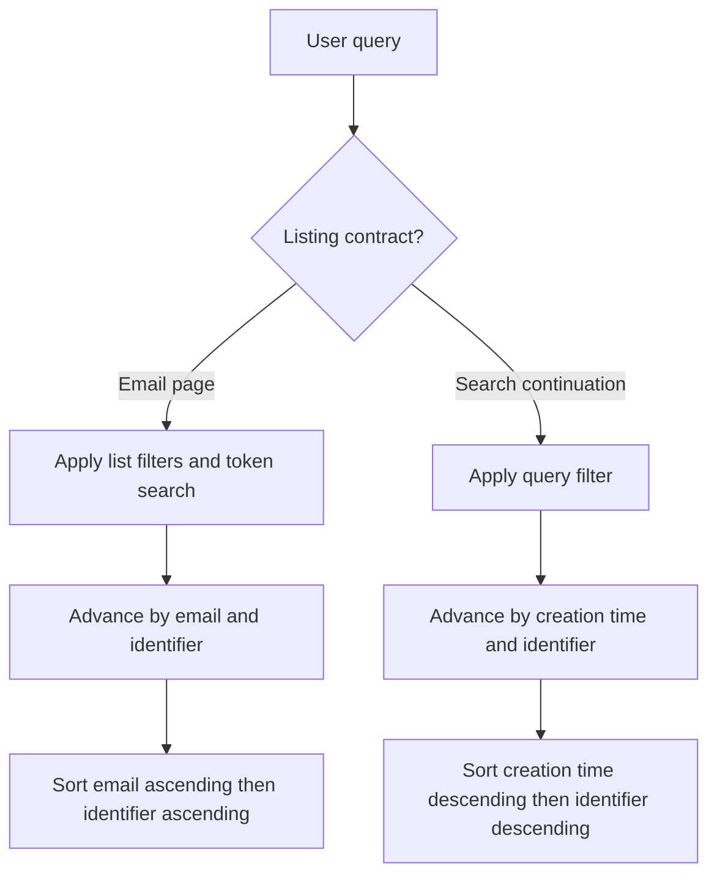

# User Invitation Repositories

User Invitation Repositories is the MongoDB query layer that supports tenant-scoped user discovery and pending-invitation listings. It is supplied at runtime by the OpenFrame OSS Library through the `com.openframe.oss:openframe-data-mongo-sync` dependency, pinned by this service at version `7.0.11`.

The module adds application-specific query behavior to the user and invitation persistence abstractions. It does not create, update, accept, or delete records; instead, it composes MongoDB criteria, applies deterministic ordering and cursor boundaries, counts matching records, and returns the matching `User` or `Invitation` documents. Tenant isolation is contributed by the surrounding tenant-aware MongoDB template configuration rather than explicitly constructed in these repository classes.

## Responsibilities

- List only pending invitations, optionally constrained by expiration state, roles, and a case-insensitive literal email search.
- Count invitations using the same criteria as their list operation.
- List users with status, role, exclusion, and tokenized name or email search filters.
- Provide two stable user pagination contracts: a public list ordered by email and identifier, and an internal search continuation ordered by creation time and identifier.
- Treat cursor identifiers as tie breakers, preventing rows with identical primary sort values from being skipped or repeated within a stable result set.
- Preserve legacy records with missing creation timestamps by explicitly placing them after timestamped rows in descending creation-time scans.

## Architecture

The repository interfaces define the query contracts. Their implementations receive a `MongoTemplate`, build `Criteria` and `Query` objects, log the generated query at debug level, and map database results into domain documents. The module is part of the synchronous Mongo data artifact and is assembled into OpenFrame services that consume that artifact.

## Components

| Component | Responsibility |
| --- | --- |
| [Custom Invitation Repository](https://github.com/flamingo-stack/openframe-oss-lib/blob/16e7c1cbd9664e7d10ec5ebca7d53c9bd314decf/openframe-data-mongo-sync/src/main/java/com/openframe/data/repository/user/CustomInvitationRepository.java) | Defines paged pending-invitation retrieval and matching-count operations. |
| [Custom Invitation Repository Implementation](https://github.com/flamingo-stack/openframe-oss-lib/blob/16e7c1cbd9664e7d10ec5ebca7d53c9bd314decf/openframe-data-mongo-sync/src/main/java/com/openframe/data/repository/user/CustomInvitationRepositoryImpl.java) | Builds invitation filters, applies descending creation-time cursor pagination, and executes queries with `MongoTemplate`. |
| [Custom User Repository](https://github.com/flamingo-stack/openframe-oss-lib/blob/16e7c1cbd9664e7d10ec5ebca7d53c9bd314decf/openframe-data-mongo-sync/src/main/java/com/openframe/data/repository/user/CustomUserRepository.java) | Defines user search, email-ordered listing, counting, and creation-time continuation operations. |
| [Custom User Repository Implementation](https://github.com/flamingo-stack/openframe-oss-lib/blob/16e7c1cbd9664e7d10ec5ebca7d53c9bd314decf/openframe-data-mongo-sync/src/main/java/com/openframe/data/repository/user/CustomUserRepositoryImpl.java) | Translates user filters into criteria and maintains the two ordering and cursor contracts. |
| [User Sort Key](https://github.com/flamingo-stack/openframe-oss-lib/blob/16e7c1cbd9664e7d10ec5ebca7d53c9bd314decf/openframe-data-mongo-sync/src/main/java/com/openframe/data/repository/user/UserSortKey.java) | Represents the `createdAt` and identifier continuation boundary for descending user searches. |

## Invitation Queries

`findOpenInvitationsPage` and `countOpenInvitations` always constrain results to invitations whose status is `PENDING`. The optional filter can further select expired invitations, non-expired invitations, invitations containing any requested role, and invitations whose email contains the trimmed search text. Email search uses a quoted, case-insensitive regular expression, so search text is interpreted literally rather than as a caller-supplied regular expression.

The list operation sorts by `createdAt` descending and then MongoDB `_id` descending. An invitation cursor describes the last row returned. For a timestamped cursor, the next page includes rows with an earlier timestamp, rows at the same timestamp and a smaller identifier, and rows without a creation timestamp. If the cursor itself has no timestamp, only smaller identifiers from the no-timestamp group are selected. This makes records missing `createdAt` reachable while preserving a deterministic order.

### Invitation Filter Semantics

| Filter input | MongoDB behavior |
| --- | --- |
| Expiration flag is absent | Does not filter on `expiresAt`. |
| Expiration flag is true | Requires `expiresAt` before the supplied evaluation instant. |
| Expiration flag is false | Requires `expiresAt` at or after the supplied evaluation instant. |
| Role collection is non-empty | Matches invitations whose `roles` contains any supplied value. |
| Search text is non-blank | Performs a literal, case-insensitive substring match against `email`. |

Expiration is evaluated against the `now` value supplied by the caller. Consequently, callers should use a consistent instant for a count and its associated page when they need a coherent snapshot at the application boundary.

## User Queries

The user repository has two query families because consumers need different sort orders.

### Email-Ordered User Listing

`findUsersPage` and `countUsers` share `UserListFilter` criteria:

- selected statuses;
- roles containing any requested value;
- identifiers excluded from the result; and
- whitespace-separated search tokens.

Each non-empty search token must match at least one of first name, last name, or email. Name matches are case-insensitive literal substring matches. Email matches use the same literal matching, but exclude users with the `SELF_DELETED` status only for the email alternative; this prevents a synthetic self-deleted email from becoming a search result while preserving name-based behavior.

The page is sorted ascending by `email` and then ascending by `id`. Its cursor advances with the lexicographic rule `email > cursor.email` or equal email with `id > cursor.id`.

### Creation-Time Search and Continuation

`findUsersBySearch` accepts `UserQueryFilter`, supporting an optional exact status plus optional literal, case-insensitive email and name matching. It sorts by `createdAt` descending and `id` descending.

`findUserPageAfter` uses the same sort and receives `UserSortKey` as the continuation boundary. When a boundary has a creation timestamp, later results are earlier timestamps, matching timestamps with smaller identifiers, or records without a timestamp. When the boundary lacks a creation timestamp, only no-timestamp records with smaller identifiers remain. The identifier is required because creation timestamps are not unique.

## Operational and Maintenance Notes

- The implementations use `limit` directly. Validation of page size and cursor encoding belongs to the invoking service layer.
- Both implementations escape search input with `Pattern.quote`. Do not replace that behavior with raw regular-expression input unless the API contract explicitly intends to expose regular expressions.
- Cursor generation must exactly match the selected sort order. Changing an order, field name, or identifier direction requires coordinating cursor parsing and all callers, otherwise pages can omit or duplicate records.
- The explicit no-creation-time branches are intentional compatibility behavior for records missing `createdAt`; do not simplify them into a timestamp range query.
- Criteria are composed as an unkeyed logical conjunction when necessary. This permits the tenant-aware Mongo template to add its tenant criterion alongside the repository query.

## System Context

User and invitation API operations are exposed by the OpenFrame API service layer, while registration and authentication flows are handled by the authorization service. This module remains focused on persistence querying: it supplies filtered, paginated user and invitation data to those higher-level workflows and relies on their authorization, validation, and lifecycle logic.
