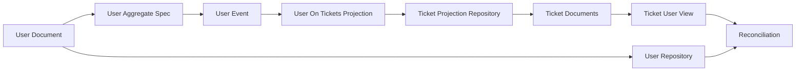
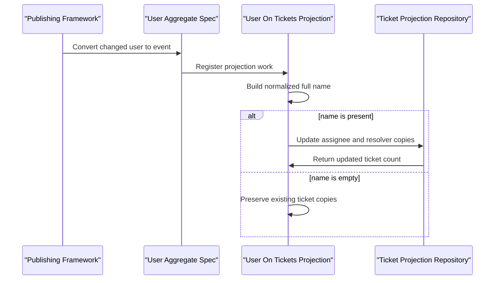
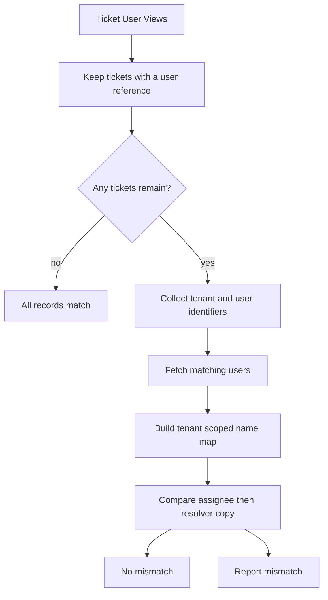

# User Publishing Repositories

User Publishing Repositories synchronizes denormalized user-name copies held by tickets with the corresponding user records. The code runs from the OpenFrame OSS Library dependency `com.openframe.oss:openframe-data-mongo-sync` version `7.0.11`; this repository assembles the service that consumes it.

The module publishes the `users` aggregate and projects a user's normalized display name to both ticket roles that store a user reference: assignee and resolver. It is tenant-aware throughout, so an identifier is interpreted with its tenant context.

## Architecture

The publishing framework provides a tenant-scoped record to the projection. For a usable name, the projection delegates updates to the ticket repository. Reconciliation reads a narrow ticket view, fetches the relevant users, and reports drift without directly modifying ticket records.

## Components

| Component | Responsibility |
| --- | --- |
| [User Aggregate Spec](https://github.com/flamingo-stack/openframe-oss-lib/blob/16e7c1cbd9664e7d10ec5ebca7d53c9bd314decf/openframe-data-mongo-sync/src/main/java/com/openframe/data/repository/user/publishing/UserAggregateSpec.java) | Spring aggregate specification for the `users` type. It converts `User` records to events and registers the ticket projection. `AuthUser` can use this specification because it extends `User`. |
| [User Event](https://github.com/flamingo-stack/openframe-oss-lib/blob/16e7c1cbd9664e7d10ec5ebca7d53c9bd314decf/openframe-data-mongo-sync/src/main/java/com/openframe/data/repository/user/publishing/UserEvent.java) | Published payload carrying the user identifier, first name, and last name. It centralizes normalized full-name derivation. |
| [User On Tickets Projection](https://github.com/flamingo-stack/openframe-oss-lib/blob/16e7c1cbd9664e7d10ec5ebca7d53c9bd314decf/openframe-data-mongo-sync/src/main/java/com/openframe/data/repository/user/publishing/UserOnTicketsProjection.java) | Projection named `user-on-tickets`; applies, counts, batches, and reconciles name propagation to tickets. |
| [Ticket User View](https://github.com/flamingo-stack/openframe-oss-lib/blob/16e7c1cbd9664e7d10ec5ebca7d53c9bd314decf/openframe-data-mongo-sync/src/main/java/com/openframe/data/repository/user/publishing/TicketUserView.java) | Minimal reconciliation view containing ticket and tenant identifiers plus assignee and resolver identifiers and copied names. |
| [User Full Names](https://github.com/flamingo-stack/openframe-oss-lib/blob/16e7c1cbd9664e7d10ec5ebca7d53c9bd314decf/openframe-data-mongo-sync/src/main/java/com/openframe/data/repository/user/publishing/UserFullNames.java) | Builds a `TenantScopedId` to normalized-name lookup for a reconciliation batch. |

## Publication and Projection Flow

`UserAggregateSpec` maps the source record to a `UserEvent`. `UserOnTicketsProjection` derives a display name by retaining nonblank first and last name parts, trimming each, and joining them with one space. The event does not serialize this derived value; both publication and reconciliation use the same helper logic.

When the derived name is empty, the projection deliberately does not clear ticket values. A ticket copy may retain another useful display value, such as an email address. Otherwise, the ticket repository updates copies matching the tenant and user identifier for both supported roles.

### Bounded Projection Work

The projection supports the publishing framework's three execution modes:

- `apply` updates matching ticket copies and logs the affected count.
- `countChanges` returns the bounded number of candidate updates, or zero when there is no usable name.
- `applyBatch` applies one page and returns the repository continuation identifier. It has no continuation when there is no usable name.

These operations permit rename propagation to be assessed and performed incrementally for large ticket sets.

## Reconciliation

Reconciliation considers only tickets having an assignee or resolver identifier. It collects the relevant tenant and user identifiers, fetches matching user documents, and keys normalized names with `TenantScopedId`. For every ticket, it evaluates the assignee copy first and the resolver copy second.

A mismatch is emitted only if the source user exists in the same tenant, has a non-empty normalized name, and that name differs from the stored copy. The resulting mismatch identifies the tenant, ticket, user, and differing names.

The following cases are intentionally treated as matching:

- A source user is absent. Historical ticket text remains useful after user deletion.
- The source user has no usable name. Existing ticket text is preserved.
- The source and copied names are equal.

## Ticket Fields

`TicketUserView` restricts reconciliation reads to the fields that this projection owns.

| Ticket role | User identifier | Copied display name |
| --- | --- | --- |
| Assignee | `assignedTo` | `assignedName` |
| Resolver | `resolvedById` | `resolvedByName` |

## Operational Considerations

- Treat `users` and `user-on-tickets` as stable aggregate and projection identifiers in publishing configuration and observability.
- Retain tenant context for every user lookup and update. The reconciliation lookup uses `TenantScopedId` to avoid cross-tenant collisions.
- Investigate reconciliation mismatches as stale projections, while excluding expected no-op cases for deleted users and blank names.
- Behavior changes belong in the OpenFrame OSS Library source linked above; this tenant repository supplies the runtime composition.

For support and community discussion, use the [OpenMSP Slack community](https://join.slack.com/t/openmsp/shared_invite/zt-36bl7mx0h-3~U2nFH6nqHqoTPXMaHEHA).