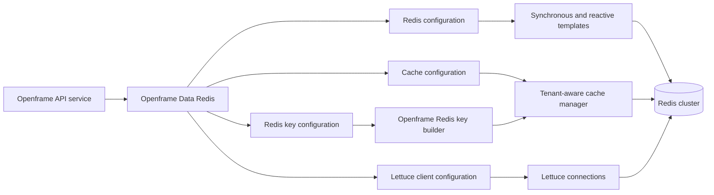
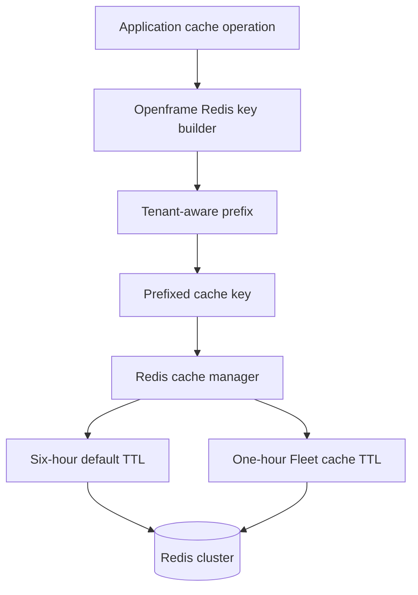
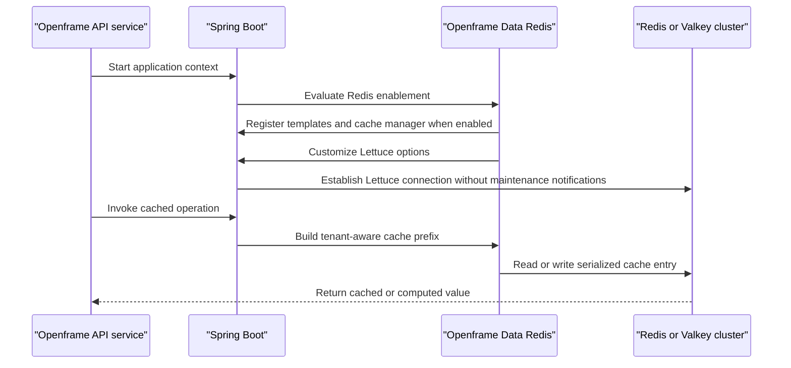

# Openframe Data Redis

Openframe Data Redis is the Redis integration library assembled by the OpenFrame OSS Tenant services. It supplies conditional Spring Data Redis infrastructure, a tenant-aware Spring Cache manager, and a Lettuce compatibility adjustment for Redis-compatible Valkey deployments.

The module is published by the OpenFrame OSS Library as Maven artifact `com.openframe.oss:openframe-data-redis` at version `7.0.11`. In this repository it is run by the Openframe API service and is configured against the Redis cluster declared in the shared application configuration. The library has no HTTP endpoints; it contributes Spring beans to the application context.

## Responsibilities

- Enable Redis repository scanning only when `spring.redis.enabled=true`.
- Provide synchronous and reactive string-oriented Redis templates unless an application supplies replacements.
- Enable Spring Cache with tenant-scoped cache key prefixes.
- Apply six-hour default cache expiry and one-hour expiry for Fleet policy and query caches.
- Disable Lettuce maintenance notifications so Valkey does not receive an unsupported `CLIENT MAINT_NOTIFICATIONS ON` command.

## Architecture



The module activates its data access and caching beans only when Redis is explicitly enabled. The Lettuce customizer is intentionally unconditional: Spring Boot may create Lettuce connections for a service that has Redis connection settings even when caching and repository support are not activated.

## Component Overview

| Component | Role | Activation and override behavior |
| --- | --- | --- |
| [CacheConfig](https://github.com/flamingo-stack/openframe-oss-lib/blob/16e7c1cbd9664e7d10ec5ebca7d53c9bd314decf/openframe-data-redis/src/main/java/com/openframe/data/config/CacheConfig.java) | Enables Spring Cache and builds the Redis-backed `CacheManager`. | Requires `spring.redis.enabled=true`; does not replace an existing `CacheManager`. |
| [RedisConfig](https://github.com/flamingo-stack/openframe-oss-lib/blob/16e7c1cbd9664e7d10ec5ebca7d53c9bd314decf/openframe-data-redis/src/main/java/com/openframe/data/config/RedisConfig.java) | Enables Redis repositories and provides string serialization templates. | Requires `spring.redis.enabled=true`; each template is created only when its bean type is absent. |
| [LettuceClientConfig](https://github.com/flamingo-stack/openframe-oss-lib/blob/16e7c1cbd9664e7d10ec5ebca7d53c9bd314decf/openframe-data-redis/src/main/java/com/openframe/data/config/LettuceClientConfig.java) | Disables Lettuce maintenance notifications. | Always contributes its customizer. |
| [OpenframeRedisKeyConfiguration](https://github.com/flamingo-stack/openframe-oss-lib/blob/16e7c1cbd9664e7d10ec5ebca7d53c9bd314decf/openframe-data-redis/src/main/java/com/openframe/data/redis/OpenframeRedisKeyConfiguration.java) | Binds Redis key properties and exposes the key builder. | Does not replace an application-provided `OpenframeRedisKeyBuilder`. |

## Redis Access Configuration

`RedisConfig` is the opt-in entry point for data access. When `spring.redis.enabled` is true, it enables repository discovery under `com.openframe.data.repository.redis` and defines three default beans:

- `RedisTemplate<String, String>` for imperative operations. Keys, values, hash keys, and hash values use `StringRedisSerializer`.
- `ReactiveStringRedisTemplate` for reactive string operations.
- `ReactiveRedisTemplate<String, String>` for reactive operations with an explicit all-string serialization context.

String serialization makes stored values inspectable and prevents application-specific Java serialization from becoming an implicit data format. Applications needing another representation can provide their own matching bean; the module's `ConditionalOnMissingBean` declarations preserve that customization point.

## Cache Configuration and Tenant Isolation

`CacheConfig` enables annotation-driven Spring caching and registers a `RedisCacheManager` when Redis is enabled and no cache manager already exists. Its default configuration:

- expires entries after six hours;
- rejects cached null values;
- serializes cache keys as strings;
- serializes cache values using `GenericJacksonJsonRedisSerializer` with type metadata; and
- tolerates missing primitive fields in cached values written by earlier application versions.

The cache prefix is calculated by `OpenframeRedisKeyBuilder`, producing the documented shape:

```text
<prefix>:<cacheName>::<key>
```

The builder receives configured Redis key properties through `OpenframeRedisKeyConfiguration`. This prefixing is the module's cache-level tenant isolation mechanism: cache names and logical keys are scoped before Redis is accessed.

Fleet policy and Fleet query caches are initialized with a one-hour time-to-live because the underlying policies and queries may be renamed or deleted. All other caches use the six-hour default unless an application supplies a different manager.



## Lettuce and Valkey Compatibility

Modern Lettuce versions send a maintenance-notification command when each connection is established. Valkey does not implement that subcommand. Although Lettuce ignores the resulting error, managed Redis-compatible services can count it as a command error and alert during rollout.

`LettuceClientConfig` contributes a `LettuceClientOptionsBuilderCustomizer` that disables maintenance notifications before connections are created. This configuration is deliberately independent of `spring.redis.enabled`, so the compatibility behavior applies whenever Boot builds a Lettuce connection from Redis host settings.

## Runtime Flow



## Integration in OpenFrame OSS Tenant

The shared configuration lists three Redis cluster nodes through `spring.data.redis.cluster.nodes`. Openframe Data Redis supplies the library-level beans that services can use once Redis is enabled; it does not deploy Redis itself. The repository delivery configuration deploys Redis Cluster as a datasource alongside application services.

The module is consumed from the OpenFrame OSS Library rather than implemented in this repository. Source-level changes belong in the linked library files. Tenant repository services assemble the artifact at version `7.0.11`.

## Operational Considerations

- Redis access and caching are separate from the unconditional Lettuce compatibility customizer. A missing or false `spring.redis.enabled` property prevents repository, template, and cache-manager registration.
- A custom `CacheManager`, `RedisTemplate`, or reactive template takes precedence over this module's default bean of the same type.
- Cache values include serializer type metadata. Changes to cached value classes should remain backward-compatible for entries that exist until their TTL expires.
- The one-hour Fleet cache settings reduce the period in which renamed or deleted policy and query data can be served from cache.
- The module scopes cache keys via the key builder. Code that accesses Redis directly must use the same key-building conventions where tenant isolation is required.

## Source Files

- [Cache configuration](https://github.com/flamingo-stack/openframe-oss-lib/blob/16e7c1cbd9664e7d10ec5ebca7d53c9bd314decf/openframe-data-redis/src/main/java/com/openframe/data/config/CacheConfig.java)
- [Lettuce client configuration](https://github.com/flamingo-stack/openframe-oss-lib/blob/16e7c1cbd9664e7d10ec5ebca7d53c9bd314decf/openframe-data-redis/src/main/java/com/openframe/data/config/LettuceClientConfig.java)
- [Redis template configuration](https://github.com/flamingo-stack/openframe-oss-lib/blob/16e7c1cbd9664e7d10ec5ebca7d53c9bd314decf/openframe-data-redis/src/main/java/com/openframe/data/config/RedisConfig.java)
- [Redis key builder configuration](https://github.com/flamingo-stack/openframe-oss-lib/blob/16e7c1cbd9664e7d10ec5ebca7d53c9bd314decf/openframe-data-redis/src/main/java/com/openframe/data/redis/OpenframeRedisKeyConfiguration.java)
