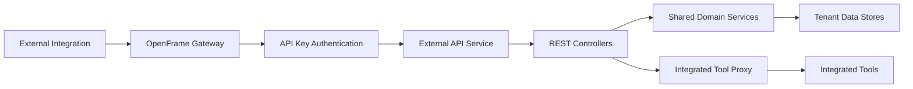
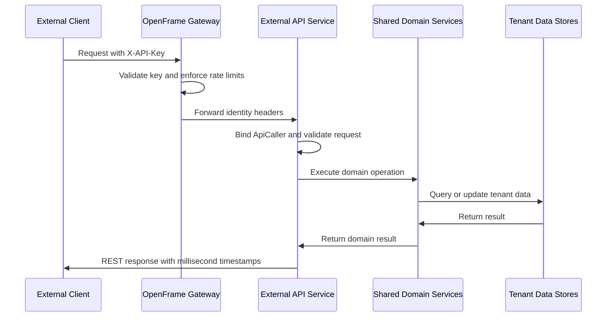

# Openframe External Api Service Core

## Purpose

Openframe External Api Service Core is the library-backed REST surface used by the `openframe-external-api` Spring Boot service. It exposes selected OpenFrame capabilities to API-key integrations: customers, devices, tickets, knowledge base content, logs, integrated tools, and proxied tool endpoints.

The tenant repository runs this module through the `ExternalApiApplication` service entry point. The implementation itself is supplied by the OpenFrame OSS Library artifact `com.openframe.oss:openframe-external-api-service-core` at version `7.0.11`.

## Architecture Overview

The gateway validates the API key before forwarding an external API request. It removes the original key and supplies the authenticated user and API-key identifiers as trusted headers. The service binds those headers to an `ApiCaller` argument for controller logging and, where the shared domain requires it, resolves the caller to an authenticated principal.

## Core Responsibilities

- Provide versioned REST resources under `/api/v1` for platform data and workflows.
- Preserve shared dashboard rules by delegating business operations to the OpenFrame API library services instead of duplicating domain logic.
- Supply cursor pagination, filtering, sorting, validation, consistent response models, and OpenAPI metadata.
- Normalize all serialized `Instant` values to UTC ISO-8601 strings with millisecond precision.
- Expose signed upload and download URL workflows for knowledge base attachments.
- Proxy permitted HTTP methods to configured integrated-tool endpoints.

## Request Processing

## Authentication and Operational Boundaries

Authentication and rate limiting are gateway responsibilities. Requests under the external API gateway prefix require an API key, while direct Swagger and OpenAPI paths are exempted by the gateway filter. A successfully validated request receives rate-limit response headers when configured. Controllers receive the gateway-provided caller context through `ApiCallerArgumentResolver`; they do not parse API-key material themselves.

The gateway routes `/api-docs/**` to the external API service. The OpenAPI group includes `/api/v1/**` and `/tools/**` while excluding actuator and core API paths. The generated contract declares the API-key header scheme and common `400`, `401`, `429`, and `500` responses.

## Submodules

- [Api Configuration](openframe_external_api_service_core/api_configuration/api_configuration.md) describes OpenAPI generation, millisecond timestamp serialization, and the trusted caller argument resolver.
- [Customer And Device Api](openframe_external_api_service_core/customer_and_device_api/customer_and_device_api.md) covers customer and device querying, filtering, tags, and lifecycle updates.
- [Knowledge Base Api](openframe_external_api_service_core/knowledge_base_api/knowledge_base_api.md) documents folders, articles, tags, lifecycle changes, and attachment URL flows.
- [Ticket Api](openframe_external_api_service_core/ticket_api/ticket_api.md) describes ticket discovery, mutation, transitions, assignment, tags, notes, and statistics.
- [Logs Tools And Integrations](openframe_external_api_service_core/logs_tools_and_integrations/logs_tools_and_integrations.md) covers operational log reads, tool metadata, and the integrated-tool HTTP proxy.

## Library Source

The runtime implementation is maintained in the OpenFrame OSS Library. Source links in the detailed documentation point to that library revision, rather than to this tenant repository.
