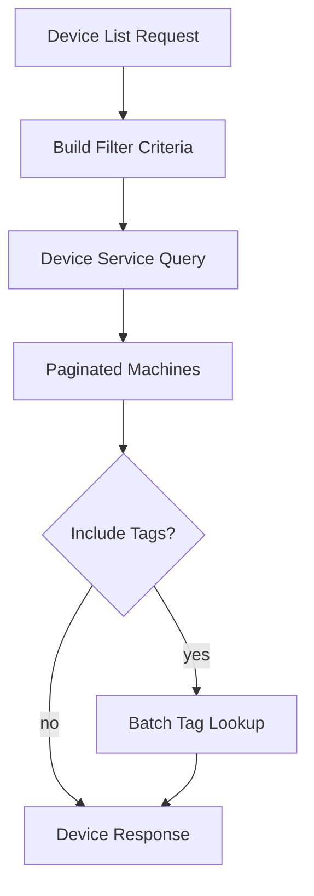

# Customer And Device Api

Customer And Device Api exposes organization data under the customer product term and machine data under the device product term. Both controllers delegate query and mutation work to shared domain services.

## Customers

[`CustomerController`](https://github.com/flamingo-stack/openframe-oss-lib/blob/16e7c1cbd9664e7d10ec5ebca7d53c9bd314decf/openframe-external-api-service-core/src/main/java/com/openframe/external/controller/CustomerController.java) serves `/api/v1/customers`.

- Lists customers with category, employee-count, contract, status, activity-range, text search, cursor, and sort controls.
- Reads a customer by its business organization identifier; internal database identifiers are not exposed by this contract.
- Creates and partially updates customers through `OrganizationCommandService`.
- Tests whether archiving is safe and changes status through the organization services. Archiving is blocked while active devices remain.

## Devices

[`DeviceController`](https://github.com/flamingo-stack/openframe-oss-lib/blob/16e7c1cbd9664e7d10ec5ebca7d53c9bd314decf/openframe-external-api-service-core/src/main/java/com/openframe/external/controller/DeviceController.java) serves `/api/v1/devices`.

- Filters devices by lifecycle status, connectivity, type, operating system, customer, tag key, and tag value.
- Uses cursor pagination, full-text search, and shared sorting. Device filter facets supply selectable values and counts.
- Retrieves an individual machine by machine identifier, including tags.
- Optionally batches tag retrieval for list results. If the tag lookup fails, it logs the failure and returns the device list without tags.
- Updates a device lifecycle status or its nickname.

`DeviceFilterItem`, `TagFilterItem`, and [`DeviceTagResponse`](https://github.com/flamingo-stack/openframe-oss-lib/blob/16e7c1cbd9664e7d10ec5ebca7d53c9bd314decf/openframe-external-api-service-core/src/main/java/com/openframe/external/dto/device/DeviceTagResponse.java) represent filter options and device-specific tag data.

