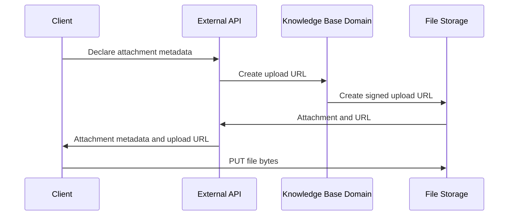

# Knowledge Base Api

Knowledge Base Api makes the shared knowledge base domain available at `/api/v1/knowledge-base`. [`KnowledgeBaseController`](https://github.com/flamingo-stack/openframe-oss-lib/blob/16e7c1cbd9664e7d10ec5ebca7d53c9bd314decf/openframe-external-api-service-core/src/main/java/com/openframe/external/controller/KnowledgeBaseController.java) resolves the API-key owner before authoring actions, so articles follow the same rules and attribution as dashboard operations.

## Item and Folder Management

The controller lists root or folder contents with cursor pagination, search, type, status, and tag filters. It returns folders before articles, omits article content from collection results, and excludes archived articles from active listings. It can read items, move them, and add or remove tags.

Folder endpoints list the complete folder set, create and rename folders, and delete folders. Deleting a non-empty folder requires an explicit child action: move children to a target or root, or archive descendant articles while removing folders. Domain services reject cycles, targets that are articles, and unsafe moves.

## Article Lifecycle

Create and update requests define the external request boundary. `CreateArticleRequest` supports initial status, content, summary, tags, and assignments to customers, devices, tickets, and related articles. Updates are partial. Separate actions publish, unpublish, archive, and restore articles. Archived articles are terminal for ordinary listings and can be restored into a folder or the root.

## Attachments

Attachments use a two-stage flow. A client first declares file metadata, then uploads bytes directly to the returned short-lived signed URL using the declared content type. The service also generates signed download URLs and deletes attachment storage and metadata together.

Responses include paginated item collections, tag metadata, attachment metadata, and signed upload or download links. Timestamp fields receive the module-wide millisecond serialization policy.
