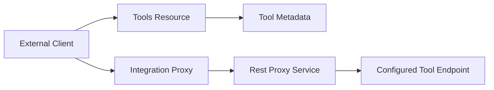

# Logs Tools And Integrations

Logs Tools And Integrations contains read-oriented operational resources and the generic integrated-tool proxy.

## Logs

[`LogController`](https://github.com/flamingo-stack/openframe-oss-lib/blob/16e7c1cbd9664e7d10ec5ebca7d53c9bd314decf/openframe-external-api-service-core/src/main/java/com/openframe/external/controller/LogController.java) serves `/api/v1/logs`.

It queries log records with date and instant boundaries, tool, event, severity, customer, device, search, cursor, and sort controls. Filter endpoints return available option sets for the supplied constraints. The details operation locates an individual record by the complete compound identity: ingest day, tool type, event type, timestamp, and tool event ID. Missing details yield the external log-not-found response.

## Tools

[`ToolController`](https://github.com/flamingo-stack/openframe-oss-lib/blob/16e7c1cbd9664e7d10ec5ebca7d53c9bd314decf/openframe-external-api-service-core/src/main/java/com/openframe/external/controller/ToolController.java) serves `/api/v1/tools`. It filters integrated-tool definitions by enablement, type, category, platform category, and text search, then uses shared sort handling. Its responses describe URLs, enabled state, credentials configuration, health and timeout configuration, layer display data, and allowed proxy paths.

## Integration Proxy

[`IntegrationController`](https://github.com/flamingo-stack/openframe-oss-lib/blob/16e7c1cbd9664e7d10ec5ebca7d53c9bd314decf/openframe-external-api-service-core/src/main/java/com/openframe/external/controller/IntegrationController.java) accepts GET, HEAD, POST, PUT, PATCH, DELETE, and OPTIONS requests under `/tools/{toolId}/**`. It passes the servlet request and optional body to `RestProxyService`, which determines the actual integrated-tool target and permitted behavior. The controller logs the caller context and converts unexpected proxy exceptions to an internal-server-error response.

