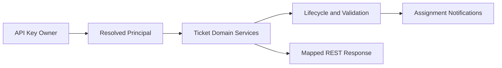

# Ticket Api

Ticket Api exposes the ticket domain at `/api/v1/tickets`. [`TicketController`](https://github.com/flamingo-stack/openframe-oss-lib/blob/16e7c1cbd9664e7d10ec5ebca7d53c9bd314decf/openframe-external-api-service-core/src/main/java/com/openframe/external/controller/TicketController.java) resolves the `ApiCaller` to an authenticated principal and delegates to shared ticket services. This preserves ticket numbering, permissions, lifecycle constraints, notifications, and attribution used by the dashboard.

## Reads and Discovery

The API lists tickets with cursor pagination, text search, filter IDs for status, customer, assignee, and tag, and supported sort fields. It provides filter values, ordered tenant status definitions, ticket tags, statistics, and complete individual ticket views including notes and attachments.

`TicketsResponse` reports the current page, opaque ticket cursors, and the filtered total. Supporting DTOs expose status metadata, tag metadata, selectable filter values, owners, attachment metadata, notes, and aggregate resolution metrics.

## Mutations

- Creating a ticket accepts title, description, optional status, device, customer, assignee, and tag IDs. When a customer is absent it may be derived from the device; a supplied device and customer must agree.
- Updating is partial and can replace the tag set. Status changes use the dedicated transition operation.
- A transition is allowed only when the destination is available from the current status. Resolution and AI-assistance semantics remain domain-owned.
- Assignment, unassignment, device unlinking, customer unlinking, and tag changes return the resulting ticket representation.
- Notes can be created, modified, and removed. The domain enforces that only the note author can change or delete a note.

