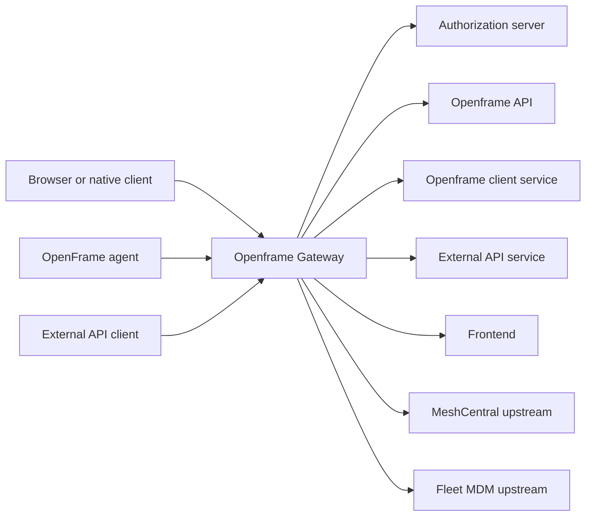
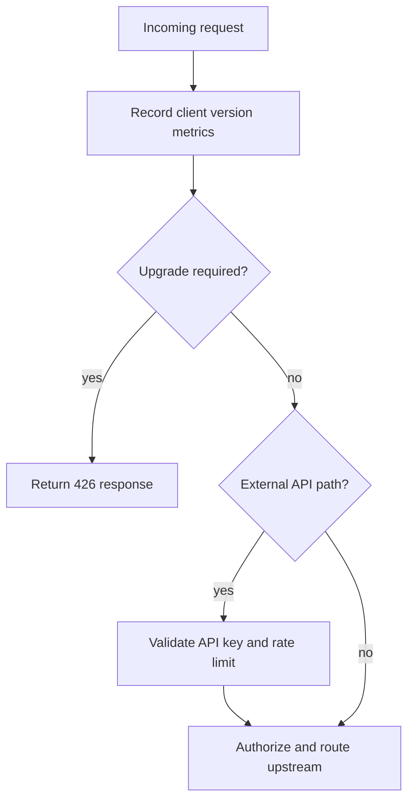

# Openframe Gateway Service Core

Openframe Gateway Service Core is the reactive edge layer used by the tenant repository's `openframe-gateway` service. It assembles Spring Cloud Gateway, Spring WebFlux, Netty, JWT resource-server authentication, API-key enforcement, and carefully controlled HTTP and WebSocket proxying for integrated tools.

The implementation is supplied by the `com.openframe.oss:openframe-gateway-service-core` library at version `7.0.11`; this repository runs it in the `openframe-gateway` service. Tenant deployment configuration routes `/sas/**` to the authorization server, `/api-docs/**` to the external API, `/api/**` to the API service, `/clients/**` to the client service, and the remaining paths to the frontend. The gateway library adds the cross-cutting security and integrated-tool proxy behavior around those routes.

## Responsibilities

- Authenticate JWTs from the configured self-hosted issuer and map `roles` and `scope` claims to Spring authorities.
- Authorize browser, agent, API, NATS WebSocket, chat, content, and integrated-tool traffic by route class.
- Authenticate external API calls with API keys, enforce rate limits, propagate verified caller context, and collect request statistics.
- Proxy REST and WebSocket traffic to integrated tools, including MeshCentral and Fleet MDM, without exposing unrestricted cross-tenant administration.
- Enforce mobile-client upgrade policy and record client-version and rejected-WebSocket-upgrade telemetry.
- Configure reactive HTTP, server sockets, CORS, origin handling, WebSocket observability, and leak-resistant proxy-session cleanup.

## Runtime Architecture

The gateway is an edge component rather than a system of record. Requests are authorized, augmented, measured, and routed onward. Integrated-tool connections are the important exception: the gateway terminates the client-side connection and creates an upstream connection, allowing it to apply route-specific header changes, logging, command filtering, and cleanup.

## Processing Order

The global filters intentionally run in this order:

1. **Client Version Metrics Filter** at order `-210` parses the optional `X-OpenFrame-Client` header and records observed client builds before policy evaluation.
2. **Client Upgrade Gate Filter** at order `-200` can reject outdated mobile bundles with `426 Upgrade Required`. WebSocket upgrades, `OPTIONS`, and selected health, OAuth, and WebSocket paths are exempt.
3. **API Key Authentication Filter** at order `-100` protects `/external-api/**`, except direct documentation routes. It validates an API key, applies rate limits, removes the raw key before forwarding, and adds verified key and user identifiers.

## Submodules

| Submodule | Responsibility |
| --- | --- |
| [Transport Configuration](openframe_gateway_service_core/transport_configuration/transport_configuration.md) | Configures Netty socket behavior and the outbound reactive `WebClient`. |
| [WebSocket Proxying](openframe_gateway_service_core/websocket_proxying/websocket_proxying.md) | Proxies tool WebSockets, supports safe frame diagnostics, restricts MeshCentral control commands, and closes leaked sessions. |
| [Security and CORS](openframe_gateway_service_core/security_and_cors/security_and_cors.md) | Implements JWT issuer validation, route authorization, CORS policy, origin normalization, and observable upgrade rejections. |
| [Request Filters](openframe_gateway_service_core/request_filters/request_filters.md) | Enforces API-key and mobile-upgrade policy while gathering client traffic telemetry. |
| [Integrated Tool Routing](openframe_gateway_service_core/integrated_tool_routing/integrated_tool_routing.md) | Exposes REST proxy endpoints and resolves MeshCentral and Fleet MDM upstream targets safely. |

All five submodule documents listed above are generated with this module and provide the detailed component-level reference.

## System Boundaries

Openframe Gateway Service Core uses the Openframe core library for JSON codec compatibility, client-version policy primitives, proxy URL resolution, and JWT configuration. It uses Openframe data repositories for integrated-tool lookup and API-key statistics. The tenant repository supplies the gateway application entry point and platform configuration; service implementations that own API, client, authorization, and external API behavior remain separate services.

The gateway accepts the Openframe authorization server as its configured issuer in a self-hosted deployment. It can also support allowed tenant issuers through an `IssuerUrlProvider` implementation. In the OSS fallback, `DefaultIssuerUrlProvider` derives one allowed issuer from the configured issuer base and super-tenant identifier.

## Operational Notes

- Outbound HTTP calls use a 30-second connect, response, read, and write timeout configuration where applicable.
- Netty server, gateway HTTP client, and Reactor Netty WebSocket client set `SO_LINGER` to `0` and enable `TCP_NODELAY`.
- WebSocket frame payload logging is disabled by default. Enable it only for targeted debugging and keep payload caps conservative because frames may include sensitive tool traffic.
- MeshCentral control filtering is disabled by default, then supports observe-only and enforcement phases. This staged rollout protects tunnel compatibility while shrinking the browser-reachable administrative command surface.
- The internal authorization probe is available only when `openframe.gateway.internal.enable` is enabled.

## Source Components

The library implementation is maintained in the Openframe OSS Library repository. Key sources include [gateway transport configuration](https://github.com/flamingo-stack/openframe-oss-lib/blob/16e7c1cbd9664e7d10ec5ebca7d53c9bd314decf/openframe-gateway-service-core/src/main/java/com/openframe/gateway/config/NettySocketConfig.java), [gateway security](https://github.com/flamingo-stack/openframe-oss-lib/blob/16e7c1cbd9664e7d10ec5ebca7d53c9bd314decf/openframe-gateway-service-core/src/main/java/com/openframe/gateway/security/GatewaySecurityConfig.java), and [MeshCentral upstream resolution](https://github.com/flamingo-stack/openframe-oss-lib/blob/16e7c1cbd9664e7d10ec5ebca7d53c9bd314decf/openframe-gateway-service-core/src/main/java/com/openframe/gateway/upstream/meshcentral/MeshCentralUpstreamResolver.java).
