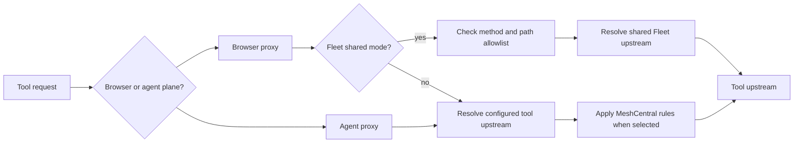

# Integrated Tool Routing

Integrated Tool Routing provides the REST entry points and upstream selection rules that let Openframe users and agents reach managed tools through the gateway.

## REST Proxy Surface

`IntegrationController` is rooted at `/tools`. It exposes health and test endpoints for a tool identifier, then forwards standard HTTP methods to `RestProxyService`:

- `/tools/{toolId}/**` is the browser-facing tool API and UI proxy.
- `/tools/agent/{toolId}/**` is the agent-facing proxy.

The controller passes the original reactive request and optional request body to the proxy service, so method, path, and request semantics remain available to upstream resolution.

`InternalAuthProbeController` exposes `GET /internal/authz/probe` only when `openframe.gateway.internal.enable` is true. It returns `200 OK` with no body and is intended for internal authorization reachability checks.

## Fleet MDM Protection and Routing

`FleetEndpointAllowlist` is a defense-in-depth control for browser requests to `fleetmdm-server` when Fleet shared multi-tenancy is enabled. It compiles configured `METHOD pattern` entries as Spring path patterns and rejects all other browser-plane endpoints. Agent-plane requests are deliberately outside this allowlist.

`FleetUpstreamResolver` directs Fleet HTTP and WebSocket traffic to separately configured shared endpoints only when multi-tenancy and the corresponding upstream URL are enabled. If either condition is absent, it delegates to the default resolver, preserving the per-tenant integrated-tool URL behavior.

## MeshCentral Routing

`MeshCentralRoutingProperties` defines separate HTTP and WebSocket upstreams, including an optional WebSocket path prefix. `MeshCentralUpstreamResolver` avoids a per-request database lookup by resolving the configured MeshCentral service directly. In tenant-routing mode it applies the trusted tenant namespace to the upstream URI and substitutes the tenant identifier in the path prefix. It also detects paths already prefixed by a MeshCentral domain so relay URLs are not prefixed twice.

## Sources

- [Integration controller](https://github.com/flamingo-stack/openframe-oss-lib/blob/16e7c1cbd9664e7d10ec5ebca7d53c9bd314decf/openframe-gateway-service-core/src/main/java/com/openframe/gateway/controller/IntegrationController.java)
- [Fleet endpoint allowlist](https://github.com/flamingo-stack/openframe-oss-lib/blob/16e7c1cbd9664e7d10ec5ebca7d53c9bd314decf/openframe-gateway-service-core/src/main/java/com/openframe/gateway/service/FleetEndpointAllowlist.java)
- [Fleet upstream resolver](https://github.com/flamingo-stack/openframe-oss-lib/blob/16e7c1cbd9664e7d10ec5ebca7d53c9bd314decf/openframe-gateway-service-core/src/main/java/com/openframe/gateway/upstream/fleet/FleetUpstreamResolver.java)
- [MeshCentral upstream resolver](https://github.com/flamingo-stack/openframe-oss-lib/blob/16e7c1cbd9664e7d10ec5ebca7d53c9bd314decf/openframe-gateway-service-core/src/main/java/com/openframe/gateway/upstream/meshcentral/MeshCentralUpstreamResolver.java)

Return to [Openframe Gateway Service Core](../../openframe-gateway-service-core.md).
