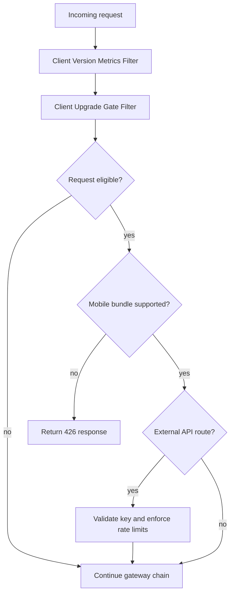

# Request Filters

Request Filters apply edge policies before the gateway forwards a request. They are reactive global filters, so they write direct responses rather than relying on controller exception handling.

## External API-Key Authentication

`ApiKeyAuthenticationFilter` applies only to `/external-api/**`; direct OpenAPI and Swagger paths are excluded. It requires `X-API-Key`, validates the key, checks rate limits, and scopes validation and rate-limit keys to the trusted tenant header when tenant routing is enabled.

On success the filter:

1. Adds rate-limit response headers when configured.
2. Replaces the raw API key with verified key and user context headers.
3. Forwards the request to the external API service.
4. Records successful or failed request statistics.

Failures yield JSON responses for missing or invalid credentials, rate-limit exhaustion, or unexpected errors. Rate-limited requests include `Retry-After` and the configured rate-limit headers.

`ApiKeyStatsService` updates successful and failed counters through `ReactiveApiKeyStatsRepository` using atomic Redis operations with the configured TTL. The increments are intentionally best-effort: a statistics failure is logged but does not fail a valid API request.

## Client Version Policy and Telemetry

`ClientVersionMetricsFilter` runs first. It parses `X-OpenFrame-Client`, increments metrics by client kind, shell version, and bundle version, and emits one client-seen event per authenticated subject and client build per tenant each day. Missing headers are counted too; a recognized native origin is classified as a legacy shell while unrelated callers are tracked as `none`.

`ClientUpgradeGateFilter` then evaluates configured minimum mobile bundle versions. It ignores non-mobile clients and excludes `OPTIONS`, WebSocket upgrades, OAuth, health, actuator, and WebSocket paths. An outdated or, if configured, unidentified mobile client receives a JSON `426 Upgrade Required` response containing the minimum bundle version and the platform store URL.

## Sources

- [API-key authentication filter](https://github.com/flamingo-stack/openframe-oss-lib/blob/16e7c1cbd9664e7d10ec5ebca7d53c9bd314decf/openframe-gateway-service-core/src/main/java/com/openframe/gateway/filter/ApiKeyAuthenticationFilter.java)
- [Client upgrade gate filter](https://github.com/flamingo-stack/openframe-oss-lib/blob/16e7c1cbd9664e7d10ec5ebca7d53c9bd314decf/openframe-gateway-service-core/src/main/java/com/openframe/gateway/filter/ClientUpgradeGateFilter.java)
- [Client version metrics filter](https://github.com/flamingo-stack/openframe-oss-lib/blob/16e7c1cbd9664e7d10ec5ebca7d53c9bd314decf/openframe-gateway-service-core/src/main/java/com/openframe/gateway/filter/ClientVersionMetricsFilter.java)

Return to [Openframe Gateway Service Core](../../openframe-gateway-service-core.md).
