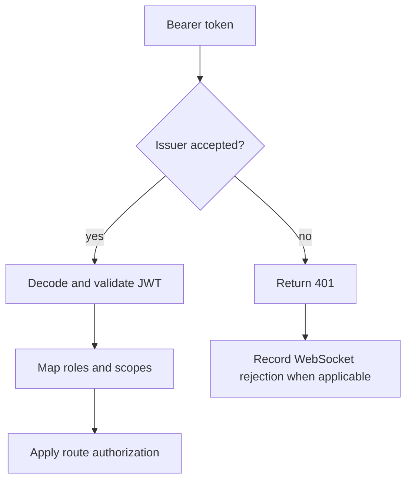

# Security and CORS

Security and CORS defines gateway authentication, authorization, issuer trust, browser-origin behavior, and visibility for failed WebSocket upgrades.

## Authentication and Authorization

`GatewaySecurityConfig` configures the gateway as an OAuth2 resource server. It maps JWT `roles` to `ROLE_` authorities and `scope` to `SCOPE_` authorities, using `sub` as the principal name. It authorizes route groups separately: API and ordinary tool routes require the administrator role; agent routes require the agent role; NATS, chat, and content WebSockets permit either role. Public agent bootstrap and selected client paths remain available without a JWT.

`JwtAuthConfig` creates issuer-specific reactive authentication managers. The configured local issuer uses its public key directly. Other accepted issuers use non-blocking discovery and JWKS retrieval with bounded timeouts. An allowlist check happens before cache or network access, and temporarily remembers unreachable issuers to prevent repeated discovery failures from overloading the gateway.

`DefaultIssuerUrlProvider` is the self-hosted fallback. It supplies exactly one allowed issuer URL assembled from the configured issuer base and super-tenant identifier.

## WebSocket Rejections and Origin Handling

`WsAwareAuthenticationEntryPoint` delegates the final `401` response to Spring Security but records a metric and diagnostic log when a WebSocket upgrade is rejected. The metric distinguishes missing, expired, and invalid tokens. The subject extracted from an unverified token is used only for correlation after authentication has already failed.

`OriginSanitizerFilter` removes a literal `Origin: null` header before the request reaches later filters. This avoids treating the string value as a real origin.

## CORS Modes

`CorsConfig` binds the standard gateway CORS configuration for all routes unless CORS is disabled. `CorsDisableConfig` is activated only when the explicit disable flag is true and installs a permissive credential-capable filter. The latter is intended for the documented deployment mode and should not be enabled as a substitute for a correctly scoped OSS CORS policy.

## Sources

- [Gateway security configuration](https://github.com/flamingo-stack/openframe-oss-lib/blob/16e7c1cbd9664e7d10ec5ebca7d53c9bd314decf/openframe-gateway-service-core/src/main/java/com/openframe/gateway/security/GatewaySecurityConfig.java)
- [JWT authentication configuration](https://github.com/flamingo-stack/openframe-oss-lib/blob/16e7c1cbd9664e7d10ec5ebca7d53c9bd314decf/openframe-gateway-service-core/src/main/java/com/openframe/gateway/security/JwtAuthConfig.java)
- [WebSocket-aware entry point](https://github.com/flamingo-stack/openframe-oss-lib/blob/16e7c1cbd9664e7d10ec5ebca7d53c9bd314decf/openframe-gateway-service-core/src/main/java/com/openframe/gateway/security/WsAwareAuthenticationEntryPoint.java)

Return to [Openframe Gateway Service Core](../../openframe-gateway-service-core.md).
