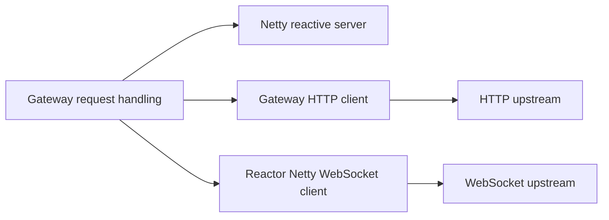

# Transport Configuration

Transport Configuration provides the Netty and reactive HTTP client defaults used by Openframe Gateway Service Core.

## Components

- `NettySocketConfig` customizes the reactive Netty server and gateway HTTP client with `SO_LINGER` set to `0` and `TCP_NODELAY` enabled. It also creates the named `reactorNettyWebSocketClient` used for upstream WebSocket connections.
- `WebClientConfig` supplies a shared `WebClient.Builder` backed by Reactor Netty. It sets a 30-second connection timeout, response timeout, read timeout, and write timeout, while registering the Openframe Jackson compatibility codecs.

## Interaction

The server and outbound clients share low-latency socket settings. The `WebClient` is the general reactive HTTP client; the dedicated WebSocket client establishes proxied tool sessions.

## Sources

- [Netty socket configuration](https://github.com/flamingo-stack/openframe-oss-lib/blob/16e7c1cbd9664e7d10ec5ebca7d53c9bd314decf/openframe-gateway-service-core/src/main/java/com/openframe/gateway/config/NettySocketConfig.java)
- [Web client configuration](https://github.com/flamingo-stack/openframe-oss-lib/blob/16e7c1cbd9664e7d10ec5ebca7d53c9bd314decf/openframe-gateway-service-core/src/main/java/com/openframe/gateway/config/WebClientConfig.java)

Return to [Openframe Gateway Service Core](../../openframe-gateway-service-core.md).
