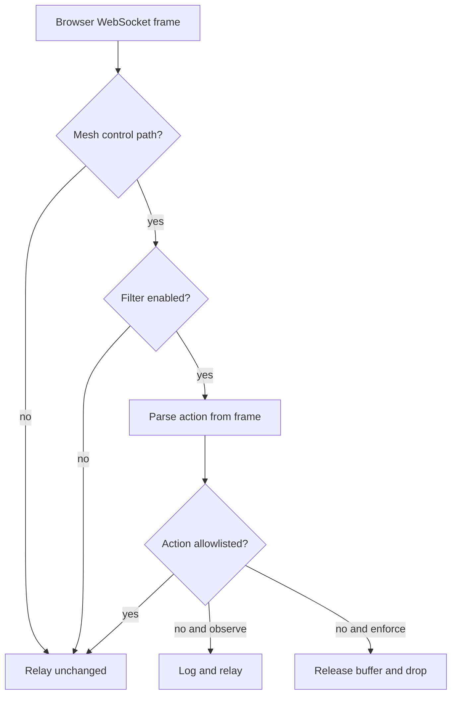

# WebSocket Proxying

WebSocket Proxying controls observability, authorization context, safety filtering, and lifecycle cleanup for proxied integrated-tool sessions.

## Session Decoration

`LoggingWebSocketSessionDecorator` taps client-to-gateway and gateway-to-client frames without consuming or releasing payload buffers. Text frames can be truncated; binary frames default to metadata-only logging and can produce a printable preview only when explicitly enabled. `WebSocketLoggingProperties` selects debug and frame paths, payload limits, and binary logging.

`ProxySessionCleanupWebSocketClient` wraps the upstream client. After the relay ends, it waits for a natural close signal before force-closing only a genuinely leaked upstream session. This grace-period design avoids duplicate close frames and distinguishes expected peer-close races from connection failures in logs.

## MeshCentral Control Safety

`MeshControlCommandProperties` identifies MeshCentral control channels beneath configured tool paths while excluding byte tunnels such as relay, desktop, terminal, file-manager, agent-transfer, and recording endpoints. Its allowlist contains the product command actions, including keepalives, relay-cookie setup, messaging, and power actions.

`MeshControlFilteringWebSocketSessionDecorator` inspects browser-originated text and binary frames on a control channel. Unknown JSON actions and non-JSON frames are logged. In observe-only mode they continue; in enforcement mode they are released and dropped. Upstream responses remain unmodified.

## URL and Claims Support

`ToolAgentWebSocketProxyUrlFilter` and `ToolApiWebSocketProxyUrlFilter` specialize a shared tool proxy filter for their route shapes. The API variant resolves tool API-key headers, removes the browser `Origin` header, and injects upstream credentials. `RequestJwtClaimsReader` reads the original bearer token retained by proxy filtering, or falls back to the request header, to expose expiration and subject claims for WebSocket security logic.

## Sources

- [Session logging decorator](https://github.com/flamingo-stack/openframe-oss-lib/blob/16e7c1cbd9664e7d10ec5ebca7d53c9bd314decf/openframe-gateway-service-core/src/main/java/com/openframe/gateway/config/ws/LoggingWebSocketSessionDecorator.java)
- [Mesh control filtering decorator](https://github.com/flamingo-stack/openframe-oss-lib/blob/16e7c1cbd9664e7d10ec5ebca7d53c9bd314decf/openframe-gateway-service-core/src/main/java/com/openframe/gateway/config/ws/MeshControlFilteringWebSocketSessionDecorator.java)
- [Proxy cleanup client](https://github.com/flamingo-stack/openframe-oss-lib/blob/16e7c1cbd9664e7d10ec5ebca7d53c9bd314decf/openframe-gateway-service-core/src/main/java/com/openframe/gateway/config/ws/ProxySessionCleanupWebSocketClient.java)

Return to [Openframe Gateway Service Core](../../openframe-gateway-service-core.md).
