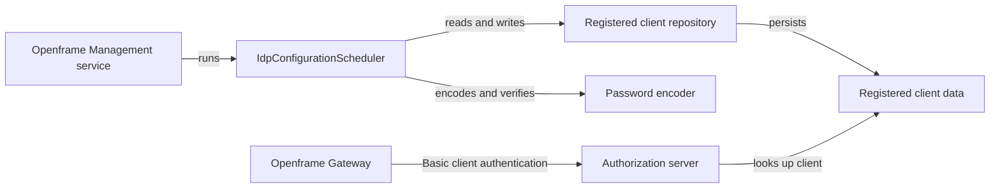
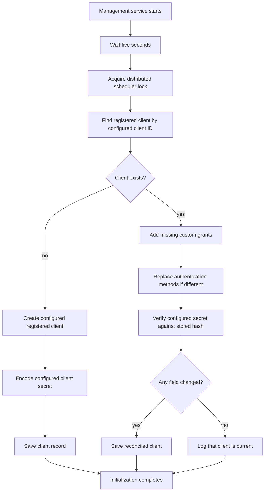
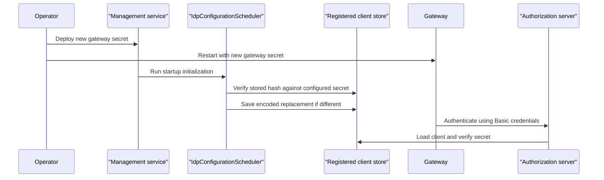

# Openframe Idp Configuration

Openframe Idp Configuration bootstraps and reconciles the OAuth client used by the Openframe gateway. It is supplied by the `com.openframe.oss:openframe-idp-configuration` library at version `7.0.11` and runs within the Openframe Management service. Its single component, [`IdpConfigurationScheduler`](https://github.com/flamingo-stack/openframe-oss-lib/blob/16e7c1cbd9664e7d10ec5ebca7d53c9bd314decf/openframe-idp-configuration/src/main/java/com/openframe/management/scheduler/IdpConfigurationScheduler.java), creates the gateway client when absent and applies narrowly scoped compatibility and secret-rotation updates when it already exists.

The module is disabled unless `openframe.management.idp.init.enabled` is `true`. This avoids modifying registered-client data in deployments that do not opt in.

## Responsibilities

- Create a confidential gateway OAuth client in the registered-client store after Management starts.
- Maintain the two Openframe custom token grants required for Apple native sign-in and mobile signup-ticket redemption.
- Enforce `client_secret_basic` as the gateway client's sole client-authentication method.
- Store a password-encoded client secret and replace its stored hash after a configured secret rotation.
- Coordinate initialization across Management replicas with a distributed ShedLock lock.

The scheduler does **not** expose an HTTP endpoint or authenticate users itself. OAuth endpoint behavior, authorization-server security, client registration persistence, and custom grant implementations belong to the authorization-server, data, and security libraries assembled elsewhere in the platform.

## Placement in the Platform

At startup, the Management service supplies the scheduler. The scheduler ensures that the gateway configuration and registered-client record agree for the settings it owns. The gateway then uses its configured client identifier and secret while authenticating to the authorization server, which reads the persisted registration.

## Dependencies and Inputs

### Runtime collaborators

| Collaborator | Role in Openframe Idp Configuration |
|---|---|
| `RegisteredClientMongoRepository` | Finds a registered client by client ID and saves a new or reconciled record. |
| `MongoRegisteredClient` | Persistent client representation populated during creation and amended during reconciliation. |
| `PasswordEncoder` | Encodes a new client secret and verifies whether the configured clear-text secret matches the stored encoded value. |
| Spring scheduling | Invokes initialization after application startup. |
| ShedLock | Ensures only one replica runs the initialization section at a time. |

### Required configuration

The implementation reads these properties directly:

| Property | Used for |
|---|---|
| `openframe.management.idp.init.enabled` | Enables the component only when its value is `true`. |
| `openframe.gateway.oauth.client-id` | Lookup key and registered OAuth client ID. |
| `openframe.gateway.oauth.client-secret` | Gateway secret to encode on creation or rotate during reconciliation. |
| `openframe.gateway.oauth.redirect-uri` | Redirect URI assigned when a client is first created. |
| `security.oauth2.token.access.expiration-seconds` | Access-token lifetime assigned when a client is first created. |
| `security.oauth2.token.refresh.expiration-seconds` | Refresh-token lifetime assigned when a client is first created. |

The library source does not define defaults or validate those values in this scheduler. Deployments must provide values compatible with the gateway and authorization-server configuration.

## Client Registration Contract

On initial creation, the scheduler persists a client with the following policy:

| Setting | Created value | Security or interoperability purpose |
|---|---|---|
| Client authentication | `client_secret_basic` | The gateway is treated as a confidential client and authenticates with HTTP Basic credentials. |
| Grant types | `authorization_code`, `refresh_token`, Apple native grant, signup-ticket grant | Supports browser authorization, token refresh, Apple native exchange, and mobile signup-ticket exchange. |
| Scopes | `openid`, `profile`, `email`, `offline_access` | Provides OpenID Connect identity scopes and refresh-token support. |
| Redirect URIs | Configured gateway redirect URI | Establishes the callback target for the initial record. |
| PKCE | Required | Requires proof key support for authorization-code exchanges. |
| Authorization consent | Not required | Disables per-authorization consent for this registered client. |
| Refresh-token reuse | Disabled | A refresh operation issues a replacement refresh token. |
| Token lifetimes | Configured access and refresh expiration values | Applies the configured values at creation time. |

The custom grant identifiers are:

- `urn:openframe:params:oauth:grant-type:apple-native`
- `urn:openframe:params:oauth:grant-type:signup-ticket`

The scheduler deliberately does not allow the `none` authentication method. Its source documents that allowing `none` would permit authorization-code redemption using PKCE alone rather than requiring the gateway's client secret.

## Initialization and Reconciliation Flow

The scheduled method has a five-second initial delay and a fixed delay of `Long.MAX_VALUE`, so it is intended to execute once per application lifecycle rather than repeatedly. ShedLock uses the name `IdpConfigurationScheduler_initializeDefaultIdp`, with a maximum lock duration of ten minutes and a minimum duration of one minute.

Any runtime exception is logged with the configured client ID and is rethrown. Consequently, a repository, encoding, or persistence failure makes the scheduled invocation fail rather than being silently ignored.

## Existing-Client Update Semantics

Reconciliation is intentionally limited. For a pre-existing record, the scheduler:

1. Adds the two custom grants if either is missing, while retaining existing grant types.
2. Replaces the entire authentication-method set unless it exactly equals `client_secret_basic`.
3. Encodes and saves the configured secret only when the encoder reports that it does not match the stored hash.

It does not synchronize the redirect URI, scopes, PKCE requirement, consent requirement, access-token lifetime, refresh-token lifetime, or refresh-token reuse flag for an existing client. Changing one of those properties therefore affects newly created registrations, but does not retrofit an already persisted registration through this scheduler.

## Gateway Secret Rotation

Secret comparison uses the password encoder's matching operation, not an encoded-value equality check, so salted password encodings can be used safely. The scheduler source explicitly warns that Management updates the stored value at its startup while gateways read their value at their own startup. Restart Management and all gateways together during rotation. Until the configured gateway secret and persisted hash match, token exchange, token refresh, and token revocation are rejected as invalid-client authentication.

## Operational Considerations

- Enable the initializer only when the Management instance has access to the registered-client repository and the deployed gateway configuration is complete.
- In a replicated Management deployment, retain the ShedLock backing configuration required by the service so initialization remains single-writer.
- Treat `openframe.gateway.oauth.client-secret` as sensitive configuration. The scheduler logs the client ID and redirect URI after creation, but it does not log the secret.
- When diagnosing authentication failures after a configuration change, distinguish a newly created registration from an existing registration: only grants, authentication methods, and client secret are reconciled for the latter.
- A failed startup invocation is not retried on a short periodic interval by this component because its next fixed-delay execution is effectively deferred for the process lifetime. Correct the underlying failure and restart the Management service.

## Component Reference

| Component | Source | Function |
|---|---|---|
| `IdpConfigurationScheduler` | [OpenFrame OSS Library source](https://github.com/flamingo-stack/openframe-oss-lib/blob/16e7c1cbd9664e7d10ec5ebca7d53c9bd314decf/openframe-idp-configuration/src/main/java/com/openframe/management/scheduler/IdpConfigurationScheduler.java) | Conditional, lock-protected startup task that creates or partially reconciles the gateway OAuth client. |
|
The module is a focused integration component: it owns only the gateway's registered-client bootstrap policy, while the wider platform supplies the Management runtime, authorization-server token processing, credential storage, and gateway request routing.
