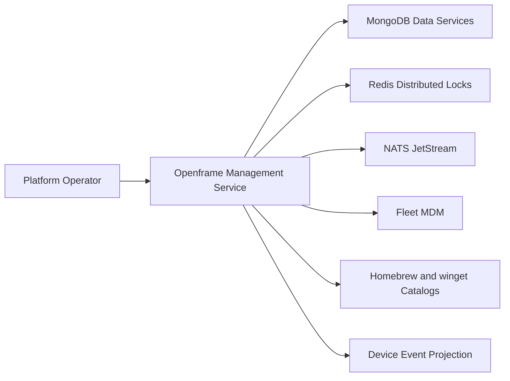
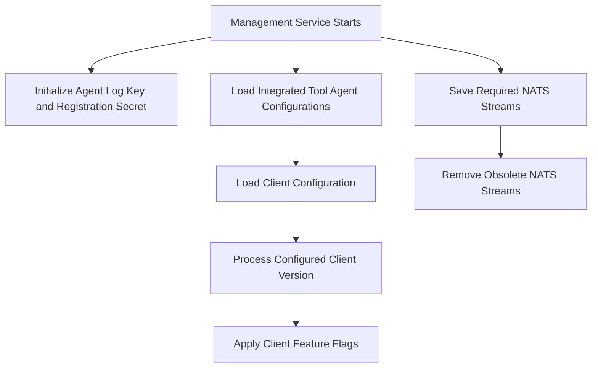
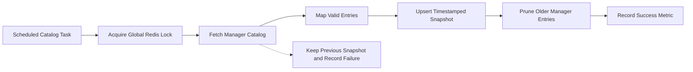

# Openframe Management Service Core

Openframe Management Service Core is the operational control plane assembled by this repository's `openframe-management` Spring Boot service. Its implementation comes from the `com.openframe.oss:openframe-management-service-core` library, pinned at `7.0.11`. The tenant application starts the library and contributes an `AdditionalStreamConfigurationProvider` that returns no tenant-specific streams.

The module initializes tenant operational state, exposes administrative REST endpoints, refreshes package-search catalogs, and runs reconciliation tasks. It coordinates configuration and records held by the data libraries rather than replacing those domain services.

## Runtime Position

The service is one of the images deployed by the tenant chart. It uses the shared MongoDB and Redis configuration, and its base configuration explicitly connects it to Kafka and NATS. NATS is used here for stream provisioning and client or tool-agent update publication; the separate stream service handles Kafka event processing.

## Architectural Responsibilities

| Area | Responsibility | Primary components |
| --- | --- | --- |
| Application wiring | Scans OpenFrame components, excludes the Cassandra health indicator, provides BCrypt password encoding, and enables scheduled work. | `ManagementConfiguration`, `ShedLockConfig` |
| Startup initialization | Ensures secrets, log keys, NATS streams, client configuration, integrated agents, versions, and feature flags are present or reconciled. | `ApplicationRunner` initializers |
| Operations API | Manages integrated-tool configuration, triggers device projection replay, and retains one temporary compatibility endpoint. | REST controllers |
| Catalog synchronization | Imports Homebrew and winget metadata into a replace-and-prune catalog snapshot. | Catalog fetchers, writer, scheduler |
| Scheduled maintenance | Detects offline devices, synchronizes API-key statistics, provisions Fleet MDM, and retries update publication. | Scheduler components |
| Fleet integration | Provisions or logs in to Fleet MDM and creates an API-only service user. | `FleetApiKeyResolver` |

## Key Flows

### Startup Reconciliation

Initializers run when Spring Boot starts. The integrated tool-agent initializer is ordered at `20`, the OpenFrame client configuration initializer at `30`, client-version propagation at `40`, and feature-flag application at `50`. The ordering ensures target documents exist before version and flag changes are processed. Key and secret initialization failures are logged without preventing management from starting, allowing a subsequent restart to retry them.

### Package Catalog Refresh

When `openframe.package-search.sync.enabled` is true, the scheduler executes independent Homebrew and winget refreshes. A global Redis ShedLock allows only one catalog writer across the deployment. A successful fetch upserts the current snapshot with one timestamp, then removes entries for that manager older than the snapshot. On a fetch or write failure, the previous catalog remains available and the failure counter is incremented.

## Operational Boundaries

* All general scheduled locks use a tenant-scoped Redis prefix derived from `OpenframeRedisKeyBuilder`. Package-catalog locks intentionally use a global prefix because the catalog is shared across tenants.
* `DevicePinotResyncController` loads all machines and delegates their processing to `MachineTagEventService`; it does not write Pinot directly.
* Saving an integrated tool addresses the tool by tenant and key, preserves the stored API key when an update omits it, configures Debezium connectors, and calls post-save hooks. Hook failures are isolated so they do not fail the tool save.
* The cluster-registration endpoint is deliberately a deprecated no-op retained for a legacy caller. It logs a warning and is documented in code for removal by `2026-07-11`.
* `OpenFrameClientVersionUpdateService` is currently an empty component despite accepting an update publisher. The actual startup version propagation described by `OpenFrameClientVersionInitializer` delegates to `ClientVersionService`, not this placeholder.

## Detailed Submodules

The following documents describe the module by operational concern:

* [Configuration and Scheduling](openframe-management-service-core/configuration_and_scheduling/configuration_and_scheduling.md) covers Spring assembly, password encoding, and Redis-backed scheduler locks.
* [Startup Initialization](openframe-management-service-core/startup_initialization/startup_initialization.md) covers state reconciliation, NATS stream setup, and ordered client configuration initialization.
* [Operational Controllers](openframe-management-service-core/operational_controllers/operational_controllers.md) covers the management REST endpoints and integrated-tool save semantics.
* [Package Catalog Synchronization](openframe-management-service-core/package_catalog_synchronization/package_catalog_synchronization.md) covers Homebrew and winget imports, global locking, snapshot replacement, and metrics.
* [Maintenance and Fleet Integration](openframe-management-service-core/maintenance_and_fleet_integration/maintenance_and_fleet_integration.md) covers operational schedulers, retry publication, Fleet MDM setup, and the registration-secret extension point.

## Source and Deployment Context

The source implementation is maintained in the OpenFrame OSS Library. The tenant runnable application is [ManagementApplication](https://github.com/flamingo-stack/openframe-oss-tenant/blob/main/openframe/services/openframe-management/src/main/java/com/openframe/management/ManagementApplication.java). Library source links are intentionally retained in the detailed submodule documents because the library owns the implementation.
