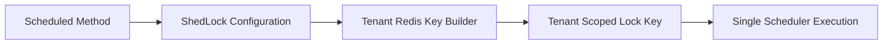

# Configuration and Scheduling

Configuration and Scheduling establishes the management service's component model, password encoder, and distributed scheduling behavior. The code belongs to the OpenFrame OSS Library; it executes inside this repository's management service.

## Components

| Component | Responsibility |
| --- | --- |
| [ManagementConfiguration](https://github.com/flamingo-stack/openframe-oss-lib/blob/16e7c1cbd9664e7d10ec5ebca7d53c9bd314decf/openframe-management-service-core/src/main/java/com/openframe/management/config/ManagementConfiguration.java) | Scans `com.openframe`, omits `CassandraHealthIndicator`, and exposes a BCrypt `PasswordEncoder`. |
| [ShedLockConfig](https://github.com/flamingo-stack/openframe-oss-lib/blob/16e7c1cbd9664e7d10ec5ebca7d53c9bd314decf/openframe-management-service-core/src/main/java/com/openframe/management/config/ShedLockConfig.java) | Enables scheduling and configures a tenant-scoped Redis ShedLock provider with a default maximum lock duration of ten minutes. |

The tenant service's `ManagementApplication` also scans management, data, and core packages while applying the same Cassandra-health exclusion. This allows the library components and shared data services to be assembled in one Spring context.

## Lock Scope

The environment value separates deployments sharing a Redis instance. Scheduler-specific annotations determine each lock's minimum and maximum duration. The catalog refresh subsystem is the exception: it uses a separate global lock because its catalog data is not tenant-specific.
