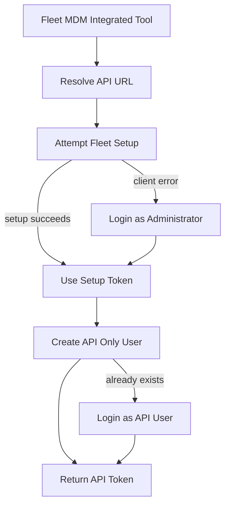

# Maintenance and Fleet Integration

Maintenance and Fleet Integration contains recurring operational tasks and Fleet MDM bootstrap behavior.

## Scheduled Maintenance

| Component | Activation and responsibility |
| --- | --- |
| [AgentVersionUpdatePublishFallbackScheduler](https://github.com/flamingo-stack/openframe-oss-lib/blob/16e7c1cbd9664e7d10ec5ebca7d53c9bd314decf/openframe-management-service-core/src/main/java/com/openframe/management/scheduler/AgentVersionUpdatePublishFallbackScheduler.java) | When enabled, republishes unconfirmed OpenFrame client and enabled tool-agent updates until their configured attempt limit. Uses ShedLock. |
| [ApiKeyStatsSyncScheduler](https://github.com/flamingo-stack/openframe-oss-lib/blob/16e7c1cbd9664e7d10ec5ebca7d53c9bd314decf/openframe-management-service-core/src/main/java/com/openframe/management/scheduler/ApiKeyStatsSyncScheduler.java) | Enabled by default; synchronizes API-key statistics from Redis to MongoDB under a distributed lock. |
| [DeviceHeartbeatOfflineDetectionScheduler](https://github.com/flamingo-stack/openframe-oss-lib/blob/16e7c1cbd9664e7d10ec5ebca7d53c9bd314decf/openframe-management-service-core/src/main/java/com/openframe/management/scheduler/DeviceHeartbeatOfflineDetectionScheduler.java) | When enabled, asks the offline-detection service to mark stale devices offline. |
| [FleetMdmSetupScheduler](https://github.com/flamingo-stack/openframe-oss-lib/blob/16e7c1cbd9664e7d10ec5ebca7d53c9bd314decf/openframe-management-service-core/src/main/java/com/openframe/management/scheduler/FleetMdmSetupScheduler.java) | When enabled, finds the Fleet MDM integrated tool and retries setup on each interval until it succeeds. |

A scheduler catches and logs operational errors, preserving future execution opportunities. The fallback publisher handles the OpenFrame client and each enabled integrated tool agent independently, so one failed agent does not prevent another update from being retried.

## Fleet API Key Resolution

[FleetApiKeyResolver](https://github.com/flamingo-stack/openframe-oss-lib/blob/16e7c1cbd9664e7d10ec5ebca7d53c9bd314decf/openframe-management-service-core/src/main/java/com/openframe/management/service/FleetApiKeyResolver.java) derives the Fleet API URL from the tool's API URL entry and validates tenant-header configuration during bean construction. It first attempts Fleet setup using the tool credentials. A client-error response means Fleet is already initialized, so it logs in as the administrator. It then creates an API-only administrator user or logs in if that user already exists.

## Extension Point

[DefaultAgentRegistrationSecretManagementProcessor](https://github.com/flamingo-stack/openframe-oss-lib/blob/16e7c1cbd9664e7d10ec5ebca7d53c9bd314decf/openframe-management-service-core/src/main/java/com/openframe/management/service/processor/DefaultAgentRegistrationSecretManagementProcessor.java) is the conditional default callback after an initial registration secret is created. It only logs the created secret identifier. A deployment can provide its own processor bean to supply additional behavior.
